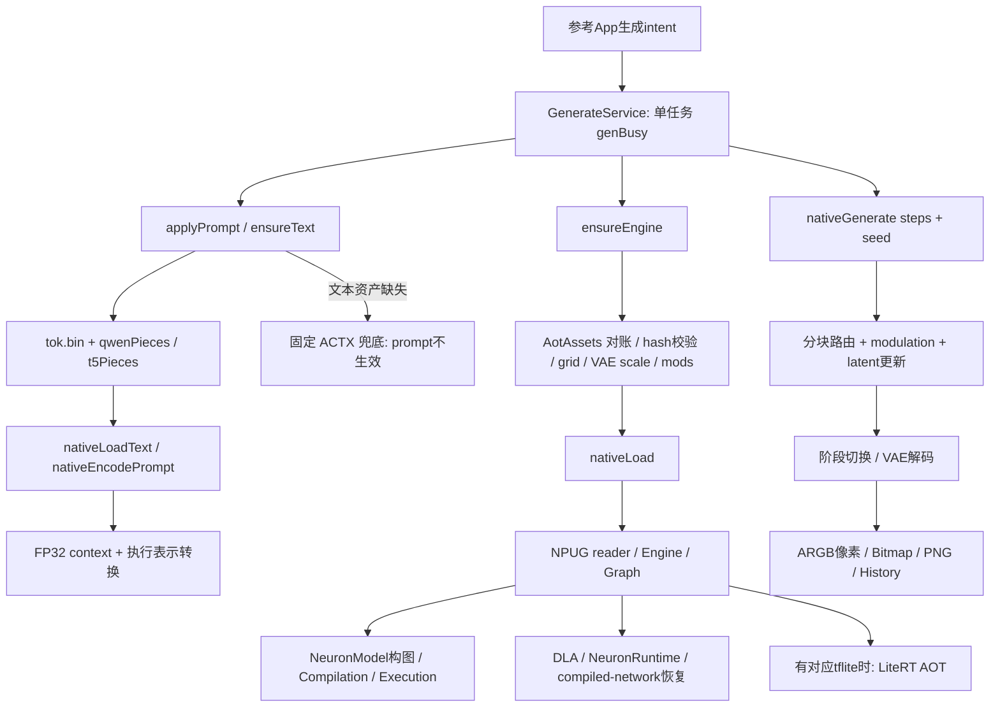

# MTK Paint 0.9.9 参考实现调查与 MCA 对标结论

日期：2026-10-31。性质：参考 APK 静态分析、公开资产核验、MCA 当前源码审计和后续设计；不是设备运行验收。

## 1. 结论与建议

参考 APK 内确实有实质性的 MediaTek NPU 集成：自定义 NPUG 图读取、原生 Neuron 构图与编译、DLA 恢复、另一条 LiteRT AOT 通道、端上文本编码、分块执行、张量定点转换、采样和 VAE 生命周期。这个结论有 DEX 调用和 ARM64 指令证据，不只是文件名或宣传文案。

**MCA 有可研究、可逐层复现的接入路线，但当前代码不能直接加载这个公开包，仍不能认定已跑通。推荐主线改为：先验证精确版本的 NPUG 拓扑 stub + Neuron DLA，再复现其完整数据流；现有 TFLite JIT/混合执行保留为独立的自有模型路线。LiteRT 是可选 transport，不是天玑生图的唯一入口。**

这里必须区分两个项目：[morluto/rea](https://github.com/morluto/rea) 是本次使用的开源逆向分析工具，不是生图引擎。本次调查对象是用户提供的 MTK Paint/Anima APK。REA 的 MIT 许可证不自动授予 libanima、厂商 runtime、模型权重的再分发权；没有据此宣称参考生图引擎已经开源。

当前授权是分析与架构方案。本次没有修改 MCA 生产代码，没有恢复推荐页下载或自检，没有安装/运行参考 APK，没有进行 Gradle/native 构建。详细实施切片见[对标架构与执行方案](MCA_DIMENSITY_NPU_REFERENCE_ARCHITECTURE_2026-10-31.md)。

## 2. 输入、版本与分析方式

| 输入 | 本次身份 | 边界 |
| --- | --- | --- |
| 用户 APK | D:/下载/base.apk.1；53,019,224 B；SHA-256 dcf99f85dd3ea72875b408d74c1a3b69b48d6a809cab6558558dc98d98ff4f09 | 原件只读；分析副本改为 .apk 后缀，hash相同 |
| 包声明 | com.anima.npu；0.9.9 / 360；minSdk31、targetSdk35 | REA/JADX静态读取；非运行结论 |
| 主原生库 | libanima.so，738,376 B；SHA-256 aa6815c21d15b0cb2f0f1bb7e126e21021ac717278f8bbb41a55151ed9cd5df0 | ARM64 ELF；保留较多C++/JNI符号 |
| ModelScope | ledi123456789/anima-npu-dimensity9400，08bfcdb5d00874fc382bf5407fdf4fb38edf71e7 | latest 0.9.9/360的APK尺寸与hash精确匹配用户样本 |
| Hugging Face | ledisbsb/anima-npu-dimensity9400，a7a7abd33c8fd5910a4316dc8cc7d1e72ef2ebac | latest仍为0.2.4/139，不能混作360的模型路由基线 |
| MCA | codex/enterprise-refactor；HEAD 68b6eef1e67870b02bfef6afda2e625d36663da9 | 大量既有dirty修改；core/mediatek-native尚未跟踪，不是干净HEAD的发布能力 |

REA固定为 rea-agents 6.8.0，隔离安装，未运行全局setup、未改客户端配置。JADX headless MCP 0.7.1，JAR SHA-256 6e5eacf500b64292bfb73c49797c1958f6ee44646e43e868039ae7feb573ff75；Node24.22.1，实际分析JDK17.0.10。MCA工程后续构建仍须遵循JDK21合同，这两个工具链用途不同。

实际执行 inspect_android_package、类搜索、成员检查、方法反编译、incoming references 和 APK signing结构检查。部分批量查询复用固定REA包的AndroidAnalysisService/JadxProvider，输出完整REA Evidence；它是分析脚本，不是建议给生产代码增加的依赖。完整JSON及Evidence ID保存在同日证据目录。

首轮原文件后缀 .apk.1 被REA识别为ZIP；对等字节 .apk 副本消除此输入问题。首次配置的JDK21路径不存在，后改用已安装JDK17成功。一个类查询发生JVM/协议输出错误，保留失败文件；后续方法查询成功，未把该失败计为PASS。REA原生objdump操作在Windows不可用，native证据实际来自NDK29的LLVM readelf/nm/objdump/strings，不能写成REA native反编译成功。

REA得到6,399个top-level class rows和137资源项；这不是全部内部类或全方法审计数量。方法源代码存在JADX duplicated-block/type-inference警告，关键调用另以DEX direct invoke、JNI导出和ARM64调用交叉确认。

APK signing记录有v2，证书指纹d77b4a450b0a0aa7b699737f5da5cb16322d9d4eb376bb37c67e61749964a498，声明的SHA-256内容摘要匹配。它支持样本身份/完整性记录，不证明作者身份、权利来源或运行安全。

## 3. 参考实现的完整调用链



这张图表示静态可到达调用，不表示本机已经观察到所有分支运行。关键入口证据为 rea-extra-generation-coroutine.json、rea-extra-xrefs-nativeGenerate.json；后者匹配classes2.dex方法索引11438、direct-invoke code-unit offset778，调用者原始名为GenerateService$onStartCommand$4.invokeSuspend。

### 3.1 上层加载与结果处理

GenerateService.onStartCommand读取modelId、steps、cfgJson，避免genBusy/active job期间重入，使用foreground service和wake lock。在生成coroutine内，顺序是applyPrompt → ensureEngine → nativeGenerate →构造Bitmap →裁剪（适用canvas）→压PNG→写History。

ensureEngine会复用同模型/网格的已加载引擎；仅steps变化时重新载入该steps的mods。新加载先做AotAssets.reconcileBeforeLoad，再核对RoPE/VAE文件、读取VAE输入输出scale、设置grid、验证预编译产物，准备runtime目录，最后调用：

```text
nativeLoad(ditPaths[], vaePath, modsPath, workDir, progress,
           optHint, optHintMask, needMB) -> status string
nativeGenerate(steps, seed, progress, double[6]) -> ARGB int[]
```

源码不是简单的一次Interpreter.run。JNI内还负责session、Engine、图驻留、采样和VAE。MCA若只移植Java文件，核心机制仍不存在。

### 3.2 动态文本确实接线，但有固定ctx降级

ensureText把APK assets/tok.bin复制到私有目录，再nativeLoadText(text.bin,tok.bin)。applyPrompt对用户prompt调用qwenPieces/t5Pieces，再nativeEncodePrompt，传入model.lk与带模型/长度/prompt的缓存key；可以先nativeLoadTextNpu加载Qwen/adapter图，编码后nativeReleaseTextNpu。低内存且DiT已常驻时选择文本CPU。wrapPrompt本版本直接返回原文。

因此“参考只有固定ctx，任意prompt没有实现”的判断不成立。准确结论是：**APK有实际端上动态文本链；具体等价质量仍未设备验证。** 缺少text资产时ensureText返回false，applyPrompt明确日志“退回固定ctx.bin（提示词不生效）”，然后loadCtx。这个兜底不应被MCA默默当作用户prompt已经生效。

还有一个行为差异：本次恢复的Anima coroutine只把正向prompt送applyPrompt；nativeGenerate参数没有negative/CFG，getNegative/getCfg出现在History记录处。不能因GenConfig包含这些字段，就宣称此Anima路径已经执行MCA的正负双分支CFG语义。完整native采样公式、是否为特殊蒸馏配置仍待核对；不能把这一观察扩展到另一个SDXL后端。

## 4. 三种真实原生通道及其适用范围

### 4.1 NPUG → 原生Neuron构图和JIT

Graph::load（0x4fc0c）通过open/fstat/只读mmap读取NPUG，检查magic/version，解析tensor/operand、operation和图I/O索引。buildModel真实helper 0x518a0依次执行：

```text
NeuronModel_create
→ addOperand
→ setOperandSymmPerChannelQuantParams（适用张量）
→ setOperandValue(mappedWeights + offset)
→ addOperation
→ identifyInputsAndOutputs → finish
→ Compilation_create / options / setCaching / finish
→ Execution_create / setInput / setOutput / compute
```

这些API由npug::initApi通过dlopen/dlsym取得，函数指针存槽与后续blr调用已经对上，证据强于strings。它独立于LiteRT compiler plugin。当前LiteRT插件GetCacheKey缺失的历史结论不能自动推导此Neuron setCaching同样无效；反过来也不能只看到setCaching就宣称缓存已命中。

NativeBridge.readNpugScales进一步证实磁盘schema包含张量条目、rank/dims、per-tensor或per-channel量化数据、u64数据offset/length、operation索引及graph I/O列表。第三u32被当作张量条目数迭代；此前把8416直接叫“头部长度”没有依据。C++ operand的0x58 stride是内存结构布局，不能照抄成磁盘结构。

### 4.2 NPUG拓扑 + DLA → Neuron编译网络

Engine helper会寻找对应/dla/<stem>.dla；Graph可持有NeuronRuntime句柄。已对上的动态API包括create、loadNetworkFromBuffer、getInput/OutputNumber/Size、setInput/setOutput、inference、release；另有restoreFromCompiledNetwork V1/V2及probe调用。

这与当前公开主资产匹配：共享aot/stub/<graph>.npug提供紧凑拓扑，aot/mt6993/np9/<graph>.dla是Neuron9编译产物。**首个实验应针对这个已找到的组合，明确恢复分支和I/O绑定，而不是把DLA传给LiteRtCreateModelFromFile。**

两份小stub已完整解析：ditc1c为8,416 tensors / 3,481 ops / 70 inputs / 1 output；dva1为8,210 / 3,398 / 68 / 1，索引引用均有效，metadata恰好到EOF，实际权重数据区为0字节；但仍保留非零dataSize。ditc1c的metadata长度加最大权重范围精确等于完整NPUG的443,597,568 B。这说明stub是剥离权重的拓扑，**DLA恢复失败不能直接用stub退回JIT**，必须另有完整权重资产。新reader要区分FULL_GRAPH与STUB_TOPOLOGY：前者要求权重范围实际存在，后者只允许绑定已校验compiled program。70个图输入也说明不能复用旧版少量mod参数接口。

尚未确定：在目标系统中具体成功的恢复API、合法SDK声明与实际ABI、DLA/runtime/driver组合、全图I/O语义和数值质量。现成DLA可减少自行编译的前提，不会消除装载ABI和内存兼容问题。

### 4.3 标准TFLite AOT → LiteRT

Engine::tryAotGraph会寻找/aot/<stem>.tflite，再LitertGraph::load。GenerateService准备files/litert_rt，把assets/litert的LiteRt、MediaTek compiler、dispatch、libc++复制到该处。APK还有另一套位于lib目录的runtime/plugin，不能因为两边文件名相同就认为构建相同或可任意混搭。

load先请求accelerator bitmask4（NPU）；仅状态504才改为5（NPU|CPU）重试。它随后调用CompiledModelIsFullyAccelerated，根据结果和降级标志处理。创建Environment、Model、CompiledModel、tensor buffers，run时lock/copy/unlock→RunCompiledModel→读出。存在内存拷贝，不是零拷贝。

这证明参考有LiteRT通道，但**本次锁定的NPUG stub不是TFL3模型**。只有另行拿到版本匹配、组件完整的标准TFLite AOT，才可把此adapter作为该资产的执行路线。不能把“APK有LiteRT实现”和“当前公开包可直接走LiteRT”合并成一个事实。

## 5. 模型包与数值契约：旧方案必须修正的地方

详见同日[公开模型调查](../artifacts/architecture/2026-10-31-mtkpaint-rea/model-findings.md)。

| 部件 | 字节/调用证据 | MCA接入要求 |
| --- | --- | --- |
| NPUG stub | 两份完整小stub为NPUG/version1，整文件无TFL3；L1024s4的1,306,364 B匹配manifest | 新reader/Neuron adapter；禁止改后缀或落入旧TFLite loader |
| DLA | manifest_np9 runtimeMajor9、dir=np9；文件前缀0x00033ced | 独立compiled-network合同；先核API/ABI与全文件hash |
| ACTX | header ACTX,1,256,1024；16+256×1024×4 B；loadCtx按FP32读取 | 是256×1024 FP32，不能当512×1024 FP16替换现有context |
| AMOD | AMOD,1,N,2048,28；N实见6/8/12 | N、mod顺序、final、schedule一起版本化 |
| ATXW | text.bin/version1/428条目录；1,461,438,080 B | 自定义文本权重+tokenizer+adapter，非GGUF或TFLite |
| RoPE/grid/VAE | nativeSetGrid、NPUG scale读取、nativeSetVaeScales | 对应分辨率、layout、scale与最终图像尺寸；不能只核tensor元素数 |

AMOD尺寸精确为20 + N×2048×(9×28+2)×2；加载层按2 B直接读取。nativeGenerate逐块复制九段4096 B，final再复制两段4096 B。九段的具体语义名称尚未完整恢复，不能在实现中猜成当前三路接口。文件名s4同时有6/8/12步mods，所以s4不等于四采样步。

最关键的精度证据是：native保存FP32 context，同时有FP16缓存；w16分支从图operand取scale，把FP32值除scale、clamp、带符号舍入后存16位整数。**2字节可能是IEEE-half，也可能是带scale的int16定点。** w8/w16名字不足以证明所有激活、LayerNorm和累加器都是什么精度；不过已能确定原有“全部按FP16解释缓冲”不能复用。

最新MS soc_index还明确撤回t3072w8档，理由涉及per-tensor int8不能处理离群激活；旧HF文件仍存在不代表它仍被推荐。该说明支持重视量化与饱和率，但不是设备数值通过的日志。

## 6. 采样、资源与失败恢复的具体机制

### 6.1 采样不能沿用“同名Anima即等价”

nativeGenerate可见相邻sigma差分、FP32 latent更新、历史缓冲修正、skip等分支，但本次没有完整恢复scheduler、shift、随机数与全部系数。上层仅传steps和seed，mods承载与步数绑定的预计算数据。原MCA四步sigma、正负CFG、当前512-token conditioning不能直接宣布兼容。

参考上层在“DiT执行输出异常”时最多重试一次nativeSetSafeSampling(true)，注释/日志指向关闭跳图和二阶求解器；首步精确全零走另一条资产/缓存处理。这提示应有明确策略与attempt记录，不能把重试成功掩盖成首次NPU成功，更不能在MCA直接复用“看似黑图就删整个包”。

### 6.2 内存优化是真实组成部分

NPUG使用mmap；Engine::dropWeightPages调用madvise(MADV_DONTNEED)回收文件映射驻留页；run分向routed、streaming和linear，routed含编译、join和下一图预取。generate存在先释放DiT再建/跑VAE的阶段切换；文本编码前后也有可选NPU释放。

这些有助于解释为什么成熟参考不需要按MCA现有session map一直持有28块，也不需要每步完全重编译所有块。代价是buffer路由、编译驻留、预取、文件页和驱动内存必须统一管理。madvise回收权重页不等于NPU内部内存已经归还；预取不应在没有峰值测量前照搬。

### 6.3 取消仍是合作式

nativeCancel只置原子标志；生成迭代读标志，未观察到中断正在执行驱动调用的接口。nativeGenerate与release持有/等待同一全局mutex；析构先join预取再释放。参考Service明确等待本轮JNI返回才允许新生成。

MCA已有worker进程和release barrier，应保留这条更完整的产品边界：取消UI状态不等于native已经退出；不得在另一线程close仍在run的句柄，不得先释放租约再让下一任务进入。

### 6.4 资产对账可借鉴，删除策略需收窄

AotAssets区分stub/compiled bytes、built/runtimeMajor/dir、服务器新版本、本地缺失和hash不符；verifyInstalled对DLA做hash并缓存已验证身份，VAE不符可退本地编译。artifactReady仅检查大小不能单独代表完整校验，必须连同verifyInstalled看。

MCA应保留外层v1 envelope和事务安装，增加新payload schema、逐资产hash和runtime fingerprint。升级先装新目录、完整验证后切换；故障只隔离具体资产/变体。参考的设备Gate、全局AppState、账号/社区/报告上传和Activity布局均不应移植；本次也没有触发任何报告上传。

## 7. 与 MCA 当前实现逐项对照

| 领域 | 参考APK已观察到 | MCA当前状态/问题 | 下一步 |
| --- | --- | --- | --- |
| 产品执行入口 | GenerateService/JNI | 已有ImageGenerationOwner→worker→LocalImageProvider→MediaTek分支 | 复用MCA唯一owner，不能复制第二个Service任务系统 |
| 资产格式 | NPUG/ACTX/AMOD/ATXW、DLA、可选TFLite AOT | 既有外层v1+Anima v3/TFLite | 增新payload，旧v3保持兼容 |
| backend | 原生Neuron与LiteRT分流 | LiteRT2.3 Java NPU-only runner | 新窄Neuron adapter；JIT adapter单后端尝试 |
| 文本 | 实际本地编码，可选文本NPU | 不能直接打开ATXW/tok格式 | 完整动态编码合同；固定ctx仅诊断 |
| 调度 | chunk/routed/streaming、量化转换 | 没有参考图拓扑/route/schedule适配 | 按模型版本定义routing和采样 |
| 数值 | w16定点转换，异常检测/安全重试 | 全局absmax1000与合法CPU热块冲突 | 按stage/block校准，比较同输入golden与饱和率 |
| NPU归因 | LiteRT调用fullyAccelerated；Neuron有明确原生执行API | npuPartitions/cpuFallbackOps仍null | typed backend evidence，未知如实UNVERIFIED |
| 内存 | mmap/page drop、prefetch、阶段卸载 | session map持有至finally；spike另有逐块销毁 | 测量后制定有上限驻留与缓存 |
| 取消 | 原子标志、mutex、join | MCA已有worker/release barrier，run内不可硬中断 | 保留barrier，native协作取消+watchdog |
| 推荐 | 作者有自己的型号/档位规则 | 当前待开发 | 本次不改；真实产品验收后再更新 |

MCA入口、文件写集与职责详见架构方案第2/4/13节。当前门禁不能仅简单调大：正确CPU block1 std就可能从约0.65升到155，合法热块可达约19万；统一相邻std比0.3–3和全局1000都会误拒绝。应先校准真实模型参考分布，保留finite/shape等硬要求。

独立smoke 1.0.17也不是“只差用户一跑”：计划CPU块被记openFallback，静态12..21块恒计10个openFallback，因此即使18NPU+10CPU数值正确，当前映射也无法得到NPU_OK；CPU不健康输出可被采用；内部CPU fallback掩盖插件重试；最近同长度latent冒充CPU参考；非有限比较可能转为未比较；acceptance FAIL后仍返回通用成功。这些已核实逻辑缺陷必须先闭环，再做设备实验，不能靠改日志文字或手填计数通过。

## 8. 对旧可行性判断的修正

| 旧判断/常见推断 | 本次结论 |
| --- | --- |
| 没有公开可研究的mt6993包 | 已有精确版本NPUG stub+DLA+文本/conditioning资产 |
| 必须厂商SDK才能做任何验证 | 自行离线编译需要工具链；现成产物的真实装载验证可先做，但合法ABI/runtime仍需核实 |
| 参考主要就是换LiteRT插件 | 原生Neuron是另一条实质路径 |
| 下载stub+DLA后直接CompiledModel加载 | 当前stub是NPUG，需对应解析/恢复/绑定 |
| ctx为512×1024 FP16 | ACTX是256×1024 FP32，Java loader与文件头一致 |
| s4就是四步，mods只有block部分 | 实见6/8/12步AMOD，还含final |
| 2 B输出统一FP16 | 存在scale+有符号int16定点路径 |
| 有text.bin也许仅占位 | DEX已实际调用load/encode；缺失时另退固定ctx |
| CPU std增长就是NPU误差累积 | 正常CPU也有大幅增长；定位必须同输入CPU/NPU逐块对照 |
| PC fp16模拟通过证明MTK会通过 | 模拟只在块输出rounding，没有覆盖内部融合/累加/量化/driver |
| 创建NPU成功或导出PNG就算NPU跑通 | 必须另验输出质量、实际采用后端和生产UI/API |

历史设备结果保持原样：MT6993 CPU四步PASS、latent与PC逐位一致，约293s；旧NPU黑图FAIL、约604s。MT6899另一台黑图原因仍UNKNOWN，不能混用。本次静态审计没有产生新的MTK成功日志，也不能把第三方verified表提升为MCA已验收。

## 9. 推荐的实施顺序和可交付物

1. **修正执行/验收闭环。** typed selection/attempt/adoption；计划CPU与失败fallback分开；非法输出不提交；比较状态分NOT_COMPARED/MATCH/DIVERGED/INVALID；FAIL不得返回成功。对应架构S1/S3。
2. **锁一个最小参考profile。** 固定build360和公共模型commit、一个分辨率、一组mods/steps、完整asset hashes；明确NPUG拓扑、DLA、ctx、RoPE、VAE的真实I/O。ditc1c的70个输入、dva1的68个输入必须逐项建立route合同，九路mods不是全部输入。新增payload而不改旧v3含义，对应S0/S2。
3. **做真正的单图Neuron验证。** 先公开NPUG stub+DLA；核对可见adapter/runtime、固定合法API声明、恢复返回码、buffer尺寸与scale；同输入golden比较；run/close/重复run。stub数据区为0，DLA恢复失败且没有FULL_GRAPH完整权重时，必须终止，不能进入JIT读权重分支。只有另行取得匹配标准TFLite AOT时才使用LiteRT adapter。dlopen、load、compile、run、质量分别报告，不能合并PASS。
4. **固定conditioning完整成图。** 对齐mod索引、sigma、随机数、latent布局与VAE scale；逐阶段首次分歧定位。该里程碑只证明已知prompt，不冒充任意prompt产品能力。
5. **接动态文本。** ATXW、tok、Qwen、adapter、padding/truncation、lk缓存身份完整校准；两个不同prompt应产生不同context并有语义响应。negative/CFG按实际模型能力声明，不默默忽略请求参数。
6. **接MCA生产worker。** UI与认证Local API仍经同一owner、lease和release barrier；成功/失败/取消都验证终态、图库、连续生成和进程释放。
7. **最后验证性能与更新推荐。** 记录cold/warm、text/compile/transfer/DiT/VAE分别耗时、峰值内存与真实NPU采用；满足生产UI/API验收才改变待开发状态，后续错误按具体运行时兼容原因处理。

每片具体文件、测试、退出条件和回滚点见架构S0–S6。此顺序避免同时改容器、采样、runtime、调度与UI，导致失败无法归因。它也不要求先把所有canvas、优化hint、prefetch、跳图策略一次复制完成。

## 10. 当前可行性与明确阻塞

技术路线：**有实质依据，值得继续小步验证。** 原生Neuron与公开产物提供了不同于旧FP32 TFLite→fp16路径的选择。代码层面并非绝境，也没有证据支持给出可靠的百分比成功概率。

当前MCA直接运行该公开包：**不具备条件。** 缺新容器/恢复adapter、完整tensor量化与routing合同、参考采样对齐、ATXW动态文本、真实后端证据，以及前述验收逻辑修复。

最关键的下一条外部证据：**一份与该版本和图绑定的单图输入/输出golden，加上一台真实兼容设备的Neuron装载/运行日志。** 它能把“解析了正确文件”“API真的工作”“量化转换正确”分开验证。没有源码可复现的参考golden时，应先向上游取得导出器、ABI/格式文档或诊断输出；不凭反汇编猜测所有私有结构后直接交给普通用户。

供应链仍需逐资产核实：模型仓README是模板Apache声明，不能证明底模、转换图、libanima与厂商plugin都可分发。REA是开放工具这一点不能填补生图runtime的来源缺口。它影响生产依赖选型，不阻止当前静态研究。

具体复用应分三层：公开模型与格式可作为版本锁定的研究输入；已核实的算法/数据流进入自有、可测试的adapter；第三方原生二进制只有在来源、ABI和分发权明确后才作为产品依赖。直接携带libanima还会绑定原JNI类名、全局session/mutex、文本格式、libLiteRt/libc++依赖和版本，不能作为省去架构工作的捷径。隔离参考探针可用于建立golden，正式MCA仍应只暴露窄open/metadata/run/cancel/close接口，错误和资源归属回到既有worker。

## 11. 证据索引与本次验证

证据根目录：[2026-10-31-mtkpaint-rea](../artifacts/architecture/2026-10-31-mtkpaint-rea/README.md)。

| 主张 | 最小复核入口 |
| --- | --- |
| 包版本/manifest | rea-android-package-jdk17.json，Evidence ev_628f5cdf571b6b94e0ae2470d8a4e3f8f3c022b5524e99d16c27a3c259272b21 |
| JNI表面 | rea-class-NativeBridge.json |
| 加载接线 | rea-method-work-GenerateService-ensureEngine.json，ev_06d1d8abad965237d2abc824144566931b6f64f519b38362219b4c371b5bb66e |
| prompt与固定ctx降级 | rea-method-work-GenerateService-applyPrompt.json，ev_f0fae558097cb8bd285676dc8258f3e15020503f50dffaff44765691fa5bb015 |
| ACTX实际FP32读取 | rea-method-work-GenerateService-loadCtx.json，ev_fe460e8ba6210e9919831799c7cb1232395ad8a5e0ccc936e4dc8d9120370bd4 |
| 真实nativeGenerate调用 | rea-extra-generation-coroutine.json、rea-extra-xrefs-nativeGenerate.json |
| NPUG scale表读取 | rea-method-NativeBridge-readNpugScales.json |
| 原生Neuron/三通道路由/内存 | native-findings.md、native-key-excerpts.txt及原始LLVM输出 |
| 公共资产/文件头/版本 | model-findings.md、model-version-lock.json、model-stub-evidence.json、model-prefix-evidence.json |
| 两份NPUG完整元数据与70/68输入 | model-npug-schema-validation.json、model-npug-schema-parser.txt、model-npug-native-schema-crosscheck.txt |
| MCA具体改动计划 | MCA_DIMENSITY_NPU_REFERENCE_ARCHITECTURE_2026-10-31.md |

本次PASS的范围是静态包读取、选定方法/交叉引用恢复、小文件hash/长度、公开文件头与报告一致性；原生部分按LLVM观察记录。签名只报告工具的digest自洽结论。所有设备实际load/run、完整成图、NPU分区归因、性能、MCA UI/API和发布验收为NOT_RUN。没有用旧单测XML或PC模拟替代这些证据。

交付写集只有本报告、同日架构方案、文本/JSON调查证据。没有改变业务规则writer、owner、模型安装数据、外部协议、默认值或冻结视觉。回退仅需移除本任务新文档/证据，不需要回滚用户模型或生产状态。不得把本任务文档完成解释为天玑功能已经实现或恢复发布。
