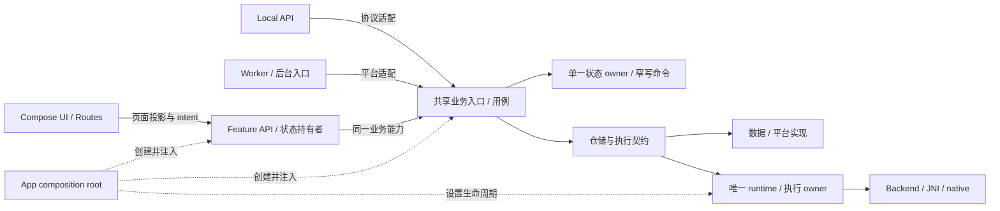

# MCA 顶级可维护性持续改进路线图

版本：1.0 · 编制日期：2026-10-18 · 基线源码：`5e2e7fe1`

## 1. 目的与结论

本路线图说明当前代码距离“顶级可维护性”主要还差什么，以及以什么顺序补齐才能减少回归风险。

这里的 10/10 是一组可审核、可重复的工程结果，不是源代码的永久属性、文件行数目标、一次构建通过或 Agent 自评。项目只有在下列边界有源码、测试和运行记录支撑，并在后续持续开发中保持结果，才可以按本路线图称为达到目标。每次新改动仍可能重新引入耦合，因而要由自动检查和每次变更的证据持续守住。

本文件是实施路线图。项目的永久规则和禁止项以 [MCA 项目架构与可维护性硬锁](MCA_PROJECT_HARD_LOCK.md) 为准；本路线图不能放宽它，也不替代用户针对行为、数据、视觉和授权的要求。

## 2. 基线及主要差距

基线来自 `E:\MAC` 在 `5e2e7fe1` 附近的只读源码检查。实施前必须重查 HEAD、工作区、子模块和文件指标；下表是路线图起点，不是后续自动刷新的事实。

| 区域 | 已观察到的源码事实 | 维护成本 | 路线图目标 |
| --- | --- | --- | --- |
| MainViewModel | 本体约 498 行；相关的 16 个 `MainViewModel*.kt` 文件合计约 1,491 行 | 主文件变小了，但仅看主 VM 会隐藏分散的状态和回调关系 | 保持本体为薄的生命周期适配点；不以继续降低行数作为目标 |
| Coordinator 装配 | `MainCoordinatorHost` 暴露约 71 项能力，adapter 将不少命令转回 MainViewModel | 改一个业务可能需要理解全局 host 和 VM 扩展，VM 仍是隐式中枢 | 按业务边界收窄 ports，逐个删除旧能力与反向回调 |
| 全应用状态 | `MainUiState` 约 141 个顶层字段；`UiStateStore` 保留 `ownerFlow` 兼容入口 | 宽写权限让协调器可能修改无关领域；迁移入口也可能被新代码继续依赖 | 保持必要原子性，同时将领域写权限收窄到 typed command |
| 依赖注入 | MainViewModel 和装配路径含多项 `Any?` 注入、运行时转换及 fallback | 错误到运行时才暴露，测试可能静默创建生产实例 | 新注入全部类型化；旧点位分批清除，不新增同类债务 |
| Chat feature | ChatViewModel 当前接收 app 状态和能力，主要将 intent 转回 app | feature 还不是独立业务拥有者，继续扩展会形成长转发链 | 只把合适的页面局部状态和页面规则放入 feature；业务执行 owner 保持唯一 |
| 架构自动检查 | 当前静态脚本有 8 项检查，但检查范围有限 | 未扫描路径的违规可能通过现有 gate | 扩大依赖图、owner、全量 API/worker 和状态写权限检查，并纳入 CI |
| 设计系统 | 有共享主题和基础组件；主题与页面语义样式的统一仍有限 | 同类控件可能出现状态、尺寸和光学差异 | 冻结布局与审美，建立同体系、可复用、可验证的设计约定 |
| native / 大实现文件 | 自有 native、API 和领域实现仍有大文件；主文件行数不等于真实解耦 | 修改热点、算法状态容易集中，review 成本增加 | 从变更热点和可独立测试的算法入手；不按行数机械拆状态机 |

检查时 `third_party/tokenizers-cpp` 含子模块内未提交改动。凡使用这些改动的验证都必须记录它们；父仓库 SHA 单独不足以重现该结果。

### 2.1 核心判断

MainViewModel 不再是优先压缩对象。**最高收益在于缩小跨领域能力接口与写权限，并把架构约束做成差量检查。** 再做全量搬文件会增加整合和功能回归风险，却不能保证这些边界变窄。

不把 141 个状态字段一次拆成多个 Flow，不重建聊天/图片/模型的平行架构，也不复制 runtime。按真实业务改动逐片收口，保留已有的正确执行 owner。

## 3. 目标架构与关键决策



这描述责任与调用方向，不代表每个节点都要新建模块、类或接口。目标性质：

1. 每项业务规则有明确 owner；UI、API、Worker 进入同一规则及同一实际执行 owner。
2. feature 只获得够用的类型化能力，不获得 engine、container 或全局可变状态。
3. composition root 只负责作用域、实例化、注入、接线和关闭，不代替业务层执行用例。
4. 业务状态只有一个权威来源。需一致的 request、model、参数及终态保持原子合同；页面以只读投影读取。
5. 各业务可以独立测试和理解；runtime 与数据所有权由真实调用关系定义，不由目录名定义。

### 3.1 禁止引入新的全能层

不以 use case、facade、coordinator、manager、port 或 module 数量衡量进度。新增抽象前要能回答：它隔离了哪个具体变化？生产调用者是谁？如何独立测试？旧路径何时删除？若答案不清楚，保持直接调用。

## 4. 优先级与阶段关系

P0 建立可重复检查基线；P1 修类型注入；P2/P3 收窄依赖与状态写权限；P4 澄清 feature 职责；P5 自动化防回归；P6 从真实热点处理大实现文件；P7 改善 UI 可维护性和质感；P8 持续验收与复盘。

P0 完成前不开展大范围移包或新抽象。每阶段可拆为小切片；若发现具体功能或稳定性故障，可以先做局部修复，同时记录基线并补回归保护。

## 5. P0：锁定事实与首批信号

### 实施内容

1. 记录 HEAD、分支、tracked/untracked 差异、子模块 revision 与内部 diff、JDK/SDK、native 构建选项和验证命令。
2. 重算 MainViewModel 相关文件、`MainCoordinatorHost` 能力、根状态字段、构造注入和 Gradle 直接依赖。每个数字注明统计脚本及范围。
3. 从源码建立功能入口地图，覆盖聊天、图片、模型、会话与内容、Local API、后台恢复；对受影响切片标出成功、失败和取消路径。
4. 追踪 UI/API/Worker 到执行、持久化和终态的调用链，确认每项状态与资源的 owner。
5. 运行当前环境能安全执行的架构检查和受影响测试；将结果分为 PASS、FAIL、NOT_RUN、BLOCKED、NOT_APPLICABLE。

### 退出条件

- 另一位维护者能重现同一源码/子模块输入及所报告结果。
- 已有改动与本任务改动分开，旧报告没有被当成当前状态。
- 输出 top 5 真实改动热点；每项有源码入口、可验证行为和负责人角色。

禁止为改善指标改变统计目录、忽略扩展文件、只数主 VM，或把 LOC 换算成重构百分比。

## 6. P1：把依赖注入从运行时猜测改为编译期契约

这是当前风险相对低、收益清楚的第一片。

### 切片顺序

1. 从 `MainRuntimeAssembly.injectedEngine` 开始，改成 `McaInferenceService?` 或有类型的 factory，追查所有测试及 production 构造入口。
2. 将 MainViewModel 其余测试注入按真实生命周期和职责类型化。优先明确构造参数/依赖对象；禁止用一个万能 test override 包起所有依赖。
3. 将 `MainCoordinatorAssembly.create` 的 `Any?` 参数改成实际 coordinator 类型或 factory。
4. 为注入对象确实被使用、默认 factory 仅在未注入时创建、配置错误不静默创建生产实例补测试。
5. 检查 Android ViewModel 创建方式、Java/Kotlin 构造兼容性和默认参数，避免破坏 framework factory。

### 退出条件

- app 主路径和相关单测通过；注入错误不能由 `as?` 静默转换成默认生产实现。
- 不再新增 `Any?` 注入。真实不透明令牌单独定性，不能误删必要身份值。
- 新依赖没有把初始化业务逻辑搬回 VM 或形成超大测试装配。

### 风险与回退

一个注入点一个独立切片。若 framework 创建、二进制 API 或生产调用点异常，回退该切片，补兼容构造/工厂测试后再迁移。

## 7. P2：拆小 MainCoordinatorHost 的权限面

目标是从 VM 回绕改成窄能力调用，不是把 71 个方法换成 71 个小接口。

### 7.1 能力地图

为每项属性/方法记录 coordinator 调用方、业务域、读/写/副作用、调用数及可否使用现有 typed port。候选分组为聊天/会话、模型/下载、图片/图库、Local API/runtime、生命周期/恢复、通用 UI 命令；分类以真实引用为准。

用源码引用、编译依赖和测试证明调用者，不能只按命名推断。找出只提供数据的能力、可搬入 owner 的命令及仅供测试的路径。

### 7.2 最小垂直迁移

1. 选一个调用者少、边界清晰、回归容易验证的业务域。
2. 定义只暴露该域必需读与命令的 typed port；不暴露整个 container、engine、store 或全部 coordinator。
3. 让领域 owner / use case 执行业务规则。MainViewModel 保留 Android 生命周期与现有公共命令适配。
4. 迁移生产调用者和测试；验证旧回调、取消、终态、持久化与启动恢复。
5. 删除无生产调用者的 Host 成员、VM 回绕和旧 delegate；搜索证明没有隐藏旧入口。
6. 复核新接口消费者、变化隔离和测试范围，避免为每个函数长期保留接口。

顺序由源码写入热点和风险决定。可先处理不触发模型/native 执行的只读能力，再处理有副作用的生命周期；具体顺序不得覆盖更高优先级故障。

### 退出条件

- 新业务能力不再加到全能 Host；每移除一组能力，Host 真实缩减，也没有在别处重建另一个万能对象。
- MainViewModel 不再充当 coordinator 的 service locator。
- 普通领域用例可在不启动完整 VM/Application/Container 时测试。
- UI/API 共用实际 owner；request identity、epoch、lease、事务和旧回调隔离测试通过。
- 旧实现已删除或登记精确例外和退出日期。

## 8. P3：收窄状态写权限，不撕裂原子性

### 8.1 建状态所有权矩阵

逐域列出字段组、权威来源、生产 reader/writer、持久化者、owner、必须原子提交的字段及测试，至少覆盖 chat/session、model/runtime、image/task、settings、API、background/recovery。

`ownerFlow` 是迁移入口；先搜索并追踪读写，不按变量名假定只有一个调用者。

### 8.2 收口方式

1. 对外暴露 immutable `StateFlow`、只读 selector 和 typed command。
2. reducer 保持纯函数；IO、磁盘、engine 和 job 创建在事务之外，由唯一 owner 编排。
3. 以领域能力限制写权限，不能把任意根状态 transform 交给新 coordinator。
4. 共享事务由一个 owner 校验身份及版本后原子提交；不能将强关联的请求/model/lease 拆成竞态 Flow。
5. 每减少一类 `ownerFlow` 调用，就加入禁止非法调用者写状态的结构检查或测试。
6. 删除最后一个 `ownerFlow` 前，确认生产、adapter、测试和启动路径都已迁移并有回退方式。

### 退出条件

- production 业务对象拿不到 `MutableStateFlow<MainUiState>`。
- 状态重试不会重放副作用，过期事件仍被 requestId/epoch 拒绝。
- reducer 测试覆盖过期事件、并发更新与交错终态；适用持久化/恢复测试通过。
- 子状态划分有业务证据，没有为了字段数做全面数据模型重写。

## 9. P4：让 Chat feature 拥有恰当的页面职责

ChatViewModel 不需要为变厚而变厚，也不需要强行变成 Android ViewModel。先以真实页面状态、生命周期和测试成本决定职责。

### 可迁移

- 与 engine 无关且只属于页面的跨组件交互状态（如确有需要的临时筛选/编辑状态）。
- 纯展示 selector、页面 intent 语义、输入校验和 feature 自身页面协调。
- 可在 feature 不依赖 app、不访问 native/数据库的情况下，通过明确 capabilities 完成的行为。

### 必须留在共享业务 owner

- 会话持久化、模型加载/切换、context 构造、共享推理、请求取消、工具执行及跨入口一致的规则。
- 需要覆盖 Worker、Local API、页面退出或进程恢复的业务任务。

### 切片流程与退出条件

选择一个真实页面规则，补 feature 测试，从 app 迁移实现，由 Route 接入 capability，跑生产聊天 UI 关键 workflow，然后删除旧实现。先证明一个 intent 的边界再推广。页面状态不因参数重组重置，不保留过期闭包；迁移规则可不启动 native 测试，执行规则仍由共享 owner 测试保护。不得产生第二个状态 writer 或四层纯转发。

## 10. P5：将架构硬锁变成可执行门禁

现有脚本通过只证明明确列出的八项范围。先保持原规则，再增量扩展；依赖本地 Git 信息的检查与跨平台 CI 分开定义。

| 门禁 | 检查内容 | 门禁策略 |
| --- | --- | --- |
| 编译依赖图 | 全模块禁用边和循环；feature → app/其他 feature/native；API → app/engine | 先 warning 建现有边清单，再禁止新增边 |
| 源码所有权 | 所有 production worker/service 禁依赖页面或 MainViewModel；UI 不取 runtime/native 实现 | 从所有 production source set 发现路径，不能只扫固定目录 |
| 注入契约 | 生产构造不新增 `Any?` 注入与 unchecked fallback | 精确旧位置基线；新增点失败，旧点只能减少 |
| 状态写权限 | production feature/owner/API/Worker 不持有 root mutable state；旧 `ownerFlow` 受限 | 新引用失败；删除引用同步缩小基线 |
| owner 唯一性 | 同一能力的真实创建位置、UI/API 共享注入、实例 identity 与竞争 | 装配测试为主，静态扫描辅助 |
| 协议/数据 | DTO、route、error、schema 与 migration 的历史 fixture 保护 | 变更时要求对应测试，不靠词表推断 |
| 文件/复杂度 | 本文预算、超长新函数、新增大接口能力 | 对新增/变更处检查；旧文件债务精确建档 |
| 子模块/产物 | revision 与 diff、ABI、许可证、凭据、APK provenance | 构建输入可追溯，私密材料不能进入产物 |
| Compose/UI | 关键交互、可访问语义、approved screenshot set 差异 | 不自动刷新 golden；差异需真实复核 |

### 实施顺序与退出条件

1. 把当前脚本纳入 CI 并保留原始结果。
2. 依赖图先报告再阻止新增违规。
3. 对 `Any?`、`ownerFlow` 做精确差量基线，只能减少不能新增。
4. API/Worker 检查升级为全 production source set，并测试新 sourceSet 和 generated 路径。
5. 加入共享 owner 装配 identity、请求终态和取消测试。
6. 真实 native、生产 UI、设备升级与长运行另设受控 release job；stub job 不得替代。

每个新脚本必须有测试覆盖空目录、新路径、Windows 分隔符、注释/测试误报、多模块、CI 环境、无法执行时的失败码。每条规则有 scope、正反例、脚本测试、CI job 和 owner；新增架构违规在合并前能失败。Local-only 检查不能被发布。

## 11. P6：基于热点处理大实现文件

本阶段不设全仓 500 行政策。

从最近 30–60 天缺陷与 diff 找热点。候选须有至少一个真实信号：无关职责混杂、业务修改相互冲突、无法小范围测试、资源生命周期不清、算法变更影响多个消费者。

优先处理自有实现。第三方代码遵循 vendor/submodule 管理，不做无关格式化或拆分。native 状态机中的协议解析、调度和释放逻辑若必须共同维护，可留在一个文件并以函数和测试隔离。

按纯解析/校验 → 映射 → 平台无关策略 → 单一生命周期 owner → 平台 adapter 顺序评估。每次先确认原契约，再搬逻辑。

### 退出条件

- 每个热点有修改成本证据和变更前后依赖图。
- 一个变更需要理解的职责或依赖减少，调用路径没有因抽象增加而更难追踪。
- 后端加载、参数、失败、取消和释放由契约测试保护；mock 仅验证纯规则。
- 超预算文件被收敛，或有精确 ADR/EX 解释；完整 codec 或状态机不因 LOC 被机械切开。

## 12. P7：冻结视觉语言下提升 UI 维护性与质感

### 结构合同

- UI 渲染页面投影并发送 intent；业务决策、数据访问、下载和 runtime 生命周期不埋进 Composable。
- 共享基础组件与 chat/feature 专用组件有清楚所有权；新增通用组件前有真实复用者或确定的扩展点。
- 提取 token 时先等值保持当前值；`remember`/`derivedStateOf` 使用正确失效 key，不缓存过期 callback。
- 结构移动同步验证 role、语义标签、focus、IME、Back、scroll 和输入草稿。

### 独立视觉精修

- 建立 G0（旧真实界面）、G0′（仅结构迁移、视觉等值）、G1（单独提交的精修）。
- 一次解决可见问题，如边界不一致、图标基线、长文本溢出、pending 状态不清，不随意换布局。
- 覆盖浅/深色和已有背景；按适用状态扩展到图片、代码、表格、失败、取消、加载、IME、大字体。
- 精修提交附固定环境、状态、before/after、最高影响观察及复核。缺渲染能力就标未验证。

### 退出条件

- 关键 Composable 行为测试通过；feature 不依赖 app 实现。
- 冻结合同无未解释差异；精修有实际截图/交互证据且可独立回退。
- 无障碍和 UI 测试覆盖关键操作；人工“看起来更高级”不是唯一证据。

## 13. P8：建立维护回归闭环

持续观察三类信号：

1. **变更成本**：领域入口、跨域 PR 数、一个小功能触及的模块和接口、回滚数。按季度抽样，不追求某一个数最低。
2. **回归质量**：引入 revision、发现阶段、测试是否检出、修复时间、用户功能/数据影响。每次生产回归补相同触发条件保护。
3. **架构债务**：Host 能力、`Any?` 注入、可变 root 引用、依赖例外、无调用 adapter 和热点超限的精确趋势。

每季度或两个稳定版本复盘最难改/最常回归领域、gate 漏报和误报、资源所有权、CI 时间及未覆盖运行条件。根据证据重新排优先级，不把路线图当作永不更新的大型重构计划。

## 14. 所有切片的共同模板

```text
切片 ID / 阶段：
当前 revision、工作区与子模块输入：
受影响功能及原有行为：
旧调用链 / 新调用链：
业务 owner / 唯一执行 owner / 状态 writer：
改动文件和明确不变文件：
先行保护测试：
最小实现与旧路径移除条件：
命令、revision、测试数及原始证据：
功能 / 数据 / API / UI / 性能结果：
PASS / FAIL / NOT_RUN / BLOCKED / NOT_APPLICABLE：
已知限制、例外编号、回滚/前向修复点：
下一个可独立验证切片：
```

只写“已完成迁移”“测试通过”“没有影响”不算证据。历史结果必须注明原 revision 和仍适用的理由。

## 15. 10 分目标的可审核评分

以下权重共 10 分。每项附源码边界、测试/门禁和未覆盖范围；没有证据记为未验证。分数用于显示风险，不得抵消硬失败。

| 维度 | 权重 | 满分证据 |
| --- | ---: | --- |
| 职责与依赖边界 | 2.0 | 业务 owner 清楚、依赖无环、feature/API 与实现隔离被 CI 检查，新违规会失败 |
| 状态与单一所有权 | 1.5 | root mutable state 不外泄、业务命令类型化、唯一 runtime owner 有 identity/竞争测试 |
| 测试与自动防回归 | 1.5 | 受影响行为有保护、架构差量 gate 在 CI、没有空执行或错模块通过 |
| 生命周期、并发与恢复 | 1.5 | 取消、过期回调、异常、恢复、资源释放及适用真实 runtime 有证据 |
| 行为、数据与 API 兼容 | 1.0 | 默认值/协议和历史 fixture 受保护，迁移及恢复有当前 revision 证据 |
| UI 分层、无障碍与视觉保真 | 1.0 | UI 无底层执行/存储、关键交互覆盖、真实渲染证明保真和独立精修 |
| 性能与可观测性 | 0.75 | 同条件基线/预算、资源观测、错误可定位且日志不泄露 |
| 可接手性与债务控制 | 0.75 | 接手入口生效、债务和例外有 owner/退出条件、切片可追溯 |

### 15.1 硬性封顶

存在任何未解决功能/数据/协议回归、第二套 runtime、不可追踪多 writer、丢失取消/资源释放、可绕过的空测试/旧证据、未经授权视觉破坏、关键生产验证未运行却宣称完成，整体都不得记为 10/10。

### 15.2 持续达标窗口

先完成所有适用代码与差量门禁；“持续顶级”还需要至少三个连续合并/发布周期没有债务重新扩张，并有新接手 Agent 能独立定位关键 owner 和复现检查的证据。生产稳定性与特定设备验收仍独立报告。

## 16. 风险与停止条件

| 风险 | 预防 | 回退 / 停止条件 |
| --- | --- | --- |
| 抽象增加跳转 | 以消费者、修改场景证明新边界，先做一个 slice | 调用者未减少且跳转增多，撤回抽象 |
| 状态拆裂 | 先列原子字段与 owner | request/model/lease/终态不一致，停拆并恢复单一状态更新 |
| 平行执行链 | 共享注入 owner，用生产装配 identity 测试 | UI/API/资源不同步，恢复唯一执行 owner |
| 迁移功能回归 | 正常/失败/取消/持久化保护测试和单独回退点 | 任一合同回归，先退 slice，修保护后重迁移 |
| gate 误报漏报 | 先 warning 报告再阻止新增违规 | 新 sourceSet 漏扫或正常代码误报，修检查后再强制 |
| Agent 冲突与缓存损坏 | 划定写集，共用构建锁，公共契约由整合者协调 | 同一高耦合文件并发编辑或构建冲突，先协调，不覆盖成果 |
| 行数成为绩效 | 评估 owner/caller/职责和测试，不以行数排名 | 只有搬文件、压行或空层，阶段不通过 |

## 17. 工作量与提速方式

在 P0 热点、测试和构建环境摸底前不能承诺日历截止日。以下初步估算假设一位熟悉 Android/Compose/native 的全职工程师并有 reviewer；属于规划范围，不是工期保证。

| 阶段 | 人周估算 | 范围 |
| --- | ---: | --- |
| P0 基线、调用地图和保护测试 | 0.5–1.0 | 文档化现状，不含设备和全模型验收 |
| P1 类型化注入 | 0.5–1.5 | 分批构造器和 factory |
| P2 Host / owner 收口 | 2–4 | 按领域迁移，不含所有 coordinator 重写 |
| P3 状态写权限 | 2–4 | 不含无关数据库 schema 改造 |
| P4 Chat feature 页面职责 | 1–3 | 不建立平行 runtime |
| P5 架构差量门禁和 CI | 1.5–3 | 受控设备 lab 单列 |
| P6 热点实现及失败保护 | 1.5–4 | 不整理整个 vendor 子模块 |
| P7 UI 结构和精修证据 | 1–3 | 不重新设计全 App |

合计约 **10–23 人周**，需每阶段按实际冲突、测试覆盖和 gate 误报校准。多人协作仅在写集独立时缩短日历时间；同时修改 VM、Host、状态、装配或 native 构建通常增加整合成本。

首批建议：先做 P0 一天内的基线和真实测试选择；再分批类型化 `Any?`；然后挑一个无推理副作用的 Host 领域迁移；把对应 gate 接到 CI；最后处理聊天执行和状态原子边界。每片最多围绕一个可验证业务能力。

## 18. 路线图完成定义

一个 slice 只有在源码、测试、适用 gate、调用迁移、旧路径清理和记录均完成时才关闭。路线图不能以计划写完、主 VM 行数下降、stub CI 通过、单设备通过或 Agent 声明“全重构”来关闭。

状态统一为 PASS / FAIL / NOT_RUN / BLOCKED / NOT_APPLICABLE。完成 P1–P7 适用范围、P8 三个周期守护及第 15 节全部证据后，才可在“代码可维护性范围内”宣称达标，并单独陈述生产稳定性证据。

## 附：实施 Agent 提示词

```text
你是 MCA 本次切片的实施 Agent。先读项目 Agent 指令、
docs/architecture/MCA_PROJECT_HARD_LOCK.md 和
docs/architecture/MCA_MAINTAINABILITY_10_OF_10_ROADMAP.md，随后基于当前源码和工作区
确认真实基线；不要沿用文档中的旧 revision、旧统计或旧测试结果。

只实施本任务明确分配的阶段与文件写集。保留已有用户和其他 Agent 改动；不修改
受保护原版仓库，不扩大功能变更，不建立第二套 runtime，不破坏数据、协议、取消、恢复
或冻结的视觉合同。开始前写出受影响行为、原 owner、目标 owner、关键调用链、风险和
第一个可回退切片。先加能复现行为的保护，再做最小实现；逐个迁移真实调用者并清理
失去用途的旧路径。不要只移动文件、换名字、压缩代码或增加纯转发接口。

使用明确类型、窄 capability、单一业务状态 writer 和现有共享执行 owner。状态拆分须保留
必须原子的字段。一次最多完成一个独立业务 capability，除非负责人明确分配互不共享契约
的写集。不要由多个 Agent 同时修改根 VM、Host、app composition、公共状态、native ABI
或同一 Gradle 构建目录。

按风险运行项目验证，记录确切 revision、原始工作区/子模块输入、命令、真实测试数量、
结果及范围。区分 PASS、FAIL、NOT_RUN、BLOCKED；stub 不等于生产 native，通过截图或
真实交互检查 UI。失败就定位和修复新增回归；不删测试、不刷新全量 golden、不扩大豁免。

交付包含：变更文件和职责、before/after 调用链、状态与 runtime 所有权、功能保留清单、
测试证据、未验证项、债务变化/例外编号和回退点。不得只报告“已完成”或交测试摘要。
整合负责人必须审查 diff 并验证合并后的 revision。
```
