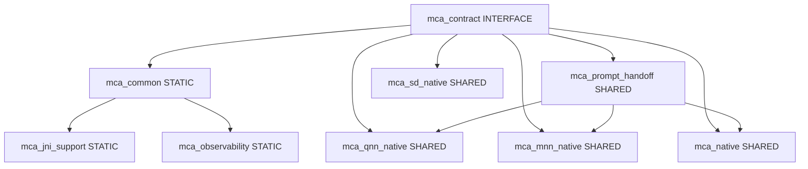

# MCA CMake Target Graph & Provider Isolation Blueprint

## 1. Overview

To guarantee enterprise modularity and prevent cyclic or leaky dependencies among native backends, the native CMake build defines clear layer boundaries:

## 2. Hard Invariants

1. **Provider Isolation**:
   - `mca_qnn_native`, `mca_mnn_native`, and `mca_sd_native` are mutually isolated.
   - None of them may link or depend on the private headers or binaries of another provider.
   - Shared data handoff (such as prompt tokens / KV handoff) is mediated strictly through the narrow `mca_prompt_handoff` target.
2. **Common Contract Distribution**:
   - `mca_contract` is an `INTERFACE` target exporting only `<mca/contract/...>` headers.
   - It contains zero runtime logic, zero third-party dependencies, and zero JNI dependencies.
3. **No Allowlist Injection**:
   - No target compilation flags may introduce device model or chipset whitelist filters.
