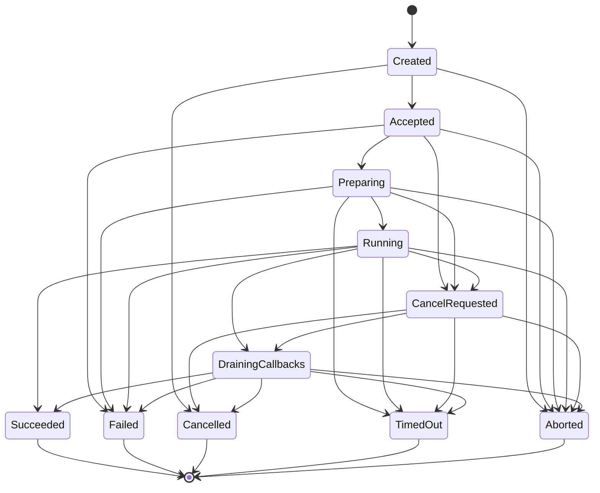

# MCA State & Lifecycle Contract Invariants

## 1. Request Identity & Monotonic Progress

Every command execution in MCA carries an immutable `RequestIdentity`:

| Field | Purpose | Validation |
| :--- | :--- | :--- |
| `requestId` | Stable identifier of the user or API request | Non-blank string |
| `attemptId` | Monotonic index of retry or recovery attempts | `attemptId >= 0` |
| `sessionGeneration` | Epoch of the conversation/engine session | `sessionGeneration >= 0` |
| `runtimeEpoch` | Epoch of the native runtime host and backend | `runtimeEpoch >= 0` |
| `workerIncarnation` | Process or worker instance incarnation | `workerIncarnation >= 0` |
| `nativeSequence` | Monotonically increasing sequence within attempt | `nativeSequence >= 0` |
| `traceId` | Distributed tracing ID | String |

## 2. Request State Lifecycle

## 3. The 5 Core Invariants

### Invariant 1: Terminal Exactly-Once
Once a request reaches any terminal state (`Succeeded`, `Failed`, `Cancelled`, `TimedOut`, `Aborted`), that state is strictly irreversible.
Any subsequent terminal event arriving from late threads, stale workers, or delayed JNI callbacks is rejected as duplicate, recorded as a diagnostic metric, and will not alter the business state or deliver duplicate terminal signals to the user.

### Invariant 2: Stale Callback Rejection
Any callback event arriving with:
1. `runtimeEpoch < activeRuntimeEpoch`
2. `sessionGeneration < activeSessionGeneration`
3. `workerIncarnation < activeWorkerIncarnation`
4. `nativeSequence <= lastSeenSequence` (within the same attempt)
is classified as stale and discarded immediately.

### Invariant 3: Cancel Drain
Calling `requestCancel()` sets state to `CancelRequested`. This pauses upstream input producers, but does **not** assume native execution has halted.
The native runtime transitions to `DrainingCallbacks`, flushes in-flight buffers, halts background threads, and only then emits the terminal `Cancelled` event.

### Invariant 4: Timeout Abort
If an operation times out and cannot be gracefully stopped within the drain deadline, it transitions to `Aborted`. The runtime host is marked `UNHEALTHY` and scheduled for complete recreation, guaranteeing that orphaned threads cannot corrupt subsequent requests.

### Invariant 5: Monotonic Sequence Ordering
Within an attempt, tokens and progress must be strictly ordered by `sequence`. Dropped or out-of-order packets are handled deterministically without silent token omissions.
