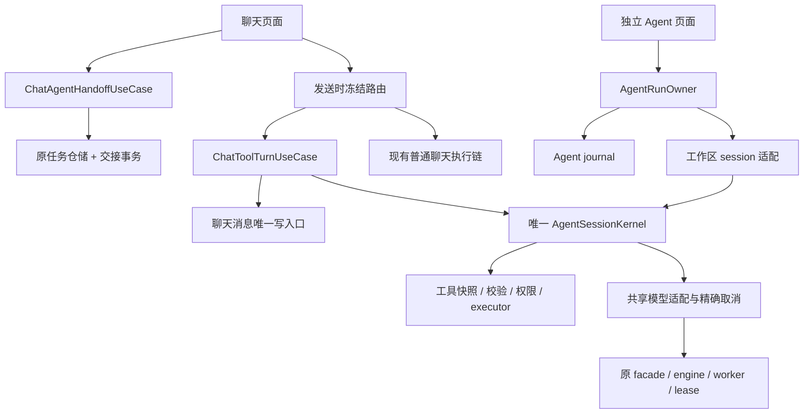

# MCA 聊天工具增强与独立 Agent 共核方案 V1.1

状态：设计交付，尚未实施。本轮只新增方案文档，不修改生产代码、数据库或构建配置。

适用目标：聊天工具增强 + 独立 Agent 工作区 + 一个共享的执行内核。此方案在现有 Agent V1 上增量演进，不重新建设一套 Agent。

## 1. 阅读顺序、效力和事实边界

1. 阅读 [MCA 项目架构与可维护性硬锁](../../architecture/MCA_PROJECT_HARD_LOCK.md)。它仍是工程约束的权威入口。
2. 阅读本文，冻结产品边界、所有权、协议和数据合同。
3. 阅读 [当前问题与验收](PROBLEMS_AND_ACCEPTANCE.md)，先处理开放新入口的前置风险。
4. 通过 [执行任务与提示词](EXECUTION_PROMPTS.md)逐卡交付，不能一次性重写全仓。

原有 [Agent V1 架构](../agent-v1/MCA_AGENT_V1_ARCHITECTURE.md)、[K00–K17 执行包](../agent-v1/MCA_AGENT_V1_EXECUTION_PACK.md)、[验收矩阵](../agent-v1/MCA_AGENT_V1_ACCEPTANCE_MATRIX.md)继续负责独立工作区。本文补充跨入口集成；不覆盖其尚未通过的门禁，不将实现存在改写成验收通过。若条款存在实质差异，先写具体 ADR，经整合者审查后再实现，不能任选宽松版本。

此次只读检查基线：2026-10-19，HEAD `ea11d213dae43c8f7dd5ac15aaaaf62f5b8c71e7`。Agent 大量实现及部分前端改动尚未提交；本方案依据的是当时工作区，不是一个可单独复现全部实现的 commit。三个子模块 revision 及 tokenizers 的既有补丁都需纳入未来构建输入。本文未重新运行构建、单测、adb 或真机任务。

文档结束复核时，并行会话将HEAD推进至`2368c72cec312f820e2452f2537302dcfc067805`；这段已提交差异仅涉及Local API设置页和帧测量脚本，其他前端未提交变动仍在继续。保留这些改动，不将本轮Agent源码审查冒充新revision全量验收；实施C00必须重新锁定最新工作区。

所有新名称、签名、表和目录均标为**拟新增或拟调整**；源码定位表中的名称才表示当前存在。提示词可以减少误解，最终正确性仍须由行为测试、真实执行和审查证明。

## 2. 冻结产品决策

| 入口 | 用户看到什么 | 运行及数据归属 |
| --- | --- | --- |
| 默认普通聊天 | 保留现有对话、流式、角色、记忆、附件、检索、生图及续答体验 | 现有聊天 owner 和历史存储；默认不进入 Agent 协议 |
| 聊天工具模式 | 用户按轮显式启用；完成有界读取、资料查询、检索，然后正常回答 | 聊天 turn owner 管生命周期；共享 kernel 执行模型与工具；不创建 AgentTask |
| 交给 Agent | 预览目标和逐项选择的材料，确认后创建独立任务 | AgentTask/Run 持久化，跳转独立工作区；聊天保留任务引用 |
| 独立 Agent 工作区 | 长任务、文件产物、审批、补充问题、继续/暂停/停止、Skills/MCP | 原有 AgentRunOwner、Room journal、私有 workspace |

新增工作区入口继续放在左侧栏“图片”下方。`AppTab.AGENT` 仍表示“智能调参”，`AGENT_WORKSPACE` 表示新工作区；不改旧标识含义或持久化映射。

**首个集成发布的聊天工具集合限定为显式授权资料的只读工具和有审批的网络检索。** 通用文件写入、外部副作用、任意 MCP 调用先通过“交给 Agent”进入独立任务，在工作区按冻结命令逐次审批。聊天可展示任务审批的只读摘要和跳转；不暗中转换成后台任务。现有聊天生图属于已存在的业务流程，继续保留。

这不是删掉通用写入能力：用户可从聊天发起并在工作区执行。后续如需直接在聊天中写入，单独增加有界 profile 和持久化/产物归属验收，不能在本次只读 profile 内逐步放宽权限。

首发工具模式按轮生效，默认关闭；重试沿用该轮冻结配置，用户编辑并重新发送则创建新执行身份。启用工具不自动启用网络，不继承其他任务的批准。

## 3. 当前源码能复用什么

| 真实边界 | 当前入口 | 本方案的处理 |
| --- | --- | --- |
| 聊天发送和路由 | [ChatWorkflowCoordinator](../../../app/src/main/java/com/muyuchat/mca/ChatWorkflowCoordinator.kt) | 保留附件、角色、上下文准入等前置合同；发送时决定唯一执行路径 |
| 聊天执行/结算 | [ChatExecutionOperations](../../../app/src/main/java/com/muyuchat/mca/ChatExecutionOperations.kt)、[ChatStreamAccumulator](../../../app/src/main/java/com/muyuchat/mca/ChatStreamAccumulator.kt) | 保留默认路径；工具模式通过窄 adapter 投递合法回答及结算结果 |
| 已有搜索 | [ChatExecutionWebSearchTurn](../../../app/src/main/java/com/muyuchat/mca/ChatExecutionWebSearchTurn.kt) | 当前是推理前确定性阶段；工具模式避免再次重复搜索 |
| 已有聊天生图 | [AssistantImageToolTurnOperations](../../../app/src/main/java/com/muyuchat/mca/AssistantImageToolTurnOperations.kt) | 保留审批、模型绑定、产物与角色续答路径，不在本次整套迁移 |
| Agent 任务调度 | [AgentRunOwner](../../../core/agent-runtime/src/main/java/com/muyuchat/core/agent/runtime/run/AgentRunOwner.kt) | 继续唯一写 Agent run 状态，保持一活动任务、五排队任务 |
| 控制循环 | [AgentPromptedLoopCoordinator](../../../core/agent-runtime/src/main/java/com/muyuchat/core/agent/runtime/run/AgentPromptedLoopCoordinator.kt) | 等值提取唯一循环为通用 session kernel；原入口变为工作区适配器 |
| 执行类型 | [AgentLoopTypes](../../../core/agent-runtime/src/main/java/com/muyuchat/core/agent/runtime/run/AgentLoopTypes.kt) | 当前强绑 AgentRun/Task；提取公共 session 类型，不用假 task 绕过 |
| 本地实际执行 | [ChatExecutionFacade](../../../app/src/main/java/com/muyuchat/mca/facade/ChatExecutionFacade.kt) → [ChatExecutionOwner](../../../core/engine/src/main/java/com/muyuchat/core/engine/ChatExecutionOwner.kt) → 原 engine/worker | 同一生产执行链、原 lifecycle lease、原请求身份；不增加 engine 或 native 仲裁锁 |
| 任务创建 | [AgentTaskRepository](../../../app/src/main/java/com/muyuchat/mca/agent/data/AgentTaskRepository.kt) | 复用已有原子创建路径，补稳定回执和交接 readiness |
| 输入快照 | [AgentInputSnapshotStore](../../../app/src/main/java/com/muyuchat/mca/agent/data/AgentInputSnapshotStore.kt) | 已有实现但未发现生产调用者；接入文本快照和来源校验 |
| Agent UI | `feature/agent-workspace` | 保留独立页面，不依赖聊天 feature 内部组件 |

## 4. 目标结构和依赖方向



这里共享的是执行协议和实现，不是让所有任务共享一个可变状态对象、一个无限队列或一个巨型 owner。

模块职责冻结如下：

- `core:agent-contract`：平台无关的 session/profile、执行事件、交接命令/回执、查询与权限主体等稳定契约。增加真实使用的类型；不塞 Compose、Room、Context、File、Uri、engine 实例。
- `core:agent-runtime`：唯一模型/工具循环、协议解码、预算、上下文配对、暂停/审批 yield 等纯运行逻辑；不知道聊天页面或 Room 表。
- `app/.../agent`：原模型、工具、安全、数据、平台 adapter；按职责继续维护，不在 composition 中放策略算法。
- **拟新增** `app/.../chattools`：聊天 turn 用例、历史适配、只读 audit 存储映射；不复制协议或搜索实现。
- **拟新增** `app/.../agent/handoff`：选中上下文快照、交接事务及恢复用例；不直接写聊天消息或调用主 VM。
- `feature:chat` 与 `feature:agent-workspace`：仅拿各自窄 typed port，互不依赖；公共内容组件在实际出现两个生产调用者后等值提取。
- `app composition`：只创建和注入；唯一位置决定实例、scope、关闭顺序，不决定工具批准、来源选择或上下文拼接规则。

不为本次集成新建一组 Gradle 模块。共享 UI 基础优先进入 `core:designsystem`；只有其依赖面或职责明显不合适时，先用 ADR 说明为何新增 `core:conversation-ui` 等独立模块。

禁止扩展 `MainCoordinatorHost` 业务能力、向 `MainUiState` 增加 Agent/工具活动/审批业务字段、新增无类型注入或向 feature 暴露全局可变状态。聊天现有 writer 可继续完成历史结算，新对象不得获得整个根 store 的写权限。

## 5. 共享 kernel 的精确边界

### 5.1 等值提取，不复制循环

拟新增 `AgentSessionKernel`，从现有 `AgentPromptedLoopCoordinator`提取模型→完整控制响应→验证→权限→工具→观察→下一轮这一条状态机。原协调器保留为工作区协议适配，迁移完调用者后清除旧循环体。

提取期间可临时保留旧实现供测试对照，但生产一次只能走一个实现；同一切片结束前旧生产路径退出，不能长期保留两套开关轮流执行。禁止 feature、聊天 use case 或 model adapter 再写模型/工具 `while`。

拟冻结的概念签名如下，属于设计草图，实施时须映射到已有类型，不是可直接粘贴的 Kotlin：

```text
ExecutionSubject = ChatTurn(sessionId, turnId) | WorkspaceRun(taskId, runId)
ExecutionIdentity = executionId + epoch + stepIndex + attemptId + attemptOrdinal
ExecutionProfile = CHAT_TOOLS_READ_V1 | WORKSPACE_TASK_V1
SessionSpec = subject + identity + binding + policy + budget
              + frozenContextRef + resourceScope + toolSnapshotRef

AgentSessionKernel.execute(spec, resume, eventSink, progressSink) -> SessionOutcome
SessionOutcome = Completed | WaitingApproval | WaitingUser | NeedsWorkspace
                 | BudgetExceeded | Failed | Cancelled | Stopping
```

约束：

1. kernel 不读取页面当前选择，不补聊天历史，不创建 AgentTask，不写 MainUiState，不控制导航。
2. run 状态 CAS 仍由 `AgentRunOwner`负责；chat turn 生命周期由聊天用例负责。kernel 返回 outcome，不自建第二个终态 writer。
3. `ExecutionEventSink`只承担执行事实持久化及必要 CAS 回执。分成 beginAttempt、settleAttempt、appendEvent、recordInvocation 等少量有类型能力；不能用通用 `dispatch(Any)`或静默 no-op sink。
4. 副作用前必须已有成功持久化的 invocation/批准消费事实。写入失败应停止执行；成功事务后的 UI 通知失败不能反过来抹掉事实。
5. workspace sink 适配现有 AgentJournal；chat sink 只记录本轮执行 audit。不要为 chat 伪造 AgentRun、taskId 或 FK 记录。
6. 资源及权限主体使用 typed `ExecutionSubject`。若既有 `FrozenToolCommand`/read grant 强绑 task，先等值提取共同 binding/策略判定，再分别提供存储 adapter；禁止以一个聊天 ID 冒充 taskId。
7. broker 的校验规则、授权消费算法只有一套。每个主体的 owner 在一次事务里消费批准并登记执行；不能 broker 和 owner 各消费一次，也不能 owner 跳过最新策略核对直接执行。
8. 旧 Agent 持久化 JSON 和审批行可通过 workspace adapter保留原格式；不因抽象名字变化重写历史记录。

### 5.2 两个执行 profile

| 项目 | CHAT_TOOLS_READ_V1（拟新增） | WORKSPACE_TASK_V1（已有基线） |
| --- | --- | --- |
| 生存期 | 一轮聊天；可等待资源/外发审批 | 跨页面的独立持久任务 |
| 模型尝试上限 | 5：最多三轮控制 + 一次修复 + 一次最终回答；实际总量先到即止 | 12，含修复 |
| 工具调用上限 | 2，串行，每个控制响应最多 1 次 | 8，串行，每个控制响应最多 1 次 |
| 修复上限 | 1 | 1 |
| 总生成 token 起始上限 | 8,192，精确 usage 缺失时标估算 | 24,576，沿用原合同 |
| 最终可见回答 | 工具禁用阶段真实流式，正文上限沿用现有输出守卫 | 合法控制终态里的最终文字与产物 |
| 工具结果 | 入模型 ≤16 KiB，持久化 ≤64 KiB | 沿用相同上限 |
| 活跃时长起始上限 | 180 秒；包含模型/工具执行，不含等待用户批准 | 沿用 900 秒 |
| 资源等待 | ≤120 秒，可取消自己的 waiter | 沿用 ≤120 秒 |
| 工具集合 | 本轮明确授权资料只读；网络检索单独授权 | 现有 workspace 工具，依能力门禁增加 Skills/MCP |
| 写入/外部副作用 | 返回 NeedsWorkspace，用户确认后新建任务；不自动执行 | 冻结参数后 ASK；不得由模型自批 |
| 进程死亡 | 原轮标中断，不自动重发或继续 | 核账后 PAUSED/NEEDS_REVIEW，显式继续 |

以上聊天数值是可测试的首发保护默认值，不是实测性能承诺；调整必须版本化，不修改既有普通聊天参数或降低上下文/输出质量来达标。每次尝试、修复和最终回答都计费计预算；进入最终回答前必须预留其预算。二次同类权限拒绝不再循环请求。

预算采用单调时钟硬deadline，不是等infer/tool返回后才检查耗时。deadline触发所属attempt或工具的准确取消；本地模型仍须等待真实静止证明后释放lease。工具无法证明中止时标UNKNOWN/可能副作用，不自动重放。模型失败、取消、修复、FINAL以及多次批准yield前后的活跃时段累计到同一execution预算；等待批准/用户才暂停活跃计时，不因重新execute归零。checkpoint保存已消费预算和计时会话标识，重启不复活旧deadline或批准。CHAT_TOOLS单模型attempt硬上限沿用180秒且受剩余总活跃时长更窄约束，单工具≤30秒；workspace沿用现有预算值并补齐真正执行的硬限时。

`AgentContract.MAX_ACTIVE_RUNS_PER_PROCESS`目前语义是独立 Agent run 上限。集成时在代码和 ADR中明确作用域，保留 workspace=1、queue=5；不能把所有默认聊天塞入它。chat tool turn 沿用现有聊天发送准入，不平行制造多个聊天生成。不同执行主体之间仍由现有 engine/resource owner 仲裁实际资源，云端独立请求遵守原网络和取消合同。

### 5.3 流式回答与控制响应分开

当前 model port 的 `TextDelta`可能是原始控制 JSON，不能追加到聊天回答。

CHAT_TOOLS_READ_V1 固定两阶段：

1. **CONTROL**：完整合法终态后才解码 PROMPTED_V1；只向 UI 发布活动、等待、工具结果摘要。协议 JSON、partial arguments、reasoning 均不能触发工具或变成回答正文。
2. **FINAL_SYNTHESIS**：控制阶段完成后，kernel 使用已配对、已授权的材料，以同一个冻结模型启动新的精确 attempt；禁用工具 schema，输出自然语言 `FinalAnswerDelta`。不再将该阶段文字当控制消息解析，不允许再进入工具循环。

模型请求增加typed phase；workspace/旧调用默认CONTROL，FINAL显式启用。FINAL使用独立的phase-aware prompt/serializer：保留角色与任务目标、已授权输入和配对工具观察，将控制final转换成“回答草稿/材料”，移除要求JSON的控制system prompt、工具schema和待执行控制指令。不能把末尾Final envelope直接放入要求observation的原CONTROL assembler，否则会形成未配对历史。复用同一模型transport与来源投影，不绕回旧聊天执行器再次拼上下文；仅FINAL允许产生FinalAnswerDelta，CONTROL原始delta只作内部受限进度。

新的 attempt 同样做上下文准入、真实终态检查、预算和精确取消。只能基于本轮授权内容回答；遵守聊天角色及可用引用，禁止生成不存在的来源 ID。控制 final 可作为回答草稿，不宣称对草稿再润色是免费或零时延。

最终阶段失败/断流：保留已可见部分并标“未完成”，不把它提交为成功记忆/摘要；用户可明确重试。终态确认前的 delta 是可见暂存，成功后才完成一次历史结算。不得失败后静默切云、切模型、自动重新生成或显示假打字动画。

workspace profile首发保持原有终态行为；不强行加一次 synthesis 推理。真实最终流式是聊天工具模式发布验收项，不能用解析完再分字播放冒充。

## 6. 聊天接入合同

### 6.1 发送时冻结唯一执行路径

拟新增 typed 路由决策 `LEGACY_CHAT / CHAT_TOOLS / IMAGE_EXISTING_FLOW`。同一轮冻结一次，后续 UI 选择变化不改运行中路由。

保留现有显式 `/image`、附件不兼容校验、角色归属和已有生图确认；这些行为优先沿用当前合同。明确纯文本且用户启用工具的轮次才进入新 profile。启用工具但输入不受支持时，发送前解释并让用户选择原聊天或独立任务，不在后台丢弃附件、转文字或调用 OCR。

工具路径消费原聊天领域形成的上下文快照：session/turn/message IDs、chat epoch、角色 snapshot、模型绑定、有效参数、已准入历史、当前摘要 revision、记忆及资料引用、附件 asset/hash、检索配置及选择授权。提取 typed snapshot builder复用原组装规则；不复制世界书/记忆/压缩算法，也不把整个 MainUiState传给 kernel。

默认聊天已有上下文压缩保持。工具 profile内部不自动发起额外压缩模型；快照若经现有发送前显式/既定压缩，应记录该结果，后续不能再次改写。资料超窗口应返回真实准入错误或移交工作区，不悄悄截掉用户选择。

工具路径不再运行legacy本轮自动搜索，搜索统一由kernel调用共同search adapter；已有历史搜索结果仅作为带来源的历史快照，不重新宣称本轮已检索。显式搜索意图纳入kernel上下文与验收，C06必须断言没有重复请求；默认普通聊天仍保留原搜索路径。

### 6.2 状态与持久化

拟新增最小 `chat_tool_turns`表：executionId、sessionId、userMessageId、assistantMessageId、chatEpoch、profileVersion、frozenContextRef/hash、bindingHash、policyVersion、state、revision、lastSequence、terminalCode、timestamps。

拟新增 `chat_tool_events`表：executionId、sequence、kind、attempt/invocation ref、payloadRef/hash、commandId/commandHash等有类型事实。大字段仍走有界私有 payload；必须有按execution+sequence及commandId的唯一约束，事件和turn revision推进同事务。

批准投影至少持久化approvalId、executionId/epoch/invocationId、frozenCommandRef/hash、schemaHash、policyVersion、sourceSetHash、expiresAt、decision、consumedAt及revision。可在有确定性归约和CAS的事件投影中实现；若为可靠查询确需单独chat批准表，由C05冻结迁移，不准只存摘要。一个invocation最多一次消费；批准消费、invocation开始事实及command幂等回执同事务原子CAS。拒绝记DENIED，过期/撤销记NOT_EXECUTED，消费后不得再执行；进程死亡后未消费批准失效，已开始且结果不明记UNKNOWN，不自动重放。

这些audit记录只服务聊天工具轮，不进入 AgentTask 查询、不复制聊天正文、不保存模型内部推理，不形成第二份消息历史。复用权限策略及事件编码，避免再实现完整 Agent journal。相关状态只投影给聊天 feature的窄查询端口，不扩大全局 MainUiState。

冻结context/payload实际可能含私人聊天内容，必须接入聊天删除生命周期：删除源会话/相应轮次先取消其准确执行、失效批准，待停止后事务tombstone审计并排队清除快照/payload，清理失败可重试；仅保留必要commandId/hash/时间等脱敏幂等壳。startup/维护GC按引用和ledger清孤儿，不能按文件年龄直接删活动输入。聊天导出保持旧格式，默认不带audit/审批/控制转录；新增私有payload根加入云备份及设备迁移排除，同时核查当前数据库规则，不为排除新audit额外改变旧聊天备份合同。独立Agent任务副本遵循另行确认的保留语义，不能把它套到普通聊天audit。

成功/失败的聊天文字、引用、摘要激活、记忆、重试及回滚仍通过原聊天 mutation/settlement owner。kernel、工具、Agent仓储均不得直接追加聊天 DAO。

每次可见输出必须匹配被冻结的 sessionId、assistantMessageId、chat epoch 和 executionId；当前目标已删除/替换时拒绝迟到写入，不能写到“当前页面”。原有 buffer/flush/dismiss 行为优先复用。取消、失败、进程死亡只结算一次；重试创建新执行身份，保留旧轮审计。

### 6.3 生命周期与取消

页面切换、重组、订阅 Flow 不启动模型，不创建新 task，不等价于取消。工具轮遵循原聊天生存期；仅看不到页面不能销毁应用执行 owner。等待批准不持 native lease；不通过常驻 FGS 保留仅等待用户的任务。

首发WAITING_APPROVAL仍占用原聊天发送槽，提供批准/拒绝/取消；保留当前生成期间的切会话限制，不通过清isGenerating让新轮覆盖旧轮。页面局部projection可显示等待状态，但不是第二个准入writer。独立workspace等待批准只占自己的活动槽，不占聊天槽。未来若允许等待时跨会话聊天，单独设计多会话投影及恢复，不在本切片改变原行为。

停止时先捕获这个 chat turn已持有的执行/attempt identity，再取消其 Job、搜索 deferred、HTTP Call及精确模型请求；不能在停止时读取“此刻活动 token”作为目标，更不能调用全局 `cancelAll`。没有已派发 attempt时只取消本轮自己的等待。

UI 及时显示“已请求停止”；真实 engine/worker静止前保留 STOPPING/resource fence。超时显示等待后端停止与诊断，不能释放原 lease让新请求重入。旧普通聊天的停止路径也要在独立兼容切片中收窄，否则新的 Agent仍有被误停风险。

## 7. 从聊天交给 Agent：完整数据协议

### 7.1 明确选择，不自动携带全部历史

确认界面显示：可编辑目标、勾选消息/文本资料清单、来源和大小、是否为已保存截取文本、模型、离线/联网策略、允许的工具范围。

默认只预选用户显式触发的内容；不附带整段聊天、隐藏 system prompt、角色私人记忆、所有知识库、凭据或其他任务。要加入额外内容必须逐项选择。正在生成的 assistant文本默认不可交接；不隐式停止生成来获取快照。

选中聊天内容在原 conversation mutation barrier 后捕获：`sessionId + messageId + contentHash + selectionRange`。稳定 messageId使用现有映射归一化结果；不拿列表 position当身份。确认后若内容 revision变化，重新预览确认或拒绝过期请求，不能替用户读取更新内容。

### 7.2 强类型创建回执

拟将创建命令返回调整为专用结果：

```text
AgentCreateTaskResult = Created(AgentTaskCreationReceipt) | Rejected(AgentError)
AgentTaskCreationReceipt = commandId + taskId + workspaceId
                           + creationTaskRevision + idempotentReplay
ChatAgentHandoffReceipt = handoffId + creationReceipt + preparationState
```

创建的所有调用者改用回执；不能通过“新出现且 goal相同”的任务列表查找来猜 ID。其他命令继续使用既有结果类型；不要给所有成功结果增加一组互斥的 nullable字段。

创建回执及其creationTaskRevision是不可变创建事实，幂等重放保持一致；preparationState是当前查询投影。READY可能推进task revision，因此启动前以receipt.taskId查询当前任务和READY状态，使用当前revision提交Start；不能直接用旧creationTaskRevision启动，冲突后不自动放宽CAS。

### 7.3 最少新增两张交接关系表

| 表（拟新增） | 必要事实与索引 |
| --- | --- |
| `agent_task_handoffs` | handoffId PK；commandId UNIQUE、canonicalPayloadHash；sourceSessionId、anchorMessageId；taskId UNIQUE；PREPARING/READY/PREPARATION_FAILED/REVOKED；selectionManifestRef/hash、inputSetHash、sourceGeneration；revision；errorCode；timestamps、unlinkedAt |
| `agent_input_sources` | taskId + inputId唯一；sourceId、kind、source messageId/assetId、selectionRange、sourceContentHash；稳定logicalPath、expectedStoredHash、storedHash/size、PREPARED/COMMITTED状态、dataClass、revokedAt；按task/source建立查询索引 |

交接表同时作为聊天任务引用和交接 ledger，不再新增重复的 link状态表。大正文和选择清单进入现有私有 payload/inputs；goal仍保持原 8 KiB上限。运行状态查询 AgentTask/Run权威，不拷贝到交接表。

聊天和 Agent现已共用 `McaRoomDatabase`，任务与交接关系用同一 Room事务；不引入消息总线或分布式事务。聊天消息表主键是 sessionId+position，messageId不是已证明唯一的数据库键；来源使用软关联和 hash，不添加错误 FK。

### 7.4 事务与文件准备顺序

1. 用户确认生成一次稳定 handoffId/commandId；记录 canonical payload hash。相同命令同内容重放返回原回执，内容不同返回冲突；不按内容 hash全局去重，允许用户再次创建同目标任务。
2. 在**原 AgentTaskRepository 的创建事务**内原子写 task/workspace/frozen binding+policy+budget/read grant/command receipt，同时写 handoff=PREPARING。复用原创建算法；直接新建工作区任务仍可无 handoff。
3. 复制前持久化每个选中项的稳定inputId、来源fingerprint、预期转换后hash/size、目标logicalPath及PREPARED账本。复用store时增加有稳定import key的幂等接口，重试不能重新生成随机importId。先写准备manifest/ledger，再拷贝→校验→rename→登记COMMITTED；覆盖rename成功但最终manifest未写的窗口，按预期路径和hash核账，禁止从聊天临时路径长期借读。需要文本转码时在确认前预检其确定性转换指纹，源变化则重新确认。
4. 校验全部内容大小/hash/来源状态和manifest后，最终事务CAS handoff revision、inputSetHash和当前sourceGeneration，确认所有项COMMITTED且未撤销，再冻结 input-set引用及 handoff=READY，按既有规则更新必要 revision。CAS失败保留非READY并重新核账，不能以旧校验结果覆盖新撤销。先存在文件不等于已提交输入。
5. `startRun`/continue/spec读取在同一一致性检查中要求输入集 READY且未撤销。存在非 READY交接的 task返回 `INPUTS_NOT_READY`。只在 UI禁用按钮不够。
6. “创建并执行”的一次明确确认可在 READY后发独立幂等 Start命令；进程死亡、恢复或导航不得重放执行意图。READY后是否已发 Start可查原命令账本，不重复执行。
7. 导航失败保留真实 task ID并显示“打开任务”；创建成功不因导航异常撤销数据。准备失败保留可见任务，提供重试准备/重新选择/删除，不运行缺资料的任务。

输入首阶段支持已完成的消息和受支持文本文件。图片、PDF、音视频、脚本运行没有适配前明确提示限制，保留原聊天资料。现有聊天的 64 KiB等截取内容只能标“已保存的截取副本”；读取原文件需重新明确选择与授权，不能冒充完整文件。

### 7.5 崩溃和幂等恢复

| 中断点 | 恢复行为 |
| --- | --- |
| 创建事务前 | 无任务，重试同命令 |
| 已提交 PREPARING，UI未收到回执 | 从命令账本取原回执，不能再创建 |
| 正复制某个输入 | 从manifest/hash核对已完成项；缺来源权限时提示重新选择，不自动联网补资料 |
| 文件完成，READY事务前 | 按固定manifest核账；未验证完保持非READY |
| READY已提交，导航/启动前 | 可打开任务；恢复不自动推理、不自动发网 |
| Start已成功，回执丢失 | 重放同Start命令返回原 run，不新建第二 run |
| 输入丢失、哈希错误或撤销 | 禁止使用该输入，暂停/需修复；不能跳过后继续声称任务完整 |

### 7.6 资料撤销、删除和结果返回

确认页明确“所选资料将保存为独立任务副本”。删除原消息或会话不自动删除副本、取消任务；来源链接显示缺失，任务继续按自己生命周期管理。提供单独“撤销已移交资料/删除任务”操作，语义不能混在删除原聊天里。

撤销来源时：同步提交source撤销和策略版本变化 → 失效待批命令 → 精确暂停/停止受影响执行 → 后续模型/工具/外发每次重新验权。已读内容、摘要、tool observation、最终回答草稿及派生产物带provenance，不能只删文件后继续旧 transcript。已外发数据不能声称已收回。

首发采用明确的保守规则：**handoff变REVOKED后，原task不可再start/continue；用户可确认创建排除已撤销资料的全新任务**，不在原task自动建successor run。原记录和已提交产物可保留本地审计，但受撤销来源污染的内容禁止继续送模型、外发或作为执行输入；不复活原批准。未来若支持同task版本化input-set，须另做迁移/重新授权协议。本规则优先于通用successor概念，消除REVOKED与continue门禁的歧义。read/start/提交模型结果/egress均绑定冻结的sourceGeneration并在提交时重验，拒绝撤销前的迟到结果。

首发“引用结果继续聊”把用户选中的已提交产物/结果摘要放入原 composer，保留原草稿，发生冲突提供合并或取消；**用户发送后**才成为聊天消息。引用不自动加入模型上下文、不自动再调用模型。产物读取必须核对真实 commit/hash和选择大小，不取临时文件或模型虚构 ID。

该动作冻结targetSessionId、draftRevision、source runId/artifact commit/hash。异步读取后目标已变、草稿有新修改、任务被删或来源被撤销，应拒绝过期写入并保留原草稿，不写当前页面。composer的typed引用附件保留provenance/class/sourceGeneration直到用户发送并完成实际payload授权，不能只粘贴文本丢掉LOCAL_ONLY等分类。

任务卡从handoff查询投影叠加到聊天列表，不插入一条会被旧快照reconcile覆盖的假消息。解除引用不删任务；删除任务走原精确停止→tombstone→重试文件清理，新关系表接入同一删除清理。要保留“任务已删除”的历史卡，仅留脱敏引用壳taskId/anchor/时间及必要command hash；清除selectionManifest/body和input_sources敏感字段。不得既把handoff引用整行删除又承诺仍显示卡片。

用户删除源聊天时只解除sourceSession/anchor关联和聊天投影、清理聊天侧私人字段；**仍在的独立task必须保留其readiness/REVOKED/幂等ledger**。不能物理删除该handoff整行后让task按“无handoff的直接任务”绕过门禁。task侧副本依独立任务保留合同处理，task也删除时才走完整tombstone与清理协议。

后续“直接导入为历史消息”须另做切片：通过聊天唯一 mutation owner，在同一事务保存回执与消息，重复点击/恢复只导入一次。本首发不新增该路径。

## 8. 权限、外发、Skills/MCP 与手机本地

### 8.1 两种可理解的运行方式

- 完全在手机离线执行：本地模型 + 手机内 kernel + 私有文件工具；不开云服务、远程MCP、搜索，也不开本机网络服务连接。`offlineForced`必须由所有 Agent传输入口执行，不能只在UI显示离线。
- 手机内运行 Agent、模型可选云端：调度/工具/文件/审计仍在手机；发送给云端的实际内容需授权。选择本地模型不自动表示工具没有网络。

现有 `LOCAL_ONLY`策略代码允许受控 `LOCAL_SERVER`的设计空间；“完全离线”必须落实为更严格的 `offlineForced`，不能把可访问LAN/localhost标成完全离线。首发聊天工具和本方案的离线验收要求零网络；若以后启用本机HTTP服务，单独展示和授权，不改旧聊天网络合同。

不运行 DSH/Codex CLI、不嵌入 third-party、不依赖 Termux、不把远端 harness当作本地Agent。可参考它们的任务、权限、工具和扩展设计；不据此宣称 Android已支持任意终端/Python/Node/桌面插件。

### 8.2 共享权限规则

工具统一经过：catalog快照 → schema校验 → 参数/路径规范化 → frozen binding → 当前策略/来源校验 → 审批或拒绝 → 原子单次消费 → executor → 有界结果 → journal。

批准绑定至少包括：typed主体、epoch、invocation、工具版本/schemaHash、规范化参数 hash、资源前置hash、来源集及hash、policyVersion、有效期。原5分钟TTL不延长；进程/时钟可信度变化使旧批准失效。待批准和已批准未消费在撤销/schema变化后都必须阻止执行。

只读仅说明本地工具副作用，不代表允许把结果发给云。默认网络关闭；联网开关不等于所有材料授权。最终请求序列化前基于**实际 payload**投影来源，包括选中消息、工具结果、搜索、Skill文本、摘要及派生材料。不能只检查域名或初始附件。

云端/MCP/search传输必须拿到覆盖源ID、分类、hash和实际origin的当前授权；新来源/内容hash/目标变化重新审批。现有grant若只保存sourceId，应由批准绑定或授权版本补上hash约束；不能让同ID内容替换后沿用批准。SECRET/LOCAL_ONLY材料不得靠模型建议转为PUBLIC。

通用“允许 Agent联网”可允许受控发现连接，不等于允许发送PRIVATE工具参数。云模型开启前先完成真实client→payload检查→call取消→严格终态链；只打开模型选择器不算接通。重定向、实际DNS路由、headers/凭据、SSE总量和逐帧大小仍按V1安全合同验收。

### 8.3 扩展快照与撤销

Skills：每个新run/session读取当时启用版本，形成不可变快照；更新不改变正在执行的文本版本。停用/卸载另走撤销通道，使下一次调用和待批命令立即失效。`allowed-tools`只能收窄，不能授予路径/网络。只支持已声明的SKILL.md子集，scripts首发不执行。

MCP：复用已有run-scoped provider和registry；schema/list变化、停用、删除都把generation/批准失效传给实际broker/owner。不能只有一个未接的listener。先只在工作区开放受控tools-only HTTP子集；真实受控server通过后再声称兼容。安装配置不是连接验收。

catalog解析不得持全局Mutex做网络；临界区只登记generation及读写快照，IO在外完成，再按generation CAS发布。等待批准时不要因重建连接悄悄换schema执行旧命令；恢复必须核对快照后重新冻结批准。

## 9. UI和已有前端优化并行

当前布局和审美继续冻结。新增工具活动使用紧凑行；原始参数、完整结果按需展开，不让普通聊天变成密集任务控制台。审批显示实际目标、内容范围及后果；拒绝、过期、失效和等待停止都有明确文案。目标输入和资料选择不能让默认聊天发送多出必经步骤。

仅提取两个页面确实共用的内容：Markdown/代码块展示原语、工具活动行、审批内容展示、产物引用。业务action由typed回调传入；不要把聊天整条MessageRow、聊天model类型或VM整体搬到designsystem。先提取现有数值等值版本，再做独立视觉精修；字体/间距/滚动/选择/IME行为保持。

| 可并行写集 | 负责人 | 共享点处理 |
| --- | --- | --- |
| 既有前端精修 | 前端负责人 | 不抢写本次聊天路由/共享组件提取；变更设计token先告知整合者 |
| kernel及纯行为测试 | 内核负责人 | contract先冻结；不改Room、MainActivity或导航 |
| handoff/audit数据 | 数据负责人 | 只写分配的新DAO/仓储；DB版本/注册/schema归整合者 |
| Agent工作区局部UI | 工作区负责人 | 不依赖chat，不改其工厂/导航/共同审批契约 |
| 根配置、composition、聊天接缝、公共契约、迁移注册 | 唯一整合者 | 串行整合和审查；不能多人最后覆盖 |

相同文件不能安全并行；同checkout所有Gradle/native验证共用项目构建锁。独立工作树可并行准备，但不能假设主工作区未提交Agent代码会自动被复制。必须记录patch基线，禁止通过批量复制覆盖他人前端修改。

## 10. 实施顺序、门禁与回退

详见执行包C00–C11：

1. C00锁基线、收口状态事实。
2. C01真实停止证明与STOPPING传播；C02旧聊天精确取消/取消异常传播。
3. C03外发、catalog/Skill撤销、云路由；完成原V1所需G0实证，闭环既有门禁缺口。
4. C04共享session契约与kernel等值提取；先使独立工作区行为通过，再接聊天。
5. C05创建回执、输入和handoff事务/迁移/恢复。
6. C06聊天工具完整纵切：只读工具→安全最终流式→原历史结算。
7. C07聊天任务引用、移交确认、结果放回草稿；C08必要共享UI等值提取。
8. C09多入口竞争、恢复、真机升级、离线/云/MCP及既有功能回归。
9. C10最终证据与交接；C11作为另行排序的DSH能力路线，不混入首发。

设备阻塞时可并行准备纯逻辑测试、迁移fixture和只读设计，不以缺证据开放生产执行。当前已写出的生产模块保留和审查；不能因原门禁顺序被越过就删库、删表或清数据。通过执行门/能力开关隔离未就绪路径，补实证后再开放；开关不是删除现有成熟功能。

功能开关分别控制新chat-tools启动、handoff新建、workspace新run、cloud/MCP新调用。关闭必须拒绝新执行、按准确身份结算在途动作，不销毁engine或取消别人的请求。新聊天增强失败时可让用户明确选择“普通聊天重试”；不能自动重发原输入，不能隐去已经发生的工具/网络动作。

schema按实施时实际N做N→N+1；本次检查N=28不意味着未来必须写29。迁移后保留现有聊天/附件/模型/助手数据。回退优先关新入口和新run、保留表与文件；不回退数据库版本，不运行破坏性迁移。新profile关闭不影响普通聊天及现有生图/调参/API。

## 11. DSH能力目标与成熟度标准

本方案先建立可靠共核：有界多步、严格协议、资料/文件工具、批准、精确停止、产物、恢复、Skills/MCP子集。DSH级研发工具、终端、代码执行、子Agent、长期计划、沙箱和Android控制属于后续独立能力，不以“支持插件”一个词承诺全部可运行。

| 后续能力 | 先决条件 | 发布证据 |
| --- | --- | --- |
| 更丰富的资料和文件处理 | 本地parser、大小/格式限制、来源继承 | 真文件/损坏/取消/离线验证 |
| 代码/终端执行 | 手机可用沙箱与进程owner、资源限额、逐命令授权 | 逃逸/路径/超时/进程树清理及真实ARM64运行 |
| 子Agent | 父子身份/预算/授权交集/取消树、同资源仲裁 | 并发、终态、成本和隔离证据 |
| Android自动化 | 窄权限工具、可见执行、敏感操作确认 | 实际设备行为和系统版本范围 |
| 更广Skills/MCP兼容 | 明确格式/传输/认证/脚本支持矩阵 | 受控兼容套件和真实工作流 |

参考项目：[DSH](https://github.com/deepseek-ai/deepseek-harness)、[Codex](https://github.com/openai/codex)、[third-party](https://github.com/AAswordman/third-party)、[DSH Android参考](https://github.com/woaiys3/deepseek-harness-android-app)。这里延续前期设计参考，本轮未重新审计它们当前上游版本，不声称代码或插件可直接复制兼容。

“超过第三方/对标DSH”用相同任务、模型与执行条件比较完成率、人工介入、错误副作用、停止证明、恢复、资源及扩展兼容。只有比较范围有证据才能作结论；本地小模型的推理质量不由框架单独保证。

成熟度验收以可定位owner、变更局部性、兼容性、真实资源安全、可恢复数据和可追溯证据为准，不以文档长度、文件数或自评10分代替。
