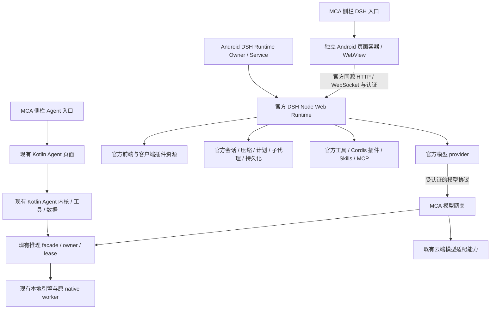

# MCA 内嵌原版 DSH 方案 V1

状态：方案，未实施。日期：2026-10-19。本文只确定用户最新要求的技术方向，不表示 Android 可运行、功能等价或生产验收已通过。

## 1. 本轮定案与历史方案的关系

用户最新要求：在现有独立 Kotlin Agent 之后，再增加独立 DSH 模式。DSH 使用官方代码、官方前端和官方工具/插件体系；MCA 提供该模式的入口与本地/云端模型。运行时位于手机，选择本地模型时不依赖电脑或远端 Agent 服务器。现有 Kotlin Agent 持续保留，后续独立优化。

据此，新增目标为 **与 Kotlin Agent 并列的原版 DSH Android 集成发行**。DSH 模式直接使用官方 Web profile、官方前端、原会话语义、原审批交互、原工具注册和 Cordis 扩展协议；其实现不借用或改造 Kotlin Agent 的执行循环。

本文只负责新增 DSH 模式；[项目工程合同](../../architecture/MCA_PROJECT_HARD_LOCK.md)继续生效。[V1.1 共核方案](../agent-chat-integration-v1/ARCHITECTURE.md)及既有 Kotlin Agent 方案仍是其各自功能的背景和计划，本轮不修改其实现或宣告优化完成。两条路线的边界为：

| 边界 | 两个独立模式的选择 |
| --- | --- |
| 执行内核 | Kotlin Agent 使用自身内核；DSH 使用官方内核；不强行共用 Agent loop |
| 前端 | Kotlin Agent 保留原生页面；DSH 使用独立 WebView 页面和官方前端 |
| 工具/Skills/MCP/审批 | 各自使用本模式体系；DSH 不绕进 Kotlin Agent 的工具与审批循环 |
| 会话与数据 | Kotlin Agent 保留原 Room/任务模型；DSH 原持久化独占自己的会话 |
| 模型资源 | 两者复用 MCA 原模型执行 owner、资源准入和精确取消，不各自加载模型 |
| 后续优化 | Kotlin Agent 独立演进；未来聊天转交需显式选择目标模式，不在本轮混合实现 |

实施前形成“独立双 Agent 模式”ADR。DSH 不替换、隐藏、降级、清理或迁移现有 Kotlin Agent；其任务仍可正常使用既有执行与恢复能力。当前只写方案，不实施任何一种内核的优化，也不更改已有前端工作。

## 2. 已核对的事实与版本

MCA 检查基线：HEAD `2368c72cec312f820e2452f2537302dcfc067805` 加当时未提交工作区；不能仅凭这个 SHA 复现全部 Agent 代码。三个子模块及其内部补丁必须另行记录。

DSH 固定基线：官方 [deepseek-ai/deepseek-harness](https://github.com/deepseek-ai/deepseek-harness/tree/687f282e8625c6b8d11ff58211a90524be2e4317)，commit `687f282e8625c6b8d11ff58211a90524be2e4317`，包版本 `0.2.1-rc.2`。本轮下载只读源码，没有安装依赖或执行其中脚本。后续升级单独评审，禁止跟随浮动 master。

| 事实 | 固定版本的源码证据 | 工程结论 |
| --- | --- | --- |
| 官方有完整 Web 发行入口 | `apps/web/package.json:2–4`；`packages/bundle/web-app/src/index.ts:124–126,206` | 使用官方前端和配套后端，不自行复刻页面 |
| 本机监听、随机端口、不打开外部浏览器均已支持 | `packages/bundle/web-app/src/startup.ts:64–68`；`cordis.patch.yml:178–190` | 可用于手机本机 WebView 宿主 |
| Web 有原审批、取消、流式和历史链 | `packages/api/session-controller/src/index.ts:513–515`；`src/history.ts:54–60,167–170`；`packages/client/ui-approval/src/client/index.ts:104` | 使用 Web 协议原链路；不能拿精简 SDK 代替 |
| 官方模型适配器支持 OpenAI 兼容自托管路由 | `packages/llm/llm-pi-ai/README.zh.md`；`src/index.ts:29–49` | 优先由 MCA 提供合规模型网关，DSH 使用现成 provider |
| 官方需要真正 Node 环境 | 根 `package.json:8–9`：`^22.19.0 || >=24.0.0` | 把 JS 塞进普通 WebView 不能代替 Node 后端 |
| 核心许可证 MIT | 根 `LICENSE`；前端/CLI package manifests | 可复用修改分发，保留版权和许可；依赖/插件仍分别审计 |
| MCA 是 minSdk 26 / targetSdk 36 | `gradle/libs.versions.toml:6–7` | 不降低目标 SDK 迎合第三方启动器 |

Android 参考项目固定为 [woaiys3/deepseek-harness-android-app](https://github.com/woaiys3/deepseek-harness-android-app/tree/98162a23b39eeeb75b8d4608b3e773bbb13be43d)。其 WebView、文件交互和平台补丁可参考；它不是官方 Android 支持证明，也不是完整功能通过证据。

## 3. 用户最终看到什么

左侧栏展示顺序固定为 **图片 → Agent → DSH**。Agent 打开已有 Kotlin Agent 页面；DSH 是新增的独立入口，打开 MCA 内部的官方 DSH Web 页面。保留官方会话、工具活动、审批、模型选择、插件设置、计划、文件与产物等已纳入发行基线的界面。

MCA 外层只处理进入/返回、启动中、启动失败、运行时退出与必要 Android 系统交互；不把 DSH 设置、历史和审批再复制成另一套 MCA 页面。官方页面内部保持原视觉和交互；MCA 聊天、生图、调参及其他页面的现有布局不随之调整。

继续保留现有导航标识语义：`AppTab.AGENT` 是既有调参入口，`AGENT_WORKSPACE` 是独立 Kotlin Agent，二者不能改成 DSH。DSH 拟新增独立稳定标识 `DSH_WORKSPACE`，按现有兼容合同追加枚举/持久化映射；展示顺序不靠挪动旧 ordinal 实现。恢复导航、返回栈、草稿、滚动和最后选择分别保存。已有前端优化可并行，但共享导航、根构建、资源 owner 和最终装配须由单一整合者修改。

## 4. 运行结构与职责

| 责任 | 唯一归属 |
| --- | --- |
| Kotlin Agent 的执行、数据、工具、审批和页面 | 原 Kotlin Agent 对应 owner，不因增加 DSH 改变 |
| DSH 决策、循环、工具调用、子代理、工作流与上下文 | DSH |
| DSH 会话历史、恢复、压缩、审批状态与插件配置 | DSH 对应官方 owner |
| DSH 前端、Web API、工具和审批展示 | DSH |
| Node 宿主启动、ready、崩溃、停止、后台生命周期 | Android DSH Runtime Owner |
| 模型目录、真实模型可用性、推理请求准入/取消和原生资源 | MCA 现有模型执行 owner；网关只做协议和身份适配 |
| Android 文件选择/保存、通知、外链和系统权限 | 窄平台适配；不包含 Agent 推理规则 |

“MCA 只提供入口和模型”仍需要 Android 运行宿主，这是让官方 DSH 在手机里运行的基础设施，不是另写一个 Agent。

两个 Agent 模式可以各自持有执行内核，这是产品明确需要的独立模式；禁止的是同一个任务被两个内核推进、同一业务数据被双写，以及为两个模式重复创建实际模型引擎。DSH feature 不依赖 Kotlin Agent feature 的内部代码，反向同样禁止；共享能力通过窄模型/平台契约提供。

新业务契约放在合适的现有契约区域或小型独立契约；不得让 feature 依赖 app/其他 feature 内部实现或 native。Service/IPC/Node 实现留在平台层，app composition 只接线。禁止扩大 MainCoordinatorHost、给 MainUiState 添加 DSH 全量业务状态或传万能 container。

## 5. Android 宿主：必须先验证的技术门槛

参考项目在 `MainActivity.java:3974–4101` 从可写的 `files/payload/runtime/bin/node` 用 ProcessBuilder 启动 Node，Manifest 的 targetSdk 为 28。Android 10 起对可写应用目录的可执行文件有明确限制，参见 [Android 官方说明](https://developer.android.com/about/versions/10/behavior-changes-10#execute-permission)。不能把解压、chmod、启动这条链直接搬到 MCA。

先验证以下候选，再选择一种，不同时建设两套宿主：

1. APK 内按 Android ABI 编译打包的 Node 共享库/JNI，在专属 Service 进程中运行。
2. APK 内合规打包的 Android 可执行宿主，验证真实安装路径、链接器依赖与 exec 行为。

两者目前均为候选，`NOT_RUN`。不得把 Linux ARM64 的 glibc/musl 包当作 Android Bionic 包，也不能仅将二进制重命名为 `.so` 即宣布完成。

宿主探针必须验证完整启动链：Node 版本、内部 loader、native addon 加载、官方 Web profile、官方前端和动态客户端插件资源、认证、会话持久化/锁、工具子进程。尤其 JNI 方案必须检查 `process.execPath`、`child_process.spawn/fork` 和 Node 自重启/重入语义；能跑 HTTP hello 不代表能跑 PTC、子进程和完整 DSH。

已确认需要 Android 检查/构建的依赖：

| 组件 | 原版依赖与风险 | 不允许的替代验收 |
| --- | --- | --- |
| Loader | boot resolver 使用 `node-addon-require-builtin` 和内部 ESM/CJS loader | 仅 Node hello 或单个 JS 模块通过 |
| system native / 文件锁 | 官方预构建以 Linux/macOS 为主，entry 有平台判断 | Linux ARM64 包下载成功 |
| 终端与子进程 | `node-pty`、`koffi`、shell、PTY/进程组 | 普通 pipe 冒充 PTY；resize 空操作冒充成功 |
| 附件与图像处理 | `sharp` | 浏览器能显示图片就认为服务端处理可用 |
| 存储 | `node:sqlite`、JSONL/压缩及锁语义 | 仅创建空文件 |
| PTC / workflow | Node 子进程和 sandbox 能力 | 加载插件成功但执行从未运行 |
| 外部工具 | Git、rg、Python、LSP 等真实可执行依赖 | 命令同名脚本或固定返回成功 |
| 沙箱 | Linux/macOS/Windows 实现不能自动等价于 Android | 设置一个 sandbox 标志但没有强制机制 |

需要平台替换时，优先实现官方 service/provider seam 或 Android Cordis 插件；仅在无扩展点时维护最小 upstream patch。每个补丁记录理由、上游路径、版本、测试和退出条件。不以关闭沙箱、删除工具、忽略错误来获得“完整 DSH”绿灯。

## 6. MCA 模型网关：不是只改 baseURL

DSH 优先使用官方 `llm-pi-ai` 的自定义 `openai-completions` provider，baseURL 指向受认证的 MCA 内部模型服务。这样 DSH loop 和前端无需为 MCA 分叉。

**当前阻碍已经源码证实：** MCA `OpenAiApiCompat.kt:136–140` 未把 tools/tool_choice 映射到请求；`:195–205` 不保留 tool 角色和 assistant tool_calls。SSE 的 `McaLoopbackServerProtocolCodec.kt:384` 固定输出 `finish_reason=stop`。现有 Local API 是兼容子集，部分未实现字段可能静默忽略，不能视为完整工具协议。底层本地 messages 序列化和工具模板也需核实；只补 HTTP JSON 字段不够。

拟新增内部 DSH 模型网关，而不是擅自重写现有公共 Local API：

- 复用适用的协议代码和原模型执行 owner；其启动不隐式开启用户的局域网/公共 Local API 服务。
- 仅监听 loopback，保留认证；DSH 使用专用、可撤销、限制用途的凭据，不得到 MCA 云服务原始密钥。
- 提供真实模型目录、上下文/输出限制和能力；官方模型选择界面使用该目录，不另建一套 MCA 模型配置 UI。
- 本地模型的加载/切换仍通过现有授权用例和资源准入；不能由网关绕开模型生命周期或任意抢占聊天/生图。
- 工具 schema、tool_choice、assistant tool_calls、tool_call_id、tool result、并行调用的关联和顺序必须保真。
- 推理侧正确套用该模型实际支持的工具模板/解析器；DSH 得到合法的工具调用事件，工具本身只由 DSH 执行。
- 流式支持 text/reasoning/tool 参数片段及严格终态、usage、错误；不把 length、异常 EOF、取消或解析失败改写成 stop。
- 云端走 MCA 既有云端适配能力；若既有能力不满足字段与终态合同，精确补齐，不新建独立的第二套云模型账号与密钥存储。
- 网关不拼接普通聊天的角色、记忆、搜索或历史；请求上下文由 DSH 负责，防止两套提示词系统叠加。

若现成 provider 无法无损表达 MCA 模型协议，允许新增一个 `mca-model-provider` Cordis 插件，使用官方 `LlmAdapter.stream/listModels/resolveModel/prepareCall` seam。该选择必须有协议实测证据，仍不改 loop；不能同时长期维护两条未经区分的网关路径。

缺乏模型原生工具能力时，可以在 provider 层研究提示词兼容协议，但它是有明确能力标签和独立测试的适配模式，不能冒称原生 tool calling 或相同任务质量。复用同一 DSH 不会让小模型自动获得大模型的推理与工具可靠性。

## 7. 请求、并发、停止与生命周期

DSH 可以并行运行子代理和工具，但本地模型请求与 Kotlin Agent、聊天和 API 一起进入 MCA 原准入与 lease；资源不足时排队或按现有合同报 busy，不创建第二个 native loader。等待工具、审批或用户时，不持有不必要的推理 lease。两模式可保有各自活动任务，但实际共享资源能否并行由唯一执行 owner 决定，不以界面切换隐式抢占。

模型网关维护显式关联：`runtimeEpoch + DSH call identity → MCA requestId/attempt/lease`。官方 provider 如不能直接携带 sessionId，不伪造来源；由最小 provider/传输扩展补关联或以网关 call identity 精确绑定。取消按实际请求身份，不调用全局 stop 清空其他入口。

DSH cancel、AbortSignal、HTTP 断连、Android Service 停止和 Node 崩溃分别映射到自己的在途请求。Node 已退出、Flow 已结束、stop token 消失、supervisor 终态都不能单独证明 native 已停；释放 lease 必须取得原 worker/native 精确停稳证据。超时保持停止 fence，不让新请求复用未知资源。

Runtime Owner 状态拟为 `STOPPED / STARTING / READY / STOPPING / FAILED`，带运行代次；只描述宿主，不复制 DSH 会话状态。重复进页只附着同一个宿主，不重新启动整棵 DSH tree。Activity/WebView 不持有 Node 的生命周期权威。DSH 默认按需启动，不随进入 Kotlin Agent 或普通聊天而预加载；返回/切模式不自动取消任一模式的任务。

启动 ready 必须等待官方 Loader tree 稳定、认证入口与客户端插件资源就绪；页面不可把端口已打开当完整 ready。服务生命周期、前台通知、后台限制依 targetSdk 36 实测，不以 START_STICKY 承诺永不被杀；退出页面不自动终止任务。通知/停止 action 必须区分 Kotlin Agent 与 DSH 及各自代次；停止 DSH runtime 不得关闭共享模型 owner 或停止 Kotlin Agent 的调用。

进程死亡后按官方会话日志恢复事实，不自动重做未知副作用。新宿主代次撤销旧模型凭据/连接；在途调用结算与资源停稳独立核对。计划/定时功能还需 Android 调度与重启补触发语义，不能声称进程内 timer 在手机休眠/杀进程后仍可靠。

## 8. 官方前端、认证与 Android 交互

使用官方 Web 服务的同源 URL，候选启动参数为 `dsh --profile web --host 127.0.0.1 --port 0 --no-open`，具体启动由选定宿主实现。不用 `file://` 打开 dist，不只拷贝 index.html；必须包含官方 boot 注入、`/plugins/.../client.js` 等动态资源与配套后端。

保留 DSH 原 launch-token → HttpOnly/SameSite Cookie → 清洁 URL 流程及 Host/Origin 校验。随机端口不是认证；不得开放到任意网卡，不输出可用 token 到普通日志、崩溃报告、页面历史或外部 Intent。

WebView 只把认证交给自己的 DSH origin，外链交 Android 受控打开；拒绝外站获得原生桥或认证 token。需要桥时仅提供文件选择、保存等小型能力，按来源和路径验证，禁止 `exec`、反射或任意文件读写万能桥。

真实检查至少包括：上传/下载、附件、多文件、SAF 取消、分享、剪贴板、弹窗/外链、返回层级、滚动恢复、键盘/组合输入、大字体、软键盘遮挡、深浅色、窄屏、断线重连、Cookie/会话恢复与可访问性。

优先由 Android 宿主补交互。确需移动样式补丁时限制在移动适配层并单独截图验收；不得以适配名义重做 DSH 信息架构或混入 MCA 其他页面视觉变更。

## 9. 插件、工具和真实隔离边界

复用原 npm/Cordis 插件加载、依赖注入、生命周期、前后端插件资源、Skills 和 MCP。不要将插件转换成 MCA 自定义 manifest，或让 DSH 工具再绕进 Kotlin AgentToolRegistry。Android 控制/SAF/系统权限可由新的 Cordis 平台插件提供，MCA 只提供必须的系统能力端口。

兼容分三个独立结论：插件协议兼容、依赖能安装/加载、实际功能通过。纯 JS 插件最接近直接复用；native addon、桌面浏览器、PowerShell、外部 CLI、Linux 沙箱等依赖需要真实 Android 支持。任意未来第三方插件“全部原样可运行”不是可验证承诺。

普通 `:dsh` Service 进程与 MCA 同 UID，只隔离崩溃和部分生命周期，不阻止插件使用 Node fs/net/process API 访问同 UID 资源。DSH 官方 [SAFETY.md](https://github.com/deepseek-ai/deepseek-harness/blob/687f282e8625c6b8d11ff58211a90524be2e4317/SAFETY.md)也明确其为未安全审计的开发预览。

宿主必须明确二者区别：

- 单 APK 普通进程方案把 DSH 及安装的插件视为应用内受信任可执行代码。保留原审批策略，不复制参考 app 的 `danger-full-access + approval: never` 默认；但是审批和路径约定不构成对恶意 npm 代码的隔离。
- 若验收要求任意不可信插件不能接触 MCA 私有数据库/凭据，必须采用额外 UID/有效 OS 隔离。单 APK isolatedProcess 需要文件描述符、存储和网络代理适配；独立签名 runtime APK 则增加分发/安装成本。二者须先探针，不能假定普通多进程已满足此要求。

先明确可信代码合同，再确定宿主；不得在报告中把同 UID 方案描述成强隔离。模型密钥不下发 DSH、目录分离和凭据缩权能缩小风险面，但不能抵消同 UID 的文件访问能力。

本机运行不等于全离线。选择本地模型且工具/插件都不联网时可离线运行；云模型、MCP 远端、搜索和在线插件安装需要网络。若提供“全离线”强开关，必须覆盖整个 DSH/plugin 进程的网络出口；仅限制 MCA 模型网关不能保证任意 Node 插件离线。未经有效机制验证，不展示强隔离/全离线保证。

## 10. 数据、已有实现与上游升级

新会话采用官方 DSH home/workspace/配置/日志格式，DSH 为唯一 writer。MCA 不把 JSONL 双写进 Room，不把官方事件重建成另一个可编辑任务状态机。必要的导航引用只存 `runtime/profile/session` 稳定身份及最小显示信息，重建失败不得篡改官方日志。

DSH 数据目录与 MCA 聊天/模型/Kotlin Agent 数据逻辑分离；SAF 授权导入导出，备份/设备转移策略随真实敏感内容评审。逻辑目录分离不能写成 OS 安全隔离。清空 DSH 历史、卸载 DSH 插件或重置其配置不能清空 Kotlin Agent；反向亦然。

已有 Kotlin Agent 的代码、入口、任务、历史、审批、工具配置与恢复保持独立且可用。本次不建设两种格式的迁移，不将 Kotlin 任务只读归档，也不把 Room 事件猜成 DSH 日志。两种模式的 session/task ID 使用明确命名空间；未来转交只能创建新的目标会话并保存来源引用，需要独立授权和协议，不能用切页把在途任务改换内核。

原普通聊天仍由原 owner 执行。未来聊天转交可明确选择 Kotlin Agent 或 DSH，只转交用户选中的材料并保存目标回执与引用；本轮不实现这项功能，不自动路由或上传全部历史/文件。

维护分为三层：官方源码/发行闭包、Android 平台补丁、MCA 宿主与模型适配。记录上游 SHA、lockfile、所有 npm/native 依赖、Android ABI/API、构建参数、许可证、校验和与补丁。禁止在 node_modules 原地手改而无来源记录。

升级先跑现有官方相关测试与 Android/网关契约回归，再用旧会话 fixture 验证。数据写入新格式后不承诺简单 APK 降级可回退；保留可验证快照、前向修复或官方支持的回退方案。原 MCA 二进制/模型配置/旧会话不能成为这次集成的牺牲品。

## 11. 完整对齐的定义与门槛

“就是 DSH”指固定版本的官方程序、官方前端和扩展协议真实运行，不是 UI 相似或工具数量接近。不承诺不同模型在任务质量上与同版本桌面大模型结果一致。

实施 R00 必须从选定 profile 实际装配树生成发行清单：服务端/客户端插件、工具、命令、Skills、MCP 传输、native 依赖、默认配置、可选实验包。逐项分为本次必需、上游可选、平台依赖待适配；不能把原本必需的失败项改成可选逃避验收。

每一行同时记录 `复用来源 / Android 适配 / 对照用例 / 原版结果 / 手机结果 / 未验证条件 / 证据`，覆盖至少：

| 能力族 | 关键行为 |
| --- | --- |
| 会话 | 创建/历史/恢复/fork/steer/queue，崩溃后的未知副作用 |
| Agent loop | 多轮工具往返、错误、重试、流式、最大输出/上下文与取消 |
| 上下文 | 压缩、裁剪、回放、持久信息关联 |
| 目标与计划 | goal/plan/todo/rounds/继续执行与边界条件 |
| 子代理 | 创建、通信、等待、取消、资源竞争与持久谱系 |
| workflow/PTC | 真执行、隔离、超时、输出和恢复 |
| 工具与终端 | 文件/搜索/编辑/网络/PTY/进程组及真实依赖 |
| 扩展 | Cordis 插件安装/加载/配置/卸载、客户端扩展、Skills、MCP |
| 工作成果 | 附件/文件/产物/展示/导入导出 |
| 长期运行 | schedule/jobs、后台/休眠/杀进程/重启语义 |
| UI | 官方各功能页、审批、权限、错误、移动交互和重连 |
| 双模式共存 | 图片→Agent→DSH 导航、分别恢复/清理、Kotlin Agent 原任务继续可用、模型竞争和精确取消互不串扰 |

只完成 Node/WebView/文本对话只能叫宿主验证。只完成一部分能力只能记录实验进度，不能发布“完整 DSH 已对齐”的结论。真实阻碍保留 FAIL/BLOCKED/NOT_RUN，不以 mock、源代码存在或旧报告替代。

下一步只应实施 [执行包](EXECUTION_PACK.md)中的有限探针，先证实 targetSdk 36 的官方 Web/工具/模型闭环，再投入大规模适配。该结论支持直接复用的方向，尚不构成运行成功证据。
