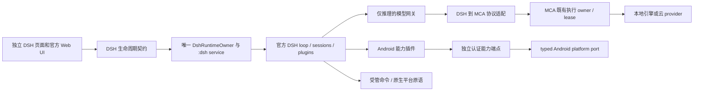

# DSH 详细补齐方案 V1

日期：2026-10-20。类型：架构与实施准备方案。状态：待执行，不代表生产验收通过。

本轮只形成方案与交接材料，不修改生产代码，不构建、不安装、不操作设备。本方案承接 ADR 0003 与既有 R00–R08，新增补齐任务使用 C 编号，避免把历史实施任务重新计作交付。

配套文件：

- [实施任务包与执行提示词](DSH_COMPLETION_EXECUTION_PACK_V1.md)：按依赖执行的任务卡、文件所有权、交接格式。
- [验收规范与证据矩阵](DSH_COMPLETION_ACCEPTANCE_V1.md)：确定性探针、模型任务、故障注入、发布门禁。
- [C07/C08 可行性与 PTY 决议](DSH_COMMAND_AND_PTY_FEASIBILITY.md)：2026-10-20 对命令闭包、包装脚本 EACCES、JS PTY 与 node-pty 边界的只读决议。该备忘的 F1/F2 已经 Lead 复核更正：home 级 overlay 会被官方读取；以本方案 §5.0 为准。
- [项目架构合同](../../architecture/MCA_PROJECT_HARD_LOCK.md)：优先于本方案的工程约束。
- [双 Agent 决策](../../adr/0003-dsh-embedded-dual-agent-modes.md)、[原架构](ARCHITECTURE.md)、[原执行包](EXECUTION_PACK.md)：背景与既有边界。本方案修正其中已过时的事实描述，不覆盖历史证据。

## 1. 目标、成功定义与不可变边界

目标是把已经能进入官方前端、选择模型并完成本地调用的 DSH，补成可执行真实任务、正确停止和恢复、可靠安装插件、可持续升级的手机本地运行模式。

产品结构维持“图片 → Agent → DSH”。Kotlin Agent 与 DSH 是两个独立模式。DSH 的 Agent loop、会话、工具调度、审批、子 Agent、压缩、技能与插件管理沿用固定版本的官方实现；MCA 负责 Android 宿主、必要平台适配、模型网关和资源仲裁。不得再用 Kotlin 复制一套 DSH 业务循环。

“功能对标”有四个独立层次：

| 层次 | 达成条件 | 不能作为替代证据的事项 |
| --- | --- | --- |
| 官方代码与配置覆盖 | 固定上游 revision 的功能逐项找到生产调用路径 | 包存在、页面存在、静态数量 |
| Android 平台语义 | 锁、文件、命令、终端、信号、停止与依赖真实等价或明确报错 | no-op、管道冒充 PTY、字段宣称沙箱 |
| 模型协议完整性 | 请求、模板、工具、上下文、终态真实贯通 | fake gateway 单测代替实际 adapter |
| 用户任务成功 | 固定任务正确执行、产物可检查、失败可恢复 | 生成结束、文字声称“已完成” |

只有固定版本、固定 profile 的完整功能映射和适用验收全部闭环，才能声明对应范围的对标完成。不能承诺所有未来 DSH 版本、任意桌面插件或任意模型都天然等价。

必须分别说明：运行时在手机本地、推理在手机本地、工具与依赖可完全离线。这三项不是同一件事。云模型属于可选配置；本地任务不能暗中依赖云端主模型、辅助模型或网络工具。

## 2. 事实基线与证据解释

### 2.1 基线身份

- 当前分支：`codex/enterprise-refactor`。
- 读取时起点 HEAD：`1965bed836de40610948d92e2e1bb62890635d93`；撰写时当前 HEAD：`68b6eef1e67870b02bfef6afda2e625d36663da9`（12:25 提交，1965bed 为其祖先）。工作区有大量既有修改和未跟踪生产模块；HEAD 不能单独代表当前源码，C00/C15 必须按实际工作树重新绑定指纹。
- 子模块 revision：llama.cpp `4ceb1719101f32637b841206c172f3f058ffc182`；stable-diffusion.cpp `16b3846acfdf2c9499a3ac0c3d5d2914ebe859a0`；tokenizers-cpp `acbdc5a27ae01ba74cda756f94da698d40f11dfe`。三者均存在既有内部差异，后续构建需绑定实际补丁指纹。
- 官方源基准：[能力清单](CAPABILITY_MANIFEST.json)记录 DSH `0.2.1-rc.2`、revision `687f282e8625c6b8d11ff58211a90524be2e4317`。源归档的 commit 标记不是本地 Git 可重推导的证明，应保留该来源局限。
- 当前 Android 参考包来源：`woaiys3/deepseek-harness-android-app` v1.20.1；[payload lock](../../../scripts/dsh/payload-lock.json)中的 payload SHA256 为 `975146516216ced02299676689c1731c7f390962389dbef56821cd59a3bf69ab`。

上述归档已经包含 Android 补丁，不能称为“未经修改的官方运行包”。必须分开管理官方源码、参考项目补丁与 MCA 补丁。

### 2.2 已有真机证据

[05:12–05:18 原始记录](../../../artifacts/dsh-verify/20261020-051217/FINAL-RELEASE-VERIFY.md)绑定 APK SHA256 `b610e1d0d29195e966e705a4a5113f46d8601a16349f45bedb98954ace73ae9a`。已有入口、官方 UI、模型列表与实际切换、本地回合返回、离页再入同一 Node、短回归无 crash/ANR 的成功证据。

该回合要求 `DSH-OK`，实际离题，且只产出离题文字、没有实际调用工具。因此它不能作为命令或工具可用的证据。本方案承认“调用链完成”，把“严格任务遵循”记为失败样本待诊断；原记录将其归为仅模型质量问题，本方案不采纳未经分层定位的归因，也不改写原记录；命令链与配置层修复前，不把工具失败归因于模型质量。— 归档可确认。

`n_ctx=16384` 只适用于当时 Qwen3.5 0.8B MNN、模板、完整 DSH 输入及有效参数组合；不能推广为所有模型默认值。云端成功回合未在这次短回归复测；此前上游 503 不能记为成功。

旧 R07 汇总仍有 PENDING。后续创建新的证据索引，逐条引用原日志、产物身份和适用范围；不能批量把旧 PENDING 改成 PASS，也不能让过时汇总否认更新的原始证据。

### 2.3 当前实现与缺口

| 编号 | 当前事实或风险 | 性质 | 补齐优先级 |
| --- | --- | --- | --- |
| G01 | 停止失败后 service 仍可能自行关闭，FAILED 通知显示“已停止” | 源码可确认的错误分支 | P0 |
| G02 | 主进程重建网关，存活 Node 可能保留旧端口/令牌 | 源码推导风险，未真机复现 | P0 |
| G03 | payload 的 flock native binding 缺失时返回总成功 | 已读取归档确认，尚未做竞争探针 | P0 |
| G04 | hardlink 失败后的 stat→rename 有并发覆盖窗口 | 已读取归档确认 | P0 |
| G05 | sandboxMode 声称 workspace-write；`bash-local` 硬编码该声明且从不调用 `ctx.sandbox`，不能证明 enforcement；`bash-sandbox` 在无 Landlock runner 时 fail-closed，`danger-full-access` 则直接走非隔离分支 | 归档可确认；真实执行边界待设备探针 | P0 |
| G06 | DSH 请求仍可能被添加 reasoning 指令、被通用上下文准入裁历史 | 源码可确认的路径；实际模型影响待定位 | P0 |
| G07 | named 被降为 required，required 无调用仍可能成功，真实 LENGTH 未贯通 | 源码可确认的语义缺口 | P0 |
| G08 | `bash` 实为指向 `/system/bin/sh` 的符号链接（mksh）；`npm/npx/pnpm/pip` 包装脚本在可写目录，targetSdk 36 下 execve 可被拒（EACCES）；Python PATH 入口被 relink 但运行时身份未验证；package bins/shebang 执行链不完整 | 源码/归档可确认；设备 EACCES 与实际执行待复现 | P1 |
| G09 | payload 已有纯 JS ptmx/pts 真 TTY，但 resize 空实现、无 controlling tty/会话/前台组，失败静默回退管道；node-pty 未安装 | 归档可确认；/dev/pts 可见性、^C 归属、resize 实效待设备探针 | P1 |
| G10 | 模型列表以启动快照为主，缺 applied revision 闭环 | 当前实现限制 | P1 |
| G11 | Android 能力已有契约/fake，尚无生产工具桥 | 当前实现限制 | P1 |
| G12 | 有校验安装，无候选真实启动后提交及完整恢复事务 | 当前实现限制 | P1 |
| G13 | 多模态、本地 native tools、各云传输 fidelity 尚不完整 | 当前能力边界 | P2，但完整对标前必须验收 |
| G14 | MCA seeder 只生成 permission/workspace-controller/llm-pi-ai 三条顶层 row 的 home overlay，未复制或合并 payload 模板 `dshhome/cordis.patch.yml`（79 行：disable bash-sandbox、insert bash-local 与参考 Android 工具行等）；home overlay 本身被官方读取，缺的是平台 patch 合并。Android 上 bash-sandbox 仍启用，配合默认 workspace-write 与无 Landlock runner，bash 工具预期 fail-closed（SANDBOX_UNAVAILABLE） | 源码可确认（seeder/官方 boot）；归档可确认（模板）；设备失败待复现 | P0 |

P0 先保护数据、停止事实与协议语义；P1 补完整任务生态；P2 扩展能力。这个顺序不代表允许删掉后两类后宣布完整对标。执行顺序按用户要求固定为：先停止误报、真实文件锁、原子文件发布、请求二次裁剪与工具协议缺口，再补终端、插件和平台能力；G14 配置生效层是工具生态入口，排在上述前五项之后、C07 之前，作为 C07/C08/C09/C11 证据的前置，不改变前五项顺序。

## 3. 架构与文件所有权



| 位置 | 权威职责 | 禁止扩张 |
| --- | --- | --- |
| `core/dsh-contract` | 平台无关 DTO、错误与窄操作协议 | Android/Compose/engine 类型 |
| `core/dsh-runtime` | Node 生命周期、退出证明、payload 与宿主配置 | 模型业务、第二套 DSH session store |
| `api/dsh-gateway` | 内部 HTTP/SSE、认证与协议校验 | 工具执行、云密钥存储、直接创建 engine |
| `app/.../dsh` | 模型目录、MCA 请求映射、call registry | Agent loop、自动执行工具 |
| `app/.../composition/DshGatewayAssembly.kt` | 主进程网关实例生命周期 | 提示词规则、协议解析与迁移算法 |
| `app/.../composition/DshModeAssembly.kt` | 两进程生命周期连线 | 通过吞停止异常强制新开 Node |
| `feature/dsh-workspace` | WebView、展示与页面交互 | 持有 runtime/native、修改 DSH 数据 |
| Android 能力服务与平台实现 | 复用现有 capability DTO，系统交互与结果结算 | 放入模型 gateway，Activity 缓存在单例 |
| native 适配 | 必需的锁/原子文件/PTY/启动原语 | Kotlin/native 再造插件管理器或 loop |

所有模型调用仍经既有 MCA 执行 owner 与资源 lease。DSH Node 是独立宿主，不是第二套推理引擎。聊天、Kotlin Agent、生图与 DSH 的竞争沿用现有资源仲裁；不因 DSH busy 就取消无关入口的任务。

共享契约、全局执行参数、composition、构建脚本由整合者独占写入。并行工作者只写任务卡授权范围。不得新增 MainUiState 根状态写权限、大 Host 成员、Any 注入或全局 scope。既有大文件按真实职责抽出小组件，不靠重命名或大量纯转发缩行。

## 4. 生命周期、真实停止与网关重绑

### 4.1 保留 host 五态，增加独立健康投影

保留 `STOPPED / STARTING / READY / STOPPING / FAILED`。READY 仅表示宿主官方服务就绪；模型连接、目录应用、WebView 首帧、任务成功分别验证。

新增窄维护契约，建议三项操作：`inspect`、`requestBindingUpdate`、`queryCommand`。沿用原 client 的启动/停止。命名是建议，最终字段须经契约审查；不得由每个工作者各增一套接口。

建议身份：

```text
HostIdentity = serviceInstanceId + epoch
GatewayIdentity = gatewayInstanceId + generation
BindingRevision = 不含端口令牌内容的随机/版本身份
MaintenanceCommand = protocolVersion + commandId + expectedHostIdentity
                   + desiredGatewayIdentity + desiredCatalogRevision
```

service 或 gateway 重建必须换 instanceId。不能比较两个进程各自从 1 起算的 epoch，就认为它们同代。PID 只用于诊断和进程树核验，还需启动身份避免 PID 复用误杀。

保留现有 `dsh:<runtimeEpoch>:<requestOrdinal>` 外部 callId 及路由兼容；额外宿主/网关身份内部携带，跨版本字段有默认与 Unsupported 语义。不能借修复直接改掉已有 API 身份格式。

维护投影至少区分 `BOUND / BINDING_STALE / RECONFIGURING / UPDATE_PENDING / QUIESCED / OUTCOME_UNKNOWN`，不写进全局聊天状态。它是实际 owner 状态的只读投影，不另建业务 writer。

### 4.2 停止算法

1. 使用 expected HostIdentity 进入现有停止 fence，阻止该代新启动和新派发；其他模式不受影响。
2. 让 DSH 处理可用的官方取消/关闭流程；同时按既有 request identity 取消该代模型请求，等待真实 engine lease/停止结算。
3. 分阶段结束已识别的 Node/工具/PTY 子树。超时策略必须明确 TERM、宽限、KILL 与核验预算；预算从现有实现与真机基线确定，不写一个任意全局超时冒充正确性。
4. 检查 tracked 进程、同 UID 的相关孤儿及身份；扫描失败/权限不足为 UNKNOWN，不能当空集合。
5. 确认退出且相关资源结算，才提交 STOPPED、撤前台通知、关闭 service 与网关资源。
6. 超时或证据不足：FAILED/STOP_TIMEOUT，保留 fence、可见通知与再次核验/停止入口。UI 显示“停止未确认”。不得继续 `stopHostAndSelf()` 或启动第二个 Node。

网关在停止开始时应关闭该代新请求准入；不能等清理 service 才禁止新调用。关闭监听或撤凭据不等于已经取消并释放旧推理。若安全原因提前撤销认证，仍需独立完成活动请求结算与停止证据。

跨进程结算来源必须接实：由 app 既有执行 owner 基于 `EngineStopSettlement`（Released/NotDispatched 才构成释放事实）提供绑定 HostIdentity、gateway/call、MCA requestId、requestEpoch、load incarnation 的只读回执；翻译成平台无关 DTO，经窄、版本化 IPC 汇总到停止 fence。`:dsh` owner 不导入 engine/native，也不能自行推断其空闲。发 cancel、Flow finally、registry 注销、main/Binder 消失均不是释放证明；证据记录被淘汰也只能 UNKNOWN。Node 已退出但回执未齐时，停止工作流仍保持未结算，保留 fence/通知；Node 存活事实、host 阶段和组合停止结果分别记录，不用一项代替另一项。

UNKNOWN 的恢复有明确出口：优先向仍存活的原执行 owner 查询同一身份或再次核验停止；若原资源进程已死亡/运行时已重建，必须由资源 owner 核对原进程启动身份、load incarnation、当前资源/lease 与无旧执行证据后给出可审查的生命周期结算。不能只因 main PID 换了就释放。仍无法证明时保留显式恢复所需状态及诊断，禁止无声自动解锁。未结算记录必须有界保留并限制新的准入，不能靠清空记录或无限增长解决。

`DshModeAssembly` 不得把所有 FAILED 等同已退出。`restart()` 必须在同代真实停止证明后才能建立新代；原 client 中“READY 时 restart 返回现有 host”的语义继续保留，维护重启走明确编排。

### 4.3 重绑优先热更新，先做有界可行性验证

当前 `dsh-llm-pi-ai` 已见 `loader/volatile-update`、每 operation 的不可变快照、逐请求 credentials resolve，以及 profile `patchReload: live`。这提供接点，但不证明写 YAML、改环境或 endpointHolder 就会让存活 Node 用上新令牌。

先完成四个可审查输出：官方设置/Loader 更新入口、仅内存凭据 provider 的合法扩展点、实际 applied revision 的可观测方式、在途 operation 与新 operation 的快照规则。

目标事务：

1. 新 gateway 健康且认证探针通过；生成新身份与 desired revision。
2. 宿主对比 Node **实际 applied binding**，不能只读 Kotlin holder。
3. 以 commandId 和 expectedHostIdentity 提交更新。官方扩展原子建立新 provider/目录/凭据快照。
4. Node 使用新配置执行无业务副作用的 health/catalog 校验，确认 applied identity/revision。
5. 仅收到该确认后投影 BOUND。旧 operation 用旧快照结算；若旧网关已随进程死亡，旧调用应明确失败/未知，不能自动转发重放到新网关。
6. 在途请求排空后撤旧凭据/旧监听；中间失败保留可证明的旧配置或显示待重连，不伪报更新成功。

临时 MCA gateway token 不写进默认 DSH 持久化凭据库、报告或日志。日志关联使用独立不敏感身份，不输出 token 或其可用于关联的摘要。

若官方热更新无法满足一致性：只有完整 quiescence 证明成立，才允许受控重启。没有可靠空闲证明时，显示需要停止当前工作后重连，等待用户明确停止；不得按“几秒没 token”自动杀宿主。

### 4.4 空闲证明与幂等

空闲必须同时满足“官方侧准入屏障”与“同一代实际活动归零”：turn、收尾中的工具、子 Agent、job、PTY/子进程、插件安装/配置写事务、待审批/待回答可继续任务、持久化提交，以及 gateway 调用和 MCA lease。扩展后台活动无法枚举即 UNKNOWN。

控制扩展只负责观测和关闭官方准入，不能镜像 loop。proof 绑定 HostIdentity、barrier sequence 与 revision；同一屏障内消费，新活动使之失效。仅模型调用数为零、UI 无转圈、RPC 返回 idle 都不足以形成 proof。

commandId 相同且身份/请求一致：进行中返回 IN_PROGRESS，完成后返回原结果；payload 不同返回 CONFLICT，旧代返回 STALE_GENERATION。派发后断连先查询；未知为 OUTCOME_UNKNOWN，不重放业务副作用。service 重建丢失命令记录时，只恢复当前可证明事实，不伪造旧命令成功。

锁只用于预留操作与原子状态提交，长 IPC/IO/官方回调在锁外等待，再持锁校验身份后提交。不得长持 Kotlin mutex 调用 Node、平台 UI 或插件。所有 scope、deadline、取消与清理均由既有 owner 管理。

## 5. 运行包语义审计与原生能力

### 5.0 配置生效层与真实执行体（P0 前置，2026-10-20 追加）

2026-10-20 可行性备忘的 F1/F2 曾把 home 级 overlay 误判为不生效。该判断已由 Lead 复核更正，本节以复核结果为准：官方启动确实读取 `$DSH_HOME/cordis.patch.yml`，并把 home 级用户层叠加在 per-profile 层之上。本节新增结论按“源码可确认 / 归档可确认 / 待设备复现 / 未验证”标注；没有标注实施状态的事项均属待执行方案，不代表完成结论。

证据：

- `payload/dshroot/lib/node_modules/@deepseek-ai/dsh/lib/profile-boot-C14i-8IN.js` 的 `homePatchPath()`（约 109–117 行）说明该文件是 home-level user patch layer，并在 `runProfile()`（约 272–302 行）boot 前把 `readProfilePatches(...)` 交给 `boot`。— 源码可确认。
- `.../dsh-app-boot/lib/index.js` 的 `readProfilePatches()`（约 1127–1137 行）按 bundle→profile patch→`join(context.home, "cordis.patch.yml")`→`--patch` overlays 的顺序装载。— 源码可确认。
- [05:12 真机回合](../../../artifacts/dsh-verify/20261020-051217/FINAL-RELEASE-VERIFY.md)的 provider 显示“MCA”、模型列表来自 MCA 网关；这些内容只可能来自 `DshGatewayConfigSeeder.buildOverlay()` 写入的 home overlay，可反证 overlay 生效。该回合没有实际工具调用，不能反证工具可用。— 归档可确认。

真正缺口是平台 patch 未合并，不是 overlay 路径错误。[DshGatewayConfigSeeder.kt](../../../core/dsh-runtime/src/main/java/com/muyuchat/core/dsh/runtime/config/DshGatewayConfigSeeder.kt) 的 `PROFILE_TEMPLATE_FILES` 只复制 `cordis.yml`、`package.json`、`pnpm-workspace.yaml`，另外复制 `settings.yaml`；home 根 `cordis.patch.yml` 由 `buildOverlay()` 生成，只有 `permission`（`defaultPreset: workspace-write`、`approval: ask`）、`workspace-controller`、`llm-pi-ai` 三条顶层 row。它没有复制或合并 `payload/dshhome/cordis.patch.yml`（79 行），后者含：disable `bash-sandbox`、`pwsh-sandbox`、`session-log-download`、`session-telemetry-otel`；insert `bash-local`（cwd 取 `DSH_WORKSPACE`）、`tool-shizuku`、`tool-android`、`tool-accessibility`、`tool-vscreen`、`tool-browser`；permission 的 `defaultPreset` 是 `danger-full-access`（该档 `approval: never`；read-only/workspace-write 才是 `ask`）。— seeder 与归档均可确认。

后果链（源码可确认，设备失败面待复现）：

- `dsh-base/cordis.patch.yml` 只在 win32 禁用 `bash-sandbox`（约 249–251 行）；`sandbox-policy.mode = process.env.DSH_PERMISSION_MODE ?? 'workspace-write'`（约 243–247 行）。[DshNodeCommand.kt](../../../core/dsh-runtime/src/main/java/com/muyuchat/core/dsh/runtime/process/DshNodeCommand.kt) 的环境列表没有 `DSH_PERMISSION_MODE`，所以 Android 上默认是 `workspace-write`。
- `dsh-bash-sandbox` 在 mode 不是 `danger-full-access` 时调用 `confine()`；Landlock runner 来自 `@deepseek-ai/node-addon-system-<platform>-<arch>`。payload 的 `node-addon-system` 只声明 darwin/linux optional 平台包，全树无 `.node`，所以 Android runner 不可用，bash 工具预期以 `SandboxUnavailableError` 失败（`SANDBOX_UNAVAILABLE`）。这是源码推导，尚未在设备上触发；必须抓一次真实失败/成功面，不能写成已复现。
- 若反向继承模板的 `danger-full-access` 默认，`dsh-bash-sandbox` 会直接调用非隔离执行分支（约 68–74 行），命令能跑但没有任何沙箱。MCA 明确拒绝该默认（seeder 注释与 `buildOverlay` 默认可确认），也不得把这条路径写成“沙箱生效”。

合并方案（表内为 V1 决策；均尚未实施）：

| 模板行 | V1 处理 | 理由与边界 |
| --- | --- | --- |
| `bash-sandbox: disabled: true` | 保留，并入 MCA 管理的有效 patch 集 | 只禁用 bash 执行器，不能顺带禁用 `sandbox`/`sandbox-policy` 服务；模板注释说明粗粒度禁用 sandbox 会让 ptc-runtime 永久 pending，导致所有 preset 会话 create/resume 失败（归档可确认） |
| `pwsh-sandbox: disabled: true` | 保留 | Android 无 pwsh；与 dsh-base 的非 win32 禁用一致，避免启动 pending |
| `session-log-download: disabled: true` / `session-telemetry-otel: disabled: true` | 保留为显式平台裁剪，登记入能力清单 | 移动端不提供 ZIP 日志下载与遥测；若产品要求保留，删除该行并单独验收，不能默认当作官方通用行为 |
| `permission`（`defaultPreset: danger-full-access`） | 不继承，以 MCA 的 `permission` 条为唯一权威：三档 preset 均 `approval: ask`，`defaultPreset: workspace-write` | 危险默认不得进入 V1；`danger-full-access` 仍可作为显式未隔离模式存在，但 UI/能力清单必须写明“无沙箱”，且不得作为默认或对标完成证据 |
| `insert: bash-local` | 保留；`cwd` 取 MCA 注入的 `DSH_WORKSPACE`；缺失时拒绝启动或回退到已定义工作区，不能让 `process.cwd()` 的偶然值决定 | 该行让 `ctx.shell` 由 bash-local 提供；`timeoutMs` 是超时不是沙箱；实际执行体仍是 `/system/bin/sh`（mksh），不得宣称 GNU Bash |
| `insert: tool-shizuku/tool-android/tool-accessibility/tool-vscreen/tool-browser` | 先核对包可加载性与 Android 授权/依赖，再决定是否并入；缺包、缺依赖或启动 pending 的行不得进入有效树 | payload 内存在这些包（归档可确认），但工具可用性依赖 Shizuku、Accessibility、vscreen/root 等外部条件，属于 C11 平台能力的前置，不是本次配置层的完成证据 |

合并与迁移约束：

- home overlay 由 MCA 独占生成；合并平台 patch 后仍要保持单一生成源，不能新增第二个 home 状态库。
- home overlay 在每次 host generation seed 时都会被重写（`DshGatewayConfigSeeder` 写 overlay 不受模板复制分支限制），因此修复必须落在 `buildOverlay()`/seeder；设备上手工改 `home/cordis.patch.yml` 不可持久，也不能作为生效证据。
- 已有 `DshGatewayConfigSeederTest` 显式断言 overlay 不得出现 `approval: never` 与 `tool-android`；C02c 若改变该策略，必须显式更新测试并说明理由，不得静默放宽。
- 已有 home 的写入必须走 seeder 的版本化迁移与原子写；发现非 MCA 内容或用户自定义 patch 时显式拒绝或提出合并方案，不能静默覆盖用户文件（沿用 C12e 的 home 证据规则）。
- 合并后必须回归 `tool-bash`/`tool-jobs`/permission presets；不能因为插入 `bash-local` 改变 `ctx.shell` 提供者就跳过审批与命令工具回归。

验证方式（本轮均未执行）：

1. composed tree：在隔离测试 home 上运行官方 `--dump-config`（`payload/dshroot/lib/node_modules/@deepseek-ai/dsh/lib/bin.js --profile web --dump-config`；源码可确认该 dump 逐层 apply 并输出 composed rows，home 层显式参与），断言 `bash-sandbox` 为 disabled、`bash-local` 已出现、`permission.defaultPreset` 为 `workspace-write`、不存在 `danger-full-access` 默认，且 `llm-pi-ai`/`workspace-controller` 仍在。— 待实施；只证明组合树，不证明启动后执行。
2. 设备 bash echo：在 `:dsh` 进程内通过官方 bash 工具执行带中文与退出码的 `echo`，要求拿到真实 stdout/exit code 且没有 `SANDBOX_UNAVAILABLE`；失败时保留原始错误、composed tree 与权限模式，不得用 Kotlin/管道执行替代。— 待设备复现。
3. 诚实边界：即使 bash 能跑，也只证明 `bash-local` 提供 `ctx.shell`；不证明 GNU Bash、npm/pnpm、PTY、沙箱 enforcement 或插件生态可用。

本节是 C07/C08/C09/C11 证据的前置，不是新增的更高优先级业务目标；它排在用户要求的前五项（停止误报、真实文件锁、原子文件发布、请求二次裁剪与工具协议缺口）之后，不改变该顺序。G14 不新增 C 编号：由 C00 的账本条目与 C02c（对应 G14）承载，C02c 在 C07 之前完成；执行包中的任务卡细化另行审查，本方案不据此扩大当前任何 C 任务的所有权。

### 5.1 先建立补丁账本

每个 Android 补丁记录：上游文件/版本/原 SHA、当前文件 SHA、来源、目的、生产调用点、语义变化、测试探针、责任人与退出条件。不能只锁 zip SHA 就宣称等同官方。

已确认的归档路径均位于 `dshroot/lib/node_modules/@deepseek-ai/dsh/node_modules/@deepseek-ai/`：

| 归档相对路径 | 读取位置 | 必须处理 |
| --- | --- | --- |
| `node-addon-system/lib/flock.js` | 26–50 | native 失败时 no-op，锁一律成功 |
| `dsh-fs-local/lib/index.js` | 509–533 | no-hardlink 分支先 stat 再 rename 的竞态 |
| `dsh-subprocess-local/lib/index.js` | 944–1176、1924–1926 | 纯 JS ptmx/pts 真 TTY、resize 空操作、无 controlling tty/前台组、失败回退管道 |
| `dsh-bash-local/lib/index.js` | 69–85 | `sandboxMode` 硬编码 workspace-write，但执行器从不调用 `ctx.sandbox` |
| `dsh-bash-sandbox/lib/index.js` | 68–116 | 非 danger-full-access 走 `confine()`；runner 不可用即 `SANDBOX_UNAVAILABLE`；danger-full-access 直接非隔离执行 |
| `dsh-base/cordis.patch.yml` | 243–251 | 非 win32 启用 bash-sandbox；mode 默认 workspace-write |

这些位置是当前归档内文本，不能在报告中当成已经展开的仓库源码链接。归档内目前未发现 `.node`；`node-addon-system` 的 `optionalDependencies` 只声明 darwin/linux 平台包，Android 没有可用 Landlock runner。依赖声明不证明 native addon 已交付。

### 5.2 文件锁与不覆盖发布

文件锁优先恢复官方 addon 的 Android/Bionic 构件；不可行时提供只覆盖已使用接口的小型 Node-API 适配。必须对调用者当前 Node 进程的真实 fd 加锁。外部 helper 持另一 fd 或接收另一个进程的 fd 整数，不能冒充等价锁。

保留排他性、重入/释放与 errno 语义。addon 加载失败必须为具体能力失败，禁止 no-op 成功。验证两个独立 Node 竞争、持有者崩溃释放、重启后再取锁，以及插件/profile/session 实际调用路径。

文件新建发布使用 `renameat2(RENAME_NOREPLACE)` 或经证明等价的原语。处理文件系统不支持、跨文件系统、symlink、已有目标和异常清理；保留同步与错误语义。不能以 stat→rename、单 Node、Kotlin mutex 或可见的半文件复制作为等价替代。无合法等价路径时返回具体不支持错误，不能覆盖用户文件。

### 5.3 命令执行闭包

维持 target SDK 与既有合法打包执行路径。Node/rg/curl/git/python ELF 已有 nativeLibraryDir 入口；新增工具也必须说明来源、ABI、Bionic、API level、动态库、16KB page 兼容、构建方式、SHA 与许可。

2026-10-20 归档复核确认了“第二道门”：`payload/bin` 的 `npm/npx/pnpm/pip` 仍是普通 shell/JS 包装脚本，位于可写应用目录；targetSdk 36 下对可写目录文件 execve 会被拒（EACCES；设备面待复现），mksh 只对 ENOEXEC 回退，不会把 EACCES 改成读脚本解释。`bash` 之所以能运行，是因为运行时把它替换成指向 `/system/bin/sh` 的符号链接（实为 mksh，不是 GNU Bash）。`python`/`python3` 的 PATH 入口在 `prepareRuntimeLinks()` 中（native 库存在时）会被替换为指向 `nativeLibraryDir` 的符号链接，但 4,448 B 的 `libdshpython.so` 身份与实际运行仍未验证，不能与 npm 类 EACCES 混为一谈。— 脚本位置/内容归档可确认；EACCES 与 Python 运行待设备复现。

对 JS/Python 入口优先使用固定解释器和独立 argv：

```text
<packaged Node ELF> <payload>/pnpm/bin/pnpm.cjs [独立参数...]
<packaged Python ELF> -m pip [独立参数...]
```

这与在可写目录直接 exec 下载 ELF 是两条不同路径。不能用 chmod、改低 SDK 或字符串拼 shell 来解决执行策略。

官方 plugin manager 已有 `profile.packageManager.command + args` 接点，应先验证指定 Node ELF、pnpm.cjs 与 copy import 选项的正式配置。单字符串 `pnpmCommand` 不能填入带空格的复合命令。

普通工具调用 npm/npx/pnpm/pip 的 V1 路径是受管窄 launcher：NDK 构建的 native 多调用垫片（以 `libdshwrap.so` 形式打包，arm64、16 KB page、来源/SHA/许可单独登记），在 payload bin 下以 `npm/npx/pnpm/pip` 符号链接指向它；垫片按 `argv[0]` basename 映射到固定脚本（原脚本必须保留或移动到受管只读目标，不能继续指向已被替换成 launcher 的同一路径），执行 `execve("/system/bin/sh", ["sh", "<固定脚本>", ...argv])`，保留原 wrapper 的 prefix/env 行为（`NPM_CONFIG_PREFIX`、`--config.package-import-method=copy`、`PYTHONHOME`、`LD_LIBRARY_PATH`）以及 cwd/stdin/stdout/stderr/退出码/信号。映射表是固定白名单，不得接受任意环境变量替换执行目标；未知 `argv[0]` 明确拒绝。— 方案未实现、未验证。

单列验收 package bins、`.bin`、shebang、`/usr/bin/env node`、shell script、postinstall、子工具和 native addon。`pnpm --version` 只证明入口，不能证明插件生态。不得全局禁安装脚本后把插件记为完整兼容；脚本审批继续交给官方管理器。

当前 `bash` 指向 `/system/bin/sh`（mksh）。V1 不承诺 GNU Bash：文档、UI 和能力清单必须如实显示 `bash` = mksh，脚本与插件兼容按 mksh 语义验收。GNU Bash 需要单独立项（Bionic 构件、许可证、16 KB page、方言与插件回归），不能与 C07 混做；兼容别名与参数转换可以有，但不能在未交付前让 sh 冒充 GNU Bash。— 归档可确认；GNU Bash 未验证。

### 5.4 真 PTY

2026-10-20 归档复核改变了起点：payload 的 `dsh-subprocess-local/lib/index.js` 944–1176 已有一版纯 JS PTY——`openAndroidPty()` 打开 `/dev/ptmx` 并枚举 `/dev/pts/N`，`spawnWithPty()` 把 slave 作为子进程 stdio，master 用 64 KiB `readSync` 泵——因此“真 TTY”不是从零实现。— 归档可确认。

现状边界：

- `resize()` 在 1046、1159 仍是空实现；没有 `setsid`/`TIOCSCTTY`，没有 controlling tty/会话/前台进程组；^C 通过 slave 行规程可能落到 Node 自己的进程组，风险待 P4。— 归档可确认（代码）；宿主信号影响待设备复现。
- 打不开 ptmx/pts 或非 Android 时回退 `spawnWithPipes()`（含客户端回显、退格、Ctrl-C 等行规程）；管道是明确标注的非交互路径，不能计为 PTY。— 归档可确认。
- `node-pty` 只在 package.json 声明，payload 未安装；Bionic 自建 node-pty 需要 node-gyp/NDK，且与 payload“无原生模块”红线冲突，不作为 V1 主线。— 归档可确认。
- 需要 native PTY 时，候选是 Termux terminal-emulator JNI（openpty/setsid/TIOCSCTTY/TIOCSWINSZ/fork/exec），不是 node-pty；需新增 native 构件、16 KB page/来源/SHA/许可与停止回收设计。— 方案未验证。

设备探针 P1–P5 必须在 MCA `:dsh` 进程内的 Node 执行；`adb shell` 是 shell UID，不能代表 app 的 SELinux 域或 mount namespace。探针至少覆盖：P1 `/dev/ptmx` 可开且能识别 slave 的 `rdev`；P2 slave 作 stdio 的交互 shell 提示符/回显；P3 `stty size`（预期 0 0，确认 resize 缺口）；P4 ^C 命中子进程还是 Node；P5 app 内 `/proc/self/mountinfo` 的 devpts 可见性。`/dev/pts` 可见性、^C 归属与 resize 实效目前均为未验证。

验收 isatty、交互输入、中文、Ctrl-C、resize→stty size、前后台组、孙进程、断连重连、terminate 和 host stop；管道可单列但不得回报 PTY 成功；输出缓冲必须有界，不能为终端持续输出拖垮 Node 或 WebView。若 P1–P5 证明 pts 可见且 ^C 不命中 Node，V1 可先接受“无 resize 的真 TTY”，把 resize/前台组列为已知限制；否则走 Termux JNI。不得以管道回退或页面效果宣称真 PTY。

### 5.5 沙箱能力与信任边界

对 DSH 报告的每个 sandbox mode 建立实际路径、网络和进程探针。没有 enforcement 的 mode 必须如实报告未支持；这不是删功能的替代方案，相应能力继续保留在未完成清单并补真实实现或明确平台分支。

2026-10-20 的具体事实是：`bash-local` 的 `sandboxMode` 是硬编码 `workspace-write` 声明（归档可确认），其执行器只注入 `ctx.subprocess`、从不调用 `ctx.sandbox`，所以不能据此声明 workspace-write 已生效；`bash-sandbox` 在无 Landlock runner 时 fail-closed，`danger-full-access` 才走非隔离执行。任何“沙箱已生效”的结论都必须等到真实 enforcement 探针通过；配置层的 `defaultPreset: workspace-write` 只表示默认权限意图，不是隔离证明。

`:dsh` 与主进程通常同 UID，任意 Node 插件可能访问相同应用私有权限；token 不能证明任意插件的真实身份。审批保护被中介的工具，不能限制任意代码绕过桥。proot/Ubuntu 也不自动建立强隔离。

在没有进程权限/内核边界的真实隔离前，按受信任插件运行模型设计，安装/脚本审批明确其权限范围。若目标进一步包含不可信插件安全运行，必须单开隔离架构 ADR 和原型门禁，不能沿用 workspace-write 标签冒充完成。

## 6. 模型协议与真实任务质量

### 6.1 诊断顺序

建立五层同配置实验：L0 确定性 wire fixture → L1 MCA 既有执行入口 → L2 gateway 无工具 → L3 单工具协议回放 → L4 官方 DSH loop 的真实工作区任务。

L1 仍经既有 ChatExecutionFacade/Owner/lease，不创建直连 native 的第二 engine。固定模型资产、模板、有效参数、上下文与输出预算；用合成数据记录最终渲染结果，生产日志只留结构摘要。

- L1 失败，先查模型/模板/特殊 token/reasoning/参数。
- L1 成功而 L2 失败，查 gateway、映射、最终序列化与二次裁剪。
- L2 成功而 L3 失败，查工具 schema、choice、ID、解析与回放。
- L3 成功而 L4 失败，查完整 system/tool 负载、审批、工具环境与 DSH loop。

完成以上定位后，才形成特定模型在特定配置上的能力限制结论。不能只把 0.8B 换成大模型，便宣称适配没有问题。

### 6.2 最终输入完整性

当前 mapper 设 `ReasoningMode.OFF`，后续 `ChatRequest.messagesJson()` 仍可能附加“请直接回答，不展示思考过程。”；`protectedMessageIds=emptySet()` 又允许通用准入裁历史。必须测最终到达模型的序列化，而非只测 mapper 的中间 messages。

建议为请求增加窄、typed 的输入策略，默认保持全部旧入口行为；DSH 明确选择由其拥有 system/transcript 的策略。不能用调用栈、模型 ID、某个 magic 字符串或全局开关识别 DSH。

DSH 已提交 transcript 必须完整保留；容量不足返回明确 context length 错误，交给官方压缩/用户调整。必须用 pinned pi-ai/DSH 验证实际 HTTP/error shape 被分类为上下文溢出，并进入官方可用压缩路径；不能只发自定义错误码便假设会压缩，普通 PI_AI_ERROR 不算该闭环。不得绕过真实容量检查、偷偷增 n_ctx、截工具 schema 或破坏 call/result 配对。压缩、摘要与辅助模型配置仍归 DSH。

按真实模板/tokenizer 或明确标注的估算测量 system、tools、history、当前输入及输出预留。无法精确计数时说明余量策略；禁止把某个字符数硬上限冒充 token 保证。

### 6.3 工具策略与兼容路径

增量契约必须保留 `none / auto / required / named`、指定函数名及 parallel policy。后端不支持某语义时返回明确错误；不能 named→required、required→auto。

native 路径必须同时具备真实模板/tools/history 与结构化解析；只有实测支持的后端/传输才声明 native。当前本地及部分云传输使用 `PROMPTED_TOOL_V1`，保留清晰标识，不能改布尔字段冒充 native。

prompted builder 返回结构化结果：完整 instruction、实际 offered tools、协议版本及省略/拒绝原因。必需协议说明不截半；schema 完整包含或明确拒绝。默认完整 preset 无法容纳时应明确报容量问题，不能为测试静默缩减工具。用户明确选择精简 preset 是另一项可见配置。

parser 只能接受实际 offered tools。REQUIRED/NAMED 无合法调用、错工具或参数不完整不能作为成功 STOP；AUTO 合法普通文字可结束，疑似格式破损必须可诊断，不生成虚构调用。不从 reasoning 文本推断执行工具。

工具执行、审批及可观察的格式纠正重试仍由官方 DSH loop 发起。gateway 不添加隐形重试或副作用执行。

### 6.4 终态、流身份与 usage

从真实 producer 贯通 EOS、输出上限、取消、错误和意外 EOF，不能按 token 数猜 LENGTH 或把所有 Done 统一 STOP。公共生成事件增量演进由整合者持有；旧消费者默认行为与序列化兼容均需回归。

工具增量必须校验同 index 的 ID/name 稳定、跨 index ID 唯一、JSON 完整与大小限制。空参数只能在契约允许时为 `{}`；缺片段不能补成可执行参数。取消/断连只影响对应 call/lease，terminal 唯一且之后不接受业务数据。

usage 区分零、未知、估计和实测。SSE/buffered 的终态与内容等价，并由实际官方 pi-ai 客户端消费验证，包括其对错误、自定义取消和 usage-only chunk 的处理。

### 6.5 真实模型任务与扩展范围

至少包括：nonce 文件读取、目录检索、读取→修改→再读、两个工具的关联回放、失败参数纠正、审批拒绝、取消、超上下文后压缩恢复。分别统计工具选择、参数合法、工具执行、产物正确与最终目标完成。

本地 prompted、可用云端 native 各需真实闭环。每个其他云传输和本地 native 后端逐条补证据；一个 MNN 模型不替代全部 MCA 后端。网络 503 等写 BLOCKED，不写 PASS。

多模态单独增量设计 content parts、大小、顺序、URI/inline 访问与模型实际视觉能力，复用 MCA 既有视觉预处理。当前图片明确拒绝是已知边界，不可丢图当纯文字成功，也不可用 base64 文本冒充看图。

## 7. 官方插件、技能与完整能力对标

保留官方 manager 的 inspect、依赖检查、安装、脚本审批、激活、执行、取消、更新、卸载、回滚与 live reload。MCA 只提供合法运行命令和平台能力，不手写 pnpm installer、不改写用户 package.json/lockfile/node_modules。

插件事务必须在真实锁与文件原语恢复后验收。官方“恢复 manifest/lockfile”与“完整重装 node_modules”可能不同，报告按真实保障范围写，不能统称无条件全目录回滚。

首批兼容样本包含：纯 JS 工具、带 package bin 的插件、受控 postinstall、Python 包、已构建 Android N-API addon、错误 ABI、网络失败/离线缺依赖、带 PTY 子进程的工具。固定版本与闭包，不能拿一个 hello-world 覆盖所有插件。

沿用 CAPABILITY_MANIFEST 的 row identity 建立一对一映射：官方来源→profile 默认/可选→MCA 生产路径→协议→平台依赖→自动 probe→真机证据→状态。package 数不是功能数；默认未启用项仍记录官方启用方式，不删行隐藏差距。

至少逐项覆盖：session/history、preset/settings、主/辅助模型路由、流式/推理显示、工具/审批、read/write/edit/search、shell/terminal、jobs、subagents、skills、插件生命周期、MCP 及固定版本实际提供的其他扩展面、压缩/记忆、产物/导出、恢复。具体子功能以 pinned 源与官方配置为准，不按产品名称臆造不存在的能力。

DSH skills 与 Kotlin Agent skills 不自动互相转换；可共享导入文件来源，语义、权限、版本与执行归属分开。外部技能文件和插件文本是任务数据，不能越过宿主授权。

## 8. 模型目录动态刷新

目录事实来源仍是既有 MCA model catalog；增加窄订阅而非从 UI 拉状态。区分 desiredCatalogRevision 与 Node appliedCatalogRevision，使用与网关重绑相同的原子配置通道。

事件包括本地加载/卸载/删除/有效配置变化、云配置添加/修改/移除、协议能力变化。合并高频事件只减少重复刷新，不丢最终修订；空目录合法，官方 UI 仍能打开。

每个 operation 冻结 model ID、有效配置、binding identity 与目录 revision。移除模型后，新请求返回明确不可用；在途请求按已有 lease 与生命周期结算，不因列表隐藏自行重播/换模型。UI 显示名继续保持可读，不展示路径、UUID 或凭据；既有 wire model ID 保持兼容，不能为了清理显示名改写稳定身份。

只显示“配置已写入”不足以完成；必须验证官方 picker 更新、实际选择及下一回合命中新配置。目录刷新不重建 WebView、不清 cookie、不清 session，也不自动重启 busy Node。

## 9. Android 能力生产桥

复用 `core/dsh-contract/.../capability` 的现有 DTO、authority、取消与错误语义。已有 pickFiles/saveFile/notify/deviceAction 和 fake，不能重新造同名契约。

生产链路：官方 DSH 插件注册工具 → 独立 loopback capability 端点 → 现有 authority 验证 → typed platform port。模型 gateway 继续只推理。新增端点可先在现有 api 区域形成独立 package；只有独立依赖/交付有明确收益才增 Gradle 模块。

第一片只做文件选择、保存与通知；设备动作、Accessibility 单独推进，不通过通用任意 Intent/命令接口一次开放全部 Android 能力。

- capability bearer 与模型 bearer、Web launch token/cookie 分开；延续 generation/header、随机 token、请求上限、路径校验与限流。
- requestId 每代最多执行一次；pending→REQUEST_IN_PROGRESS，terminal 重放原结果，派发后状态未知→OUTCOME_UNKNOWN。桥接插件把一次官方逻辑 tool invocation 固定映射为同一个 requestId 与 payload fingerprint，重试/查询复用；未知结果不能通过换新 ID 或换代自动重发。重建不能忘记状态后重复通知/保存；可恢复的最小幂等记录不存密钥及用户全文，旧协议未知项也不得重执行。
- 对有副作用的 capability，先持久记录已接收/准备派发，再执行外部操作，最后记录终态；派发边界前后的崩溃无法确定外部效果时保守保留未知，不承诺跨 SAF/系统服务的原子 exactly-once。同 ID 不同 payload 使用现有 INVALID_REQUEST 并给安全的冲突说明，不新增另一套 CONFLICT wire 枚举。记录有容量/保留/回收策略，未结算项不能淘汰后重执行；容量满明确拒绝新准入，不无限增长。
- capability 当前使用 epoch；与新的 serviceInstanceId 衔接需版本化，authority 重建撤旧 token，不能把复用的 epoch 误识为旧代。不得无审查改变既有 header 格式。
- ActivityResult 在实际 resumed host 注册，生命周期 owner 不持 Activity 单例。后台无可交互页面返回现有 USER_PRESENCE_REQUIRED；不后台强拉 picker。capability 的 REQUEST_IN_PROGRESS 与 maintenance 命令的 IN_PROGRESS 属于不同协议，不混用 wire 枚举。
- cancel 与 chooser/result 回调竞态只有一个 terminal；晚到回调不写新代。文件只进入受控 staging，并有大小、路径、symlink、TTL 与关闭策略；SAF 授权不变成任意私有路径授权。
- WebView 已有文件 input/download 不能当成模型可调用生产桥的完成证据。

该桥为受中介的平台操作提供授权，不是任意第三方 Node 代码的安全沙箱。

## 10. 运行包升级与数据保护

### 10.1 保留现有 seeder，避免重建用户 home

现有 `DshGatewayConfigSeeder` 已有 typed refusal、`.mca-profile-template.json`、home 外 guard、结构完整性检查与原子写入。旧文档说这些缺失已经过时；本方案要求复用并补回归，不新增第二个 home 状态库。

MCA 只维护明确标记的 overlay/配置；官方 profile manifest、workspace、lockfile、用户插件和 session 归官方。缺 home 但仍有用户证据必须进入恢复流程，不能用模板重建覆盖。payload 与 home/workspace 分离继续保持。`DshGatewayConfigSeeder` 的 home overlay 生成与平台 patch 合并缺陷见 §5.0；修复仍在同一 seeder 内完成，不新增第二个 home 状态库，也不能静默覆盖用户已有 patch。

### 10.2 版本身份必须覆盖整个执行闭包

```text
RuntimeClosureId = hash(官方版本 + payload文件树 + Node ELF + native helpers/libs/addons
                       + Android/MCA补丁集 + profile schema + 受管内置插件构建lock/兼容版本
                       + launch配置版本)
```

另记 UserDeploymentFingerprint，覆盖用户 profile 与实际插件版本/lock，不把可变用户插件混入受管 RuntimeClosureId。受控 trial 只验证受管闭包，不证明用户部署图已通过；后者另做兼容预检与生产验证。当前候选来自新 APK assets；V1 不额外引入在线运行包下载器。新增依赖须固定来源、可复现构建、许可证与供应链清单。参考 APK 二进制可以是已锁定的过渡输入，但不能永远替代源构建 provenance。

### 10.3 候选事务

同一 `DshRuntimeOwner` 统一串行维护，不新建平行候选 owner。停止旧生产树且证明退出后才能启动 trial Node，任意时刻最多一个 DSH 宿主 Node。测试用竞争 fixture 不是生产平行宿主。

建议 journal 状态：`PREPARED → VERIFIED → TRIAL_RUNNING → TRIAL_PASSED → PROMOTING → PRODUCTION_HEALTH_PENDING → COMMITTING → ACTIVE`；失败进入明确 `ROLLBACK_REQUIRED/RECOVERY_REQUIRED`。先写 durable 意图再改目录/指针，每步支持断电/磁盘满/重启后的幂等恢复。journal 只记录版本、路径与阶段，不存密钥或私有会话。

候选在独立 trial home/workspace，用受控内置 profile、无生产凭据的假模型端点验证 loader/auth/静态资源/平台原语/退出。不能导入执行任意用户插件后称为“无副作用 trial”；同 UID 下单靠改路径没有强隔离。外部网络限制只有真实 enforcement 才可声明，配置不用网不等于被禁止联网。

trial 结果必须绑定受管 RuntimeClosureId。通过后先完成真实 home/schema 预检及所需备份，在首次写入前决定迁移与恢复策略；再由 journal 暂选候选进入 PRODUCTION_HEALTH_PENDING，保留最后可恢复版本的记录。验证真实 home 可打开、官方必要 API/数据结构与受管服务健康后，才最终提交 ACTIVE。pending 阶段禁止自动重放用户历史中未完成/未知副作用的 turn；不以恢复为名执行用户插件的未知安装脚本。失败按实际 schema 兼容性回退或进入 RECOVERY_REQUIRED。trial、临时指针与 ACTIVE 都不能替代 WebView 首帧、真实模型任务与完整用户插件发布验收。

### 10.4 回滚的真实边界

新 APK 会替换 nativeLibraryDir 中的 Node/helper。回退旧 JS 目录不能回退旧 ELF，因此不能承诺简单 rename 就“完整版本回滚”。必须选择并证实一项：

1. 上一 payload 与当前 APK 的 ELF 闭包兼容并有真实测试；或
2. APK 预打包可审计的版本化 ELF slots，指针同时选择完整闭包；或
3. 不满足上述条件时，阻止不安全回退，保留数据与失败候选，显示恢复所需的兼容版本。

V1 优先先验证方案 1；失败后按包体与复杂度决定方案 2，不能偷偷继续执行不兼容旧 payload。应用二进制回退也必须符合 Android 安装、签名与数据 schema 条件，不默认建议强制降级。

用户 home/schema 迁移是独立事务：先检查兼容范围与可恢复备份，迁移后允许回退的范围由 schema 决定。插件数据库、凭据、外部 SAF 文件不因复制 profile 目录就全部得到保护。不能仅验证文件存在，要经官方 session API 重开并继续一个合成历史会话，验证 ID、审批与产物关联。

## 11. UI、后台与可维护性

维持独立页面、导航顺序与官方前端布局。宿主只在现有展示位置补状态与恢复动作：启动阶段、模型重连、目录未应用、停止未确认、具体插件依赖失败、升级恢复；不为本次可靠性工作整体换肤或再套一套聊天 UI。

不因离页停止任务；保留 WebView 文件流、下载、键盘、返回、滚动、cookie/token 清理和首帧 epoch gate。WebView renderer 死亡与 Node 死亡分别处理，重建前端不重启存活 Node，不重发已提交 turn。

Android 后台执行受系统限制；前台服务与通知按真实执行状态保活，不能保证用户强制停止/系统回收后仍永不中断。重开应恢复可证明状态，未知动作不重放。

维护指标按变更热点审核：新增依赖方向、每个状态 writer、owner 数、公共契约演进、真实调用者、文件职责预算、临时 adapter 退出条件。所有异常/回调包含安全的身份与阶段；导出诊断需脱敏。

## 12. 分阶段交付与分支决策

执行顺序不按阶段字母机械推进：先按用户要求完成停止误报、真实文件锁、原子文件发布、请求二次裁剪与工具协议缺口，再进入 G14 配置生效层，最后才是命令/PTY/插件/平台能力。

| 阶段 | 任务 | 可审查交付 | 完成后允许的结论 |
| --- | --- | --- | --- |
| A 事实与 P0 | C00–C06 | 补丁账本、真实停止、身份与重绑、输入/工具/终态完整性 | 不再误报停止/协议成功；核心风险闭环 |
| A→B 配置生效层（P0 前置，G14） | C02c（对应 G14）与 C00 账本；C07 前完成 | 合并后的 composed tree、设备 bash echo 与无 SANDBOX_UNAVAILABLE 证据 | 仅证明 C07/C08/C09/C11 的前置配置成立；不得宣布命令/工具可用 |
| B 工具生态 | C07–C09 | 受管命令、真 PTY（不含 GNU Bash 承诺）、官方插件事务 | 已验收插件类别可真实安装并执行 |
| C 平台与恢复 | C10–C12 | 目录刷新、Android 桥、候选/数据事务 | 对应平台能力与升级路径可用 |
| D 完整对标 | C13–C15 | native tools/视觉扩展、逐项矩阵、整合长回归 | 只对全部满足门禁的固定范围声明对标 |

先不估“几天全部完成”。C00/C03/C07/C08 的探针将决定官方热更新、Bionic native、GNU/PTY 及依赖分支；G14 配置层与 P1–P5 设备探针同样必须先出结果。未完成探针前给固定工期会掩盖风险；本方案不承诺总工期，也不把可行性备忘中的天数估算当作承诺。估时应在每个可行性输出审查后更新，并区分人力工作量、设备占用和外部阻塞。

若关键高价值插件持续受 glibc/GNU/编译闭包限制，才进入 DSHA 式 Linux 后端可行性门。比较同 DSH/插件/任务的包体、占用、冷启动、总 PSS、功耗、工具延迟、停止/数据恢复和许可。保持同 owner、同网关、同数据归属；run 开始固定后端，运行中不迁移或重放任务。无明确收益就不引入。Ubuntu/proot 名称不构成隔离或兼容证明。

## 13. 发布与“完成”门槛

具体门禁见验收文件。最低要求为：P0 无未关闭项；真实平台原语通过；配置生效层已合并并经设备证明（composed tree 与设备 bash echo 证据，且无 SANDBOX_UNAVAILABLE）；沙箱声明诚实（workspace-write 未被证明 enforcement 时不得写成已隔离，danger-full-access 不得作为默认或对标完成证据）；声明支持的命令/插件逐类通过；至少一条本地与可用云端完整工具闭环；停止/主进程独立死亡/断连未知/升级中断均有真实证据；聊天、生图、Kotlin Agent、Local API 与已有数据无回归。

四道门对应验收文件：G-A 核心正确性、G-B 工具工作区、G-C 手机平台与恢复、G-D 固定版本完整对标/发布。

新增的配置层与沙箱诚实门禁不改变“发布证据绑定当前候选”的要求；本轮没有运行设备或构建检查，相关结论均为待执行门禁，不得写成通过。

确定性协议、锁与副作用幂等测试要求全部适用项通过，不能用模型平均成功率抵消。模型任务有固定重复次数和逐项阈值，必须先冻结再测；弱模型能力不足不会自动成为禁用功能或降低任务完成定义的理由。

发布证据绑定工作树与子模块补丁、依赖/运行闭包、APK/signature、设备和具体配置。旧证据按适用性引用，不提升为当前候选通过。任何 FAIL/NOT_RUN/BLOCKED 都保留具体项与下一步。

本方案本身不宣称“满分”“完全复刻完成”或保证接手 Agent 不犯错；它通过文件所有权、可执行任务卡、失败分支与证据门禁降低误实施风险。
