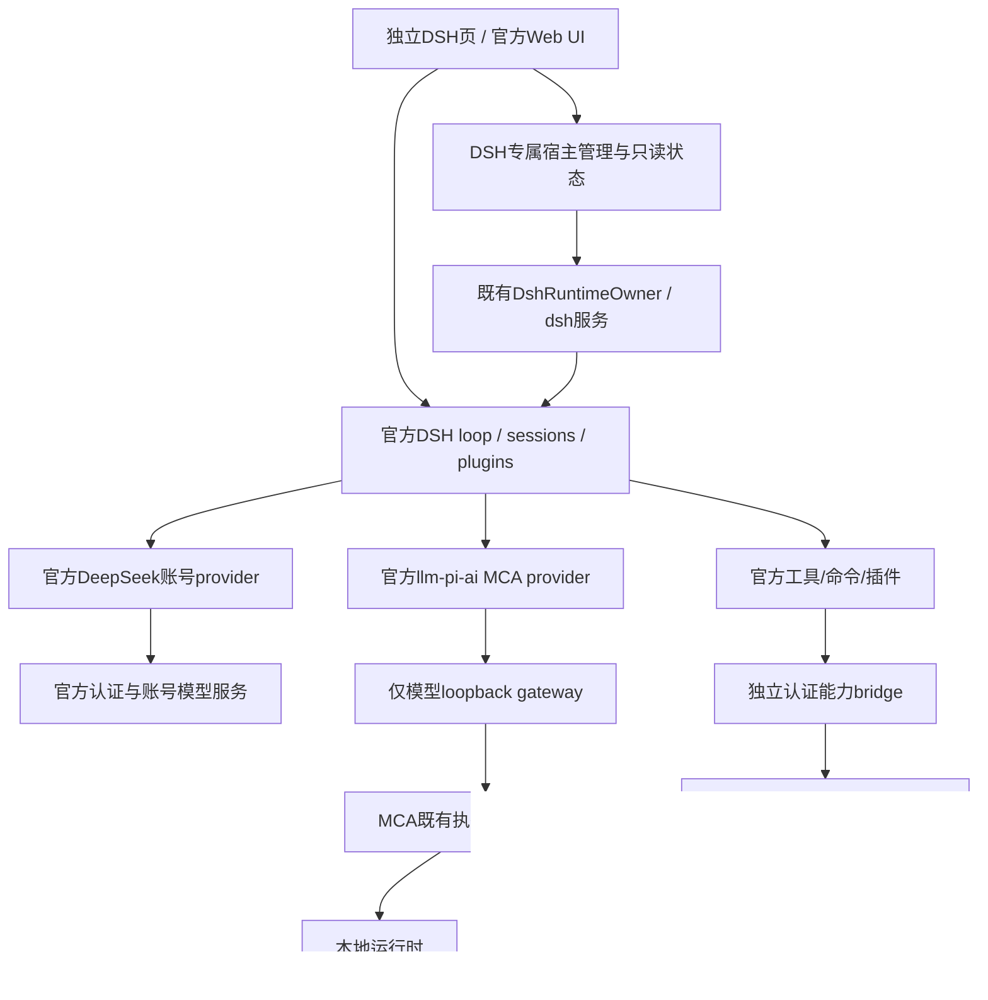

# DSH V2 详细架构：账号、模型、执行与手机版能力

配套 [总方案](README.md)、[执行包](EXECUTION_PACK.md)、[来源](SOURCE_MAP.md)、[验收](PARITY_ACCEPTANCE.md)。本文是目标设计，类型/路径带“拟”均尚未实现；源码已有实现先复用，不按本文重建。

## 1. 复用方式与依赖图

核心决策：**官方代码直接复用，平台差异集中适配，MCA只增加模型来源和宿主能力**。不把DSH业务转换成Kotlin Agent，不让Kotlin镜像session、审批或插件管理事实。没有必要为每个箭头新增Gradle模块。

| 位置 | 实际职责与增量 | 禁止 |
| --- | --- | --- |
| `core/dsh-contract` | runtime/maintenance/model/capability纯DTO与窄端口，版本演进 | Android/engine/Compose类型、万能Host |
| `core/dsh-runtime` | payload、Node进程/停止、配置装配与维护事务 | 云请求业务、复制官方账号/插件状态机 |
| `api/dsh-gateway` | MCA模型协议、认证、SSE/错误/取消 | Android工具路由或官方账号token保管 |
| `app/.../dsh` | 目录、MCA映射、模型资源回执 | 自动执行工具或隐藏Agent重试 |
| 独立capability实现 | typed设备动作、认证、操作回执与资源owner | 通用未受限反射/Context/Intent字符串执行器 |
| `feature/dsh-workspace` | 官方UI容器、入口和宿主投影/intent | 构造Node/engine、直接编辑DSH存储 |
| 受管DSH扩展包 | Android插件、MCA provider控制接点、最小平台补丁 | 移植整套手机App/重做loop、把业务藏进启动shim |

参考项目中的巨型Activity/Console、反复字符串replace、特定包名/端口/外置路径不进入MCA长期架构。提取能力协议、算法和有限平台实现，按功能/状态/生命周期拆分；公共文件/构建由整合者单写。

## 2. 配置、启动和默认模型

### 2.1 解除账号模式对MCA网关的强耦合

现有宿主启动需要gateway endpoint，seeder会读目录；V2必须让“官方账号可用、MCA网关暂不可用”仍可进入DSH。以下是目标行为：

- payload、配置损坏或Node执行失败是宿主失败。
- MCA provider暂不可用是该来源状态；不应阻断官方前端、账号登录和官方provider。
- 本地模型未加载时目录为空是合法状态，不自动加载未知模型、不假造目录。
- 已配置MCA但绑定失败时保留配置和错误，不悄悄删除用户路由。

新增typed `ProviderAvailability`/binding投影，不靠空字符串token或虚构端口占位。账号模式可按需启动宿主；MCA选择或目录准备触发既有gateway owner初始化。主进程root不可用时显示“MCA来源待连接”，官方账号路径不被伪装成MCA失败。

### 2.2 配置层所有权

保留官方bundle/profile/user配置优先级。MCA managed overlay只写明确的MCA provider和平台适配行；不反复覆盖官方provider、用户设置、profile package/lock、账号凭据。home overlay高于profile的事实必须用最终composed tree验证。

实现时按固定官方loader确认增加受管overlay的合法机制，优先使用独立managed layer/`--patch`接点；不得未经验证新建用户目录或改加载顺序。旧home overlay迁移采取有来源标记的三方比较：旧MCA生成值、当前文件、拟新值；用户修改冲突生成可审查报告，不能整文件重写覆盖。

模板、受管配置、用户配置、短期binding、账号凭据、插件状态五种数据分别归属。MCA临时gateway token仅进内存/Binder/受控环境或合法credentials provider，不写进持久用户凭据库或备份。

### 2.3 默认路由与辅助模型

已有用户沿用已有明确选择；新用户在DSH内明确选择“DeepSeek账号 / MCA本地 / MCA云端”。不因有账号自动外发既有本地会话，也不因加载本地模型重置账号默认值。尚未选择时前端可打开并引导配置，不自动试三种来源。

官方provider/model ID和现有`mca-local:<id>`、`mca-cloud:<id>`保持稳定。新增显示分组不改旧session引用。每个operation固定`providerId/modelId/resolvedConfigRevision/bindingIdentity`；用户切换只作用新operation，现有操作不重发/换模型。

标题、压缩、子Agent、记忆/检索等实际辅助调用都列入路由图。选择“本地推理/离线”时所有辅助路由必须可追踪到本地来源，缺本地能力就说明/暂停，不自动回官方云。允许混合路由时显示目的与网络依赖，需用户明确选择；不能仅换主模型却保留隐藏云端压缩。

## 3. DeepSeek账号登录：保留官方协议与权威状态

### 3.1 四类认证不能混淆

| 凭据 | 用途与owner | 明确隔离 |
| --- | --- | --- |
| DSH Web launch token / HttpOnly cookie | 手机WebView进入本地官方服务 | 不是DeepSeek账号登录，不发到外站 |
| DeepSeek账号credential | 官方账号认证及账号模型请求，DSH账号模块拥有 | 不当MCA Bearer、不放进WebView JS或MCA云模型库 |
| MCA gateway bearer | 本代DSH请求MCA模型网关 | 不提交DeepSeek认证站、不进入账号备份 |
| 手机capability token | 指定代的Android操作入口 | 不作模型凭据，不给外部浏览器 |

DeepSeek网页账户和开发者API Key是不同来源；“配置API Key成功”不算“账号登录完成”。账号可用模型、额度及权限以官方服务实时返回为准，不硬编码承诺无限额度或固定模型名称。

### 3.2 账号流程目标

优先原样复用`dsh-deepseek-account-platform`及官方账号LLM适配，从官方设置入口发起登录。Android不创建密码输入表单、不收短信/验证码、不抓聊天网站cookie来拼自造接口。真实协议以固定官方源和本版 SOURCE_MAP 为准，不凭OAuth惯例编造刷新规则。

固定版本实际入口为`startSignIn(client, callbackOrigin, loginSource)`：官方登录尝试→PKCE与state→官方HTTPS授权页→本地官方回调→官方验证交换→凭据持久提交→账号状态与provider更新。`loginSource`只接受官方已有`web / desktop`；继续由官方Web客户端按实际容器选择，不新增未经服务端支持的`android`值。

已核验的协议字段如下，Android适配不得重写其含义：

| 阶段 | 固定官方实现 |
| --- | --- |
| PKCE与state | verifier/state各32字节随机值；S256 challenge为base64url(SHA256(verifier)) |
| auth_init | `code_challenge`、`code_challenge_method=S256`、`state`、`redirect_uri`、`locale`、`login_source` |
| callback | 复用`ctx.webServer`的固定`GET /oauth/callback`；code/state各恰好一个，state用timing-safe比较 |
| auth_exchange | `code`、`code_verifier`、相同`redirect_uri`、`device_id`、`device_model`、`os_version` |
| attempt deadline | 默认600000ms，上限3600000ms；从run开始计时，init返回`expires_in`只缩短当前deadline，涵盖init/浏览器/exchange，committing阶段清timer |
| grant | 仅`{version: 1, token, issuer}`；固定版本明确无token expiry/refresh flow |

attempt超时不等于账号token过期。源码常量与服务行为将来变化须按来源锁一起演进，不能在Kotlin写另一套定时refresh。

宿主只提供外部浏览器打开、生命周期、受控回调网络可达性与返回DSH入口。账号授权页面在系统浏览器/Custom Tabs显示；DSH WebView保持精确本地origin。Android返回/旋转/切后台不重复startSignIn，不自动创建第二attempt。

现有payload已含账号platform、账号LLM、account-controller与设置UI，base/web-app bundle也已注册且未被home/profile禁用；只能据此写“已打包注册”，不能写“已登录可用”。固定官方Web客户端的真实打开序列是先`window.open('about:blank', '_blank')`，等待`startSignIn`与authorizeUrl，再`popup.location.replace(url)`。

**当前需优先验证的源码风险：** MCA `DshWebChromeClient`对空白popup约1秒即destroy、所有popup硬寿命5秒，而官方auth_init请求默认允许约30秒。授权URL晚到时窗口可能已销毁，直接测试`window.open(httpsUrl)`无法暴露该问题。D04必须保留受控pending handle，随官方attempt的有界deadline/取消/终态/Activity teardown关闭，而不是简单把1秒换成更大魔数。

pending窗口初始只接受可信本地DSH origin发起的合法创建，不立即交给系统浏览器打开空白页；URL到来后校验为当前官方attempt的授权URL再移交外部浏览器。**当前原生onCreateWindow没有attempt证据**，不能只靠URL看起来正确就声称已关联。D04a先固定最小受管client/host seam：由可信本地受管客户端与官方account安全状态观察接点关联pending handle、attempt身份、授权URL、deadline及终态；这些是投影，不含token/verifier，不赋予任意网页调用native能力。消息源认证/当前HostIdentity/重放拒绝/关闭回执必须被真实接线验证，然后D04b才实现宿主移交浏览器。

原生只拥有窗口句柄的创建/移交/关闭，不复制官方attempt状态机；官方事件仍是账号事实唯一来源。若安全接点无法实现，则保留官方打开流程并报告该分支BLOCKED，不用页面自报attempt字符串或注入任意JS桥补洞。普通外链窗口走单独规则，不能为账号扩大任意scheme。

URL匹配保留官方`authorizeUrlWithTheme`行为：官方设置客户端会在授权URL追加/覆盖`theme=light / dark`。受管接点按固定规则核对origin/path/原授权参数及其多值，唯一允许的客户端变化是官方theme转换，不简单做整串相等而误拒合法URL，也不任意忽略state/challenge/redirect参数。安全observer仅使用官方`AccountView / SignInAttemptView`等不含token的投影，拟新增EXT和host observer必须单独证明来源与生命周期。

### 3.3 浏览器与回调边界

1. 从官方账号模块取得真实授权URL和callback参数；校验HTTPS目标与已固定官方配置，禁止接受工具输出中的任意URL作为账号授权入口。
2. 系统浏览器打开原URL；不带DSH cookie、MCA token、任意请求头，不将verifier/token写入Intent/Bundle/日志。授权URL如含state/challenge也按敏感流程数据处理。
3. 固定协议由已认证客户端提交`callbackOrigin`，仅接受`http`的`localhost / 127.0.0.1 / [::1]`及显式非零端口，不允许用户信息/path/query/hash；回调复用DSH已有Web server，路径固定`/oauth/callback`，`redirect_uri = callbackOrigin + '/oauth/callback'`。Android选用当前实际DSH loopback origin；不是每attempt另开端口或生成新路径，不公开到LAN，也不另造自定义scheme。
4. 外部浏览器与App在同一手机的loopback可达性、后台listener存续、Chrome回到App等真实验证；“已打开浏览器”不是成功。
5. 回调先按官方attempt/state/code/deadline检查；错误参数/state为400，取消/重复/非waiting-browser回调为410，code交换使用原verifier与redirect_uri。一次有效callback只完成一次；旧callback、错误path和跨attempt不能覆盖新credential。
6. 仅在官方credential store提交成功且账号状态确认后显示登录成功。授权成功但存储失败显示具体错误，不能显示成功后重启又丢账号。
7. 用户取消、超时、进程死、浏览器无法打开保留typed失败/重试状态；新attempt不重放旧code。流程不可恢复时干净重开登录，不尝试猜token。

不为登录放开所有WebView外链/自定义scheme、不接受任意localhost callback。账户页离线/验证码/服务端异常需如实等待，不能绕过官方验证。

### 3.4 凭据存储、401与退出

账号credential由官方store唯一写入。首版保留官方`.credentials.yaml`及其文件语义，路径在App私有DSH home，父目录0700、文件0600，POSIX读前校验owner-only权限；写/改/删使用官方真实文件锁与原子写、监听reload语义。当前官方锁等待默认30秒，保留可识别超时；错误时不得用no-op锁或直接覆盖替代。首版不宣称Keystore加密。凭据排除系统自动备份、诊断和普通导出，不照搬参考项目把含credential的整个home外置到公共存储。D10必须证明payload内部的锁/原子原语，而非仅installer外层Java锁。

若增加Keystore加密，必须先确认官方store可替换的实际port，覆盖读写、文件锁、监听、迁移和失败语义，再增加窄适配。不能一边官方读旧文件、一边Kotlin存新token形成双权威；不能声称加密能防同UID任意受信插件读取运行时凭据。

账号失效规则完全沿用固定官方协议，不新增周期refresh或虚构expiresAt。固定官方`rejectToken / expireCredential`捕获detailsLifetime并重读credential；仅在未closed、lifetime相同、kind为grant、token及issuer都匹配时删除。保留这套真实条件式失效，不另外只按账户名删记录；旧请求401不能删除刚登录的新账号。

失效触发也按官方细分：模型目录listing的401不清登录；推理401、profile/balance的401或官方`40003`才走匹配失效。不能加通用“所有DeepSeek HTTP错误都清credential”的拦截器。

退出由官方`signOut`执行：取消登录attempt，若正committing则等待done；读取并校验grant的issuer；await本地`deleteRecord`成功；对捕获token启动不await的后台revoke；再清attempt并发布signed-out/changed。本地删除失败不得启动远端撤销。远端为`POST /auth-api/v0/users/logout`，header为`x-dsh-auth-token`，默认首发后最多5次重试，间隔1/2/4/8/16秒，仅内存持有且shutdown可abort；Android不持久另建退出重试队列。远端失败不恢复本地身份。清DSH Web cookie只是退出本地Web UI，不等于官方账号退出；反之账号退出不应清MCA配置/本地模型。

官方账号退出的Agent取消范围保留原语义：只取消`status=running`且最新持久`requestContext().provider == deepseek-account`的Agent，不能借sign-out事件把全部MCA本地/云任务停掉。初始化默认模型会先检查已配置provider API key；MCA网关临时key可能改变“登录后自动选账号”分支，D06要真实验证并保留用户明确选择，不强制覆盖默认。

不同请求来源的401分别处理：Web cookie→重新本地换票；MCA bearer→binding重连；DeepSeek账号→官方账号失效/重新登录。不能任何401都重启Node或删全部凭据。

## 4. MCA模型协议与动态配置

### 4.1 精确映射

沿用model gateway路由与既有call ID兼容。gateway只做模型请求，不装插件、不代替DSH执行工具。官方账号请求直接由官方账号provider负责，不绕进MCA云客户端，也不把MCA密钥交给Node。

native与prompted各自固定能力：schema/tools、call ID、完整JSON、tool result pairing、`none/auto/required/named`、parallel policy、reasoning、usage、视觉、真实EOS/LENGTH/取消/错误。后端不支持即typed拒绝；不得named降required、required无调用成功，或把所有Done写STOP。

DSH拥有其system/transcript/压缩。MCA最终序列化不能再附默认时间/角色/reasoning指令或自动裁历史；用窄typed输入策略保持其他聊天入口默认行为。容量不足返回官方客户端能识别的错误并验证其压缩/暂停路径；不静默减tools/context、不把图片丢成纯文字。

本地prompted是明确兼容协议，不改标志冒充native。检查实际offered schemas/预算，严格解析完整响应，不能从reasoning或partial JSON执行。大catalog装不下时明确容量错误；用户选择minimal preset是可见配置，不能后台偷换以过测试。

### 4.2 网关重绑与模型目录

沿用V1的`serviceInstanceId/hostEpoch`、`gatewayInstanceId/generation`、desired/applied revision。provider设置reload和credential解析通过官方合法接点，Node实际确认新endpoint/catalog后才显示已应用；Kotlin holder或YAML写入不算。

变更流程：构建候选绑定→验证新网关→以expected HostIdentity/commandId提交→官方provider产生新不可变operation snapshot→无副作用探针确认applied revision→新请求切新绑定→旧请求核账排空→撤旧token/监听。内存凭据轮换不落磁盘。

主进程死亡时旧operation无结果保持失败/未知，不自动转发到新网关。无法热更新则先取完整quiescence proof：官方准入屏障、turn/tools/subAgent/jobs/PTY/install/待审批、账号与所有配置/数据mutator及其持久化、gateway/MCA lease一致归零；具体写者见§11.4。无证明不杀busy Node；显示需要停止后重连。完整在线写屏障无法证明时，维护改走D01确认Node及所有可写工具/插件子树停止后的路径，不能以agent列表为空冒充一致快照。

目录订阅覆盖本地加载/卸载/删除、云增删改、有效context/能力变化；合并事件只省重复，不丢最终revision。UI picker更新后还要证明实际下一请求命中该模型。移除模型不自动换另一个；旧operation按旧资源合同结算。

## 5. Android执行语义：参考实现不等于正确性证明

### 5.1 命令闭包与现代target

指定手机版targetSdk28与MCA targetSdk36运行条件不同。保留MCA已证明的nativeLibraryDir ELF入口，不降低target以绕开exec限制，不把chmod+x当执行许可。运行时命令清单记录二进制/解释器/argv/env/cwd/CA/动态库/ABI/来源/sha256。

受管dispatcher优先显式解释器启动JS/Python入口，例如Node→npm/pnpm JS、Python→`-m pip`；需透明支持官方spawn/package bin/shebang时，做最小native launcher或官方runCli packageManager接点适配，不在Kotlin复制安装算法。不用字符串替换所有spawn冒充完整适配。

`bash`必须是经过验证的真实Bash或如实标识Android sh兼容层；依赖Bash语法的插件单独通过。pip纯Python、ABI wheel、N-API addon、需要编译的包分开；Linux glibc包不自动兼容Android Bionic。CA从受管系统来源生成并做TLS正负例，禁止通过关闭证书验证来修下载。

### 5.2 文件锁、发布与数据一致性

保持C02真正flock与不覆盖原子发布目标：缺native binding不能返回成功；实际独立进程竞争、锁持有者死亡释放可验证。`stat→rename`不是create-if-absent；失败不得覆盖已有目标/symlink。选实际可用的OS原语并锁定errno/跨FS/低磁盘语义。

版本文件发布、插件安装、profile修改、会话修复及备份需要相同维护屏障与锁顺序，不能多个“维修”同时写同home。SQLite WAL/压缩JSONL等格式用官方reader/writer，不在宿主粗暴复制热文件冒充一致快照。

### 5.3 真PTY与停止

参考手机版的`/dev/ptmx`尝试与pipe fallback、空resize没有证明完整TTY。MCA采用小型native PTY能力验证：准确分配master/slave、绑定会话/controlling tty、前台进程组、termios/winsize、resize/SIGWINCH、stdin/EOF、^C与exit；不扫描`/dev/pts/0..63`猜slave。

如平台PTY确不可用，pipe模式明确显示降级且完整对标TTY保持未通过。不能用`isatty`一个布尔值代替交互程序、job control、resize、子进程停止验证。官方DSH terminal attach协议保持原样，Node绑定仅适配平台实现。

停止先fence准入→官方取消→特定call/lease结算→TERM/KILL受管进程树→检查出生身份/残留→确认停止才撤服务/通知。Flow结束、registry空、Node退出都不能替代MCA实际停止回执。失败/UNKNOWN保留fence与恢复入口，不能允许第二宿主启动。

### 5.4 权限与沙箱诚实性

DSH审批、Android权限、OS隔离是三层。`bash-local`不强制workspace边界时，`workspace-write`只是策略声明，不能显示为已强隔离。任意受信Node插件或shell与App同UID运行可访问该UID资源；loopback token保护的是端点，不是恶意同UID代码沙箱。

默认保留审批；不照搬参考`danger-full-access/approval:never`。受中介工具可精确限制路径/设备目标；任意命令模式需单独显示实际访问面。需要强隔离时做独立可行性与实测，不默认把proot、独立进程、token说成安全沙箱。

“本地模型不外发”可证明其模型路由；“所有任意插件绝不联网”需真实网络隔离才可宣称。离线验收通过不能反推联网时存在恶意插件隔离。

## 6. 官方插件、Skills、MCP与完整Agent

官方manager继续拥有本地目录/包名/GitHub来源、依赖版本、脚本build审批、version exemption、启停/更新/移除、HMR和diagnostics。MCA只提供可工作的命令与原语，不直接改profile package.json/lock/node_modules。

操作信任、build scripts审批和版本豁免是不同决策，均保留官方入口。安装失败恢复实际范围要精确：恢复manifest/lock不必然恢复plugin data与所有node_modules；不要把它称作万能rollback。

固定样本覆盖纯JS、package bin、postinstall审批、Python、已构建Android addon、错误ABI、网络失败、离线缺依赖、终端和自带server。未知结果先查询官方事务，不换ID重装。恶意或高信任插件能力边界在安装前可见。

Skills、MCP、本地jobs/长任务、子Agent、user questions、presets、附件、产物、压缩、记忆等沿用固定官方实际路径，不用原生Agent的替代实现。旧manifest422行逐项重新评审，官方未启用行写清启用方式及平台理由，不自动删除。

## 7. 五手机能力：DSH插件加窄宿主桥

### 7.1 共用协议与授权

复用已有capability DTO/authority，再按五域扩窄port，不在模型网关加设备路由。插件保持公开tool name/schema/result语义，host传输改MCA认证bridge；包名/端口/path改为受管配置。

`operationId`由官方invocation稳定映射，绑定HostIdentity、plugin content hash、target、payload fingerprint和deadline。宿主校验session/caller/token与授权，不信guest自报generation。先持久RECEIVED/DISPATCH_INTENT再做外部动作，receipt落盘后回结果；重复同ID同参返回原事实，异参拒绝；派发后死机无receipt转UNKNOWN，不换代重放。

Android权限与用户审批两次校验，审批后目标/selector/系统状态变化重新验证。OS权限请求在真实resumed页面发生；后台需要交互时返回USER_PRESENCE_REQUIRED，不强拉Activity。owner不缓存Activity；晚结果不能提交新代。

### 7.2 系统与Shizuku

结构化应用/包/setting/input/截图/通知/overlay与特权shell分别实现。标准权限能做的先用标准API；root/Shizuku是可选真实授权通道，缺失只影响该能力，不阻断DSH模型/文件工作。

Shizuku bridge参考App内API执行而不是不可靠的rish子进程；设置写前读oldValue、写后读newValue，通知区分posted/visible/evidence，输入返回坐标/屏幕/前台包并拒越界。通用shell是广权限能力，不伪装结构化精确授权。

### 7.3 Accessibility

按SOURCE_MAP覆盖全部13个实际exports，包含status/screen/tap/type/back/home/scroll/see及swipe/hold/touch/gesture/touch_status等完整工具；精确名称以源码清单为准，不能把README较短表格当分母。status给服务组件、前台包、节点计数及读屏/手势/截图能力。节点引用绑定窗口/包/树generation；点击前检查bounds/目标，不能拿旧树坐标点新应用。

tap返回命中、clickable ancestor和页面变化证据；scroll区分已到底与失败；输入/剪贴板辅助需用户范围、敏感字段脱敏。截图走合法通道并标来源，视觉模型不支持时不丢图假成功。用户未启用无障碍不能称“无需授权”。

### 7.4 VScreen

覆盖create/status/launch/see/tap/swipe/key/close及悬浮预览。固定参照源码实际使用`ImageReader`帧泵、JPEG预览与宿主轮询，不是README描述的H.264实现；首轮按可验证JPEG链路对齐。控制面、shell身份core、帧采集/压缩、surface/overlay分别有owner；reference的LGPL来源与所有依赖先固定许可与可复现来源。H.264/MediaCodec可作为测量后的独立性能优化，不能当本版参照已完成事实或强加为首轮对标前置。

动态受认证端口替代固定8999；启动core校验hash，token不在公开命令行/日志，descriptor继承按可用原语验证。显示尺寸/dpi/orientation、真实displayId和坐标变换；launch用前后画面/前台状态验证，不将am命令退出码当应用已上屏。see区分no_display/not_rendered/no_frame，first-frame等待有上界。

参照插件的`ROOT_AVAILABLE`能力宣告不等于root-only宿主闭环：固定Java bridge启动仍无条件等待/使用Shizuku，未见独立root launcher。MCA将Shizuku与root-only分别实现准入/启动/停止并分别验收；root-only未验证时标具体缺口，不能由插件布尔值宣称已通过。参照还将本地token拼入core命令行并记录整条命令；MCA采用可验证的受控传递原语并移除这类输出，不把它复制进诊断。

关闭释放display、ImageReader/图像缓冲、FD、socket、surface、overlay和shell子进程；rotation/服务死亡/撤销Shizuku/Android后台限制可恢复。预览有帧时间戳与过期标记，轮询不能伪装连续实时视频；不能保证所有App/安全内容/系统弹窗均支持虚拟显示。

### 7.5 AI Browser

参考独立`:browser`进程、多tab、语义DOM snapshot/stable ref/真diff/find/read/动作后验证，不把受控浏览器做成DSH WebView加任意JS桥。

browser owner拥有tabId、navigationGeneration、document/frame身份；ref由元素身份映射生成且绑定tab与文档，DOM小改可稳定，navigation/关闭tab后失效。diff返回from/to generation及changed/deleted，不拿两份文本称diff。click/type后读取实际文本/URL/元素状态，返回dispatched与observed分别字段。

仅http(s)，禁DSH/gateway/capability与浏览器自身端点；覆盖redirect/DNS/IPv6/本地别名、file/content/intent/javascript/data/blob等越界。用于自动化的浏览器不读取DSH HttpOnly cookie或官方账号credential；敏感站点登录由用户交互，下载进入受控staging。浏览器renderer死重建浏览器，不重启DSH或重复外部提交。

独立进程不天然成为强隔离；实际UID/接口权限/网络策略如实记录。浏览器页面是第三方输入，不能改变DSH工具审批。

## 8. 控制台、数据保护与救援

### 8.1 DSH专属宿主管理

在DSH现有宿主状态区域增加入口，包含运行环境/权限/五插件/浏览器与虚拟屏/诊断/数据恢复。真实状态分离host READY、Web首帧、账号状态、模型binding、插件能力、任务效果；不靠轮询stdout一行判断全部成功。

文件、插件、会话等官方功能优先导航到官方UI。宿主维护按钮调用同一维护owner及官方API/CLI，不建立Kotlin平行管理库。所有破坏操作显示范围和预览；救援入口不能被主题隐藏。

### 8.2 Session回收与精准修复

先识别官方API是否可提供删除/导出/修复；有则直接使用。需要宿主fallback时固定格式适配器并取维护屏障/真实文件锁，覆盖当前session.v4.jsonl.zstd等版本，不靠旧扩展名扫描判断0条。

删除=事务移动到同存储回收区+索引状态更新，恢复保留session ID/关联；永久删除只在回收站显式确认。运行中session先取消/settle或拒绝维护。恢复与重复点击幂等。

坏附件修复仅影响诊断命中的消息/附件引用：官方reader读全→生成diff/备份→写临时完整对象→atomic提交→官方reader复检→ledger。正文、工具call/result、其他附件、压缩和上下文不得无记录重写；未知格式拒修，不用删除整会话“治好”。

### 8.3 备份/恢复

参考项目的“全部home ZIP”不能照搬。默认备份仅会话、用户配置、Skill/插件声明/lock、用户workspace与版本metadata；凭据、token/cookie、运行pid/socket、缓存、下载中断文件、native二进制不进入普通ZIP。

需要迁移凭据时另做用户明确选择的加密凭据导出与重认证策略；普通恢复建议重新登录/授权。不能把同机Keystore密文导出后宣称跨机可还原。

热备份须官方一致快照或完整quiescence+文件锁；ZIP流式、有大小/路径/条目/hash manifest与空间预检。恢复先staging、校验版本/依赖/zip-slip/冲突→可审差异→保存当前可恢复点→同owner提交→官方API重开历史/插件→最终commit；任一步失败保留原数据。外部SAF资源用引用/清单和重新授权，复制home不保证这些内容存在。

### 8.4 安全模式与自检

安全模式用临时受管配置/profile加载最小可信bundle，隔离用户patch/插件加载但不删除session/credential/workspace，不自行重置home marker。退出恢复原配置；进入/退出都可重启恢复且有journal。

自检分受管runtime manifest和可变用户内容。只读检查不能自动删；精确修复只替换hash/版本已确认的受管文件，用户第三方插件与数据不能被命名模式误删。丢home有旧数据证据时继续保留现有fail-closed guard，提示恢复，不能重新seed空home。

## 9. 用户补丁、主题与升级

用户补丁按“出厂源码+受管Android/MCA补丁+用户diff”三层记录baseHash/patchHash/目标版本。用户diff仅源/config/资源，排除ELF/DEX/JAR/shell等执行入口；配置文件依然可能有行为影响，回放前做语义检查。官方/MCA同步后再三方合并用户patch，冲突隔离并报告，禁止盲replace污染新kernel。

清空用户patch只撤该层并恢复受管版本，不删除用户session/插件；补丁回放失败可安全启动救援，不凭“尽量回放”静默运行半新半旧树。

DSH控制台主题JSON/图片/ZIP、卡片排序/显隐、文案、结构化组件和按钮动作有version/schema/深度/大小约束；保持不可移除救援面/坏配置回默认/原子保存/导入导出往返。自定义shell按钮单独广权限确认，不把主题包当授权代码。悬浮球单击/长按/双击动作通过受控action注册表，App跳转/建屏/销毁均复用已有owner；不全局劫持MCA导航。

runtime升级身份覆盖官方源码、payload、Node/native/addon/依赖、Android/MCA补丁、profile schema和受管插件lock。APK更新替换nativeLibraryDir，旧JS回滚不代表旧ELF回滚；先验证兼容或预打包完整versioned slot，否则RECOVERY_REQUIRED而非硬降级。

沿用V1候选journal：verify→隔离数据trial（无真实账号/用户插件/外部副作用）→停止确认→真实home预检/备份→production health pending→commit。trial与生产同owner串行，一次一个宿主；trial不证明所有用户插件通过。数据schema不兼容则前向修复/版本备份恢复，不清数据。

自动production health探针仅验证真实home可读、官方服务/会话reader、已配置provider的只读状态和认证就绪，不重放用户turn、不自动登录、生成收费请求或执行真实手机动作。实际账号推理/工具任务由D26受控验收或用户明确发起的正常操作证明；不能为升级health擅自恢复旧任务。只读健康不满足时不进入最终COMMITTED，保留恢复点与可解释状态。

## 10. UI、后台与可维护性验收

WebView renderer与Node/浏览器进程分别处理。重建页面不重发turn、不重启活Node；附件SAF、下载/blob、外链、键盘焦点、返回、长内容和断线重连逐项验证，不为登录把所有权限放开。

前台服务/通知仅按真实执行状态；用户停止与系统死亡区分。自动重启默认可见可撤销，有冷却、失败上界、停止意图持久化、数据损坏阻断；不使用while(true)拉起、不承诺force-stop后仍能后台运行。wake lock仅任务期间有owner/期限，停止未知仍据事实结算。

每新增资源写明创建/使用/取消/释放/恢复；每份状态标权威writer和只读投影。manifest/DB/owner/组合根/公共协议由一名整合者维护；一般实现文件按真实职责和硬锁预算拆分，禁止把上游ConsoleActivity改名为巨大McaDshManager。

现有前端优化、原生Agent和DSH可分写集并行，公共入口/主题/模型事件/构建一次一人。最终按完整脏树+子模块+APK闭包复核；本文件不构成运行或性能通过证明。

## 11. 实施时必须固定的协议与状态

以下均为目标契约，不声称已有同名类或端点。D00/D07/D15在真实官方接点验证后冻结兼容版本；能复用现有字段就不平行新增。

### 11.1 身份和版本字段

| 字段组 | 权威writer | 用途与约束 |
| --- | --- | --- |
| `protocolVersion` | 双端按显式兼容表协商 | 未支持版本拒绝具体操作，不默默丢字段；旧IPC编号保持兼容 |
| `serviceInstanceId`、`hostEpoch` | 实际DSH服务/Node owner | 服务实例不可预测且每次服务重建不同；同实例内换Node递增epoch，防PID复用/ABA |
| `gatewayInstanceId`、`bindingGeneration` | MCA gateway owner | 每次有效绑定有身份，token只作认证不代替身份；Kotlin持有的desired不等于Node applied |
| `catalogRevision`、`configRevision` | 各自目录/配置唯一owner | 快照不可变，回执指明applied；不同revision不共享可变map |
| `commandId`、`expectedHostIdentity` | 控制命令发起方/接收owner | 相同ID同参查询原结果；不同参拒绝，旧代命令不影响新代 |
| `operationId`、`invocationId`、`payloadFingerprint` | DSH调用映射/平台ledger | 可追溯官方工具调用，重连不换ID；派发后未知不能换ID重试副作用 |
| `modelCallId`、现有request/lease身份 | MCA真实推理owner | 和外部callId有映射，取消与终态按原身份，不新建平行资源计数 |

任何ACK携带实际身份、revision和结果状态。发送超时后先`query(commandId)`，不能仅凭客户端超时推断未执行。令牌轮换/Node重启不清未结算副作用账本。

### 11.2 模型操作与取消

模型操作至少可观察到`ADMITTED → RUNNING → COMPLETED / FAILED / CANCELLED / OUTCOME_UNKNOWN`；具体枚举优先沿用MCA和官方已有类型。页面断开、DSH取消、gateway断开、native停止分别记录时间与结果。

- admission前校验来源、模型存在、预算和支持的tool_choice；失败不占lease。
- admission后以实际MCA请求身份绑定lease；同步抛错、Flow收集失败、断连和callback竞态都走同一终态提交。
- 用户取消先反馈“正在停止”，真实runner停止及lease释放后才标已停止。强制超时进入有fence的未知/待恢复，不让新请求复用尚可能繁忙的资源。
- 一个模型请求只提交一次终态；取消后晚token不追加官方新turn，重复Done不重复释放lease。SSE已经发出部分内容后失败仍按真实错误收口，不补一个假的正常stop。
- model busy/排队不等于host故障；重试只针对可证明尚未开始的模型请求且遵官方策略，不重放已派发工具或整个用户turn。

### 11.3 手机动作账本与保留规则

最小记录：协议版本、operation/invocation、HostIdentity、插件内容身份、动作/目标、参数hash、审批决策引用、创建/截止时间、状态、派发时间、receipt与错误分类。敏感正文/截图不是为去重必存内容；receipt按最小范围脱敏。

| 状态 | 可执行的转移 | 恢复行为 |
| --- | --- | --- |
| RECEIVED | 校验/权限通过后进入DISPATCH_INTENT，或REJECTED/CANCELLED | 尚无派发意图可在原ID和有效审批内恢复校验，不自动重新审批 |
| DISPATCH_INTENT | 派发后等待OBSERVED/FAILED/UNKNOWN | 进程中断不能证明没执行，先查询平台；不能重新派发有副作用动作 |
| OBSERVED | 结果已持久化，只读返回receipt | 重复调用返回原事实，不再次点击/写入/通知 |
| FAILED/REJECTED/CANCELLED | 终态，只读返回 | FAILED必须有未发生/明确失败依据；不要把观察不到写成失败 |
| UNKNOWN | 通过可证明的观察或用户核对追加结算 | 保留原证据；不凭超时或新epoch自动变回RECEIVED |

网络重试不等于业务重试，外部动作不可能普遍保证exactly-once。账本提供去重和未知事实，不承诺跨系统原子提交。容量满时在派发前拒绝新操作；未知项与可重试窗口内的幂等身份不能为腾空间被静默淘汰。归档后保留足以拒绝旧ID重放的tombstone或显式过期拒绝协议，schema升级也保持这些身份。

审批绑定实际动作、参数、目标和插件hash。审批后插件更新、目标窗口/页面变化或权限撤销需重新校验；Node传来的自报session ID不是授权依据。高权限shell/任意插件在同UID的能力范围必须显示，不能借bridge的精细审批宣称其全部行为都受控。

### 11.4 维护journal与崩溃恢复

所有会修改受管版本或用户数据的维护事务由同一维护准入串行化；官方运行期写入通过官方owner屏障停止，不靠Kotlin自己加一把锁假定Node服从。journal不含token；每次状态转移先落盘再报告，写入与fsync/目录同步语义在D10核实。

**D07m必须逐类证明排他策略，不能只数正在生成的Agent：**

- turn/工具/子Agent/jobs/PTY/MCP或插件后台进程、等待审批及其最终持久提交；
- account startSignIn/cancel/signOut、callback exchange/committing、profile/balance/推理失效引发credential删除、退出后台revoke相关状态事件；
- credential/settings/profile/插件manifest与lock/用户patch/session和其他home内容的RPC写入、watch reload及其可触发写入的回调；
- 外部平台动作和操作账本若被纳入快照，需对应平台owner单独给排空/不可变快照；未纳入时明确排除和恢复边界。

在线屏障先关全部相关新mutator准入，完成或拒绝在途操作、等待所有写入settle，之后才获取真实文件锁和快照。活跃waiting-browser/committing不能因没有turn而忽略；可提示用户完成/取消登录后维护，不悄悄丢其流程。动态插件若无法证明遵循屏障，不提供假热备份，改为确认Node及所有可写子树停止后维护；残留/UNKNOWN进程仍可能写时必须BLOCKED。后台远端logout本身不写home，但其后继状态/回调仍须按实际源码核验与drain。

| 阶段 | 必需事实 | 崩溃后动作 |
| --- | --- | --- |
| PREPARED | 输入hash/版本/空间/格式/权限已验，原home未改 | 可清理本事务staging；不得清理未知目录 |
| QUIESCED | 在线全部mutator准入/drain有证明，或Node及所有可写子树已确认停止；相关lease结算且真实文件锁已取 | 重新确认owner身份和屏障，不能沿用旧进程锁证明 |
| SNAPSHOT_READY | 原数据快照hash与索引一致、可恢复 | 尚未提交时原件继续权威；取消保留原件 |
| APPLYING | 明确逐项move/write记录与恢复点 | 按journal完成或还原同一事务，不启动半新数据的Node |
| HEALTH_PENDING | 目标已落盘，等待官方reader/真实宿主健康 | 数据兼容前提下恢复快照或前向修复；不能凭端口打开commit |
| COMMITTED | 最终版本/索引/健康结果已持久化 | 延后清理已确认旧staging，保留所承诺恢复窗口 |
| RECOVERY_REQUIRED | 无法证明安全继续或回退 | 保留数据、证据、救援入口，停止自动维护循环 |

备份、会话回收/修复、用户patch应用、升级共用准入，但其journal内容按职责分开；不要建立一个囊括所有数据算法的MaintenanceManager。取消只在有明确安全点时立即完成；已提交的外部动作或不可逆数据步骤不能显示“取消即撤销”。

### 11.5 错误、状态显示与证据

至少区分：未认证/旧身份、未支持协议或参数、来源未连接、模型忙、context不足、工具参数错、审批拒绝、系统权限缺失、需要用户在场、目标失效、派发未知、运行依赖损坏、恢复所需、官方服务异常。transport HTTP映射依固定DSH/pi-ai实际消费者验证，不预设自定义码就能触发官方恢复。

每个错误有稳定code、可读提示、request/operation身份、是否可查询、是否可重试及脱敏cause；“可重试”不能允许UNKNOWN动作自动重放。UI只投影结果，不把所有错误归为“模型不可用”或“重启试试”。来源服务的401/5xx保持来源，不跨来源重置状态。

各任务证据至少记录：完整候选fingerprint/闭包、实际入口、参数与配置hash、期望结果、实际观察、模型/系统条件、原始日志与产物、失败/取消/资源释放结果。账号流程记录事件序列和脱敏状态，不截授权code/token；模型任务记录输入与工具schema的可分发fixture，真实私人内容另按用户允许范围保存。
