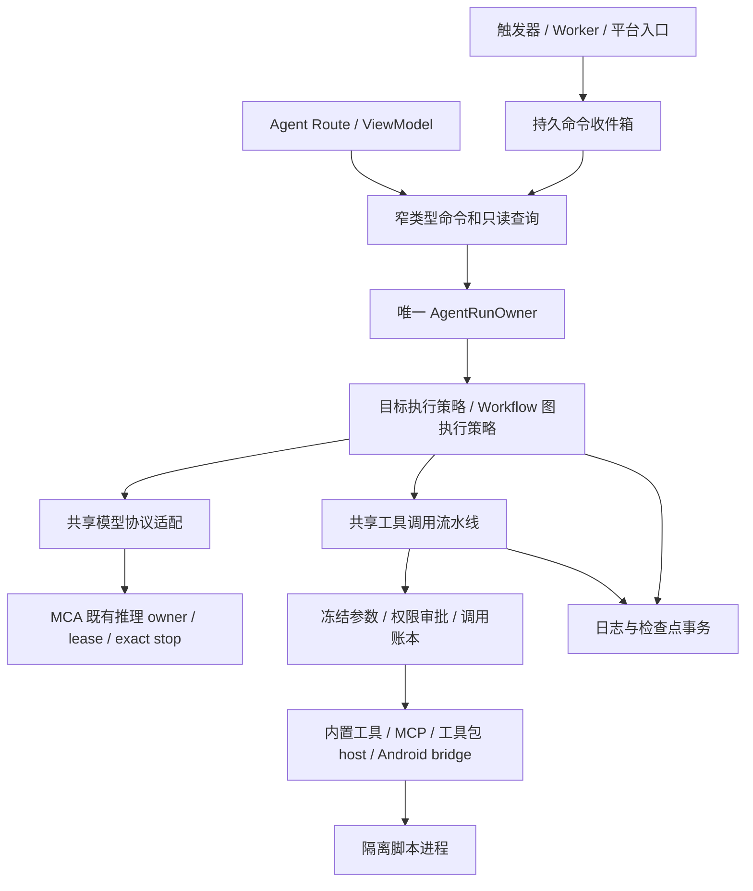

# MCA 原生 Agent 补齐方案 V1：工具、工具包、记忆与 Workflow

日期：2026-10-20（Asia/Shanghai）
状态：**设计与交接文档；尚未实施本方案，未形成新的运行验收结论。**

## 1. 目标与阅读顺序

把现有 Kotlin 原生 Agent 补齐为可在手机运行、支持 MCA 本地模型与云端模型、四个核心能力域对标 third-party 的独立工作区。保留当前原生实现、任务数据、审批和资源所有权；引用 third-party 的能力与格式，不嵌入 third-party 应用，不让原生 Agent 成为 DSH 的包装层。

本文件回答目标、现状、边界和交付顺序。实施者必须继续阅读：

1. [详细架构与协议](DESIGN.md)：数据、算法、调用链、失败、恢复和平台约束。
2. [执行任务卡与接手提示词](EXECUTION_PACK.md)：依赖、写集、交付与回退。
3. [third-party 对照与验收](PARITY_ACCEPTANCE.md)：逐域能力、用例、指标和证据。
4. 项目规范入口 [MCA_PROJECT_HARD_LOCK.md](../../architecture/MCA_PROJECT_HARD_LOCK.md)；已有 [ADR 0002](../../adr/0002-agent-v1-runtime-and-delivery.md)、[ADR 0003](../../adr/0003-dsh-embedded-dual-agent-modes.md)。本方案不修改这些规范；实施时按任务卡增补决策。

“对标”是固定上游版本的可观察行为达到要求，不是文件数量、工具注册数量或页面数量相同。四域验收全部完成以前，不显示“完全兼容 third-party”或“已超越 third-party”。高可维护性依靠实际边界、迁移、故障验证和审查持续维持，文档不能保证任意执行者绝不犯错。

## 2. 本轮事实基线

MCA 分支 `codex/enterprise-refactor`；读取时 HEAD 为 `68b6eef1e67870b02bfef6afda2e625d36663da9`。工作区含大量既有 tracked 修改和 untracked 原生 Agent/DSH 文件；**HEAD 不能单独代表被审查源码**。实施 N00 必须记录完整写集与文件内容指纹，不能覆盖本轮读取后的并行改动。

子模块读取时 revision：llama.cpp `4ceb1719101f32637b841206c172f3f058ffc182`；stable-diffusion.cpp `16b3846acfdf2c9499a3ac0c3d5d2914ebe859a0`；tokenizers-cpp `acbdc5a27ae01ba74cda756f94da698d40f11dfe`。三个模块均存在内部差异，必须保留并登记。本轮不变更子模块。

数据库当前为 Room **29**，不是早期方案的 27/28；已存在 28→29 记忆表迁移。之后以实际 `@Database` 为准分配版本，禁止照抄历史文档的“预期 30”覆盖其他迁移。

| 领域 | 当前源码事实 | 本方案增量 |
| --- | --- | --- |
| 原生内核 | `AgentRunOwner`、串行命令处理、日志、attempt、预算、审批、取消与停止结算已存在 | 增量抽出共享工具派发能力，增加协议与流程执行策略；保持唯一 run 状态写入者 |
| 模型工具协议 | 本地 `PROMPTED_V1`；每响应最多一个工具；云端 Responses 有严格终态检查 | 统一结构化回合；真正原生 tool calls；保留本地 prompted 兼容；批量只读受限并行 |
| 云端 `NATIVE` 标签 | mapper 可给出 NATIVE；当前 `mapAgentRequestToChatRequest` 的 tools/toolExchanges 仍为空，结果类型只返回 visibleText | 标签必须与实际生产路径一致，先修正能力声明，再补真正原生协议，不能按注释宣称完成 |
| 工具 | 四个 workspace/artifact 内置工具、schema、冻结命令、ledger 已有 | Android、网络、文档、终端等能力通过统一派发和平台适配扩展 |
| MCP | 客户端、registry、run-scoped provider 与管理页源码存在 | 当前组合根没有注入生产 MCP 工具；补接线、资源生命周期和协议兼容矩阵 |
| Skills | 导入、存储、allowed-tools 收窄和管理已有 | 当前快照在 runtime 构造时生成；改为每 run 固定快照，完善资源读取与引用 |
| 工具包 | manifest/ZIP/预览/存储已有，声明式 host 绑定基础存在 | 当前是 inert/preview 范围；新增生产绑定、独立脚本运行、third-party 格式适配、安装更新事务 |
| 记忆 | 空间/条目/分块、Room、词法搜索、选择授权、`memory.search` 及管理页已有 | 改善检索覆盖；语义索引、链接、提取与整理、可审计写入、撤销删除 |
| Workflow | 文件 recipe、预检、手动创建普通任务与管理页已有 | 先补可靠任务锚点；再加版本图、节点状态、检查点、触发与持久化调度 |
| 后台 | Agent scope 独立 Job 仍是传入 scope 的子 Job，随 MainViewModel 清理 | 冷启动无人值守前必须迁移实际执行根作用域；Worker 不得创建第二套 runtime/engine |
| 验证 | 已有大量行为测试及历史设备记录 | 本轮只读源码，不重签历史 PASS；每张卡必须产生当前候选源码的独立证据 |

定位入口：

- [AgentRunOwner.kt](../../../core/agent-runtime/src/main/java/com/muyuchat/core/agent/runtime/run/AgentRunOwner.kt)、[AgentPromptedLoopCoordinator.kt](../../../core/agent-runtime/src/main/java/com/muyuchat/core/agent/runtime/run/AgentPromptedLoopCoordinator.kt)。
- [MainRuntimeAssembly.kt](../../../app/src/main/java/com/muyuchat/mca/composition/MainRuntimeAssembly.kt)、[AgentRuntimeAssembly.kt](../../../app/src/main/java/com/muyuchat/mca/agent/composition/AgentRuntimeAssembly.kt)。
- [AgentInferenceSupport.kt](../../../app/src/main/java/com/muyuchat/mca/agent/inference/AgentInferenceSupport.kt)、[AgentCloudModelAdapter.kt](../../../app/src/main/java/com/muyuchat/mca/agent/inference/AgentCloudModelAdapter.kt)。
- [AgentMemoryStore.kt](../../../app/src/main/java/com/muyuchat/mca/agent/memory/AgentMemoryStore.kt)、[AgentWorkflowLauncher.kt](../../../app/src/main/java/com/muyuchat/mca/agent/workflow/AgentWorkflowLauncher.kt)。
- [既有工具/记忆/workflow 方案](../agent-v1/AGENT_TOOLS_MEMORY_WORKFLOW_PLAN.md)。它的“无脚本、无节点、仅 recipe”是旧切片边界；不是本方案完整对标目标的永久限制。

## 3. 产品范围与完成定义

保持侧栏 **图片 → Agent → DSH**。原生 Agent 的任务、工具、工具包、Skills、MCP、记忆、workflow 全部归属独立 Agent 工作区；不重排聊天、图片、调参页面。已有 `:feature:agent` 是智能调参相关界面，新增工作继续进入 `:feature:agent-workspace`。

普通聊天后续可复用工具派发、模型协议和审批组件，也可显式“交给 Agent”。本轮不把聊天历史和 Agent 任务历史合并，不在聊天页再实现 Agent 循环。DSH 的 Node/终端/插件存储独立；本方案不借用其内部对象作为原生 Agent 的执行者。

四域交付范围：

| 域 | 最终必须具备的用户能力 | 不足以验收的替代物 |
| --- | --- | --- |
| 工具调用 | 本地/云端多步调用、结果回传、批量调用、有序结果、权限、取消、恢复、Android 实用工具与 MCP | 仅 JSON 解析成功、仅输出工具名称、仅四个工具的页面 |
| 工具包 | 可导入、启停、版本更新、执行脚本、访问受控 host API、诊断、导出；声明兼容的 third-party 样本真实运行 | 只导入 manifest、Skill Markdown、host alias、只展示工具列表 |
| 记忆 | 手动和经策略授权的自动提取、持久存储、词法/语义检索、引用、链接、整理、删除与隔离 | 把历史塞进 prompt、仅 latest-N 词法扫描、只建 memory 表 |
| Workflow | 可编辑节点图、多类触发、条件/循环/子流程、模型/工具/脚本节点、输出绑定、检查点、恢复和可见运行历史 | 目标文本模板、手动 createTask、只有 scheduler UI |

手机本地的三个层次必须在界面和验收中分开：

1. **本地执行**：Kotlin 编排、脚本、存储、索引、流程引擎运行在手机；选择云模型仍可联网。
2. **本地推理**：生成、记忆提取、embedding/重排等使用已经安装的本地能力；辅助模型不得暗中走云。
3. **完整离线**：模型、脚本依赖和所需文件均已就绪，所有工具无外网依赖；断网冷启动完成四域基准任务。首次联网下载与离线包导入是独立准备步骤。

网络工具、远端 MCP 和云模型自身依赖网络，应明确标识。它们不能作为“离线任务”的隐式降级。缺少本地 embedding 时允许清楚显示词法检索，但该结果不能顶替语义记忆的离线对标验收。

## 4. 必须保住的架构

- `AgentRunOwner` 是 run 状态与终态唯一推进者。workflow 节点有自己的局部状态，但不复制 Agent run 状态机或模型 owner。
- 工具调用由一条流水线负责。模型、workflow、脚本只能提交带来源的调用提议，不得持有可绕过审批的执行器列表。
- 内核仍为纯 Kotlin；平台桥、Room、文件、HTTP、隔离进程留在实现层。feature 只取得 contract 和设计系统。
- 执行资源仍由 MCA 实际生产 owner 管理。不能为 Agent、Workflow、embedding、Worker 各自 new 一套同类 engine。
- 不向新对象暴露 `MutableStateFlow<MainUiState>`，不扩 `MainCoordinatorHost`，不把业务塞进 MainActivity/MainViewModel/组合根。
- 新文件遵守硬锁预算；拆分按协议、状态、算法或平台职责，不能建立一批没有实际生产调用者的空接口。

## 5. 需要增补的架构决定

| 拟增补 ADR | 必须明确的变化 | 保持的合同 |
| --- | --- | --- |
| 工具协议与共享派发 | V1 单调用文本结果 → 版本化结构化回合；共享 invocation pipeline | 老 transcript/数据可读；原子审批、exact stop、唯一 run owner |
| 工具包执行与兼容 | inert 包继续支持；增加独立脚本包格式及 third-party 转译边界 | 禁止包自行授权、加载任意 DEX 或绕开 egress |
| 记忆 v2 | 手动词法搜索 → 可审计写入、语义/链接/整理；来源级 egress | Agent 记忆仍不直接写聊天/角色/知识库表 |
| Workflow 图与恢复 | recipe 保留；新增图版本、节点检查点、触发 inbox | 所有模型/工具使用现有统一能力，无平行 Agent loop |
| 冷启动执行根迁移 | 进程级 Agent 与实际推理 owner 的同实例作用域迁移 | 聊天、图片、Local API、停止与模型资产行为连续 |

本方案批准设计方向不等于这些 ADR 已实施。实施者需在相应卡中记录调用者、兼容 fixture、风险与验证；不能默改 ADR 0002 使旧证据变成新证据。

## 6. 里程碑与并行安排

| 里程碑 | 任务卡 | 可独立交付的结果 | 进入下一阶段条件 |
| --- | --- | --- | --- |
| M0 基础闭环 | N00–N04 | 可靠任务锚点、真实能力声明、单一工具流水线、run 快照 | 审批/取消/恢复与旧任务兼容通过 |
| M1 工具实用化 | N05–N08 | 原生协议、批量、MCP、Android/网络/终端/文件工具 | 对照样本可从模型调用到真实结果，停止可证实 |
| M2 工具包生态 | N09–N12 | 安装事务、隔离脚本、host bridge、third-party 适配与资源/扩展 | 支持清单逐项真实执行，未支持项预检说明 |
| M3 记忆体系 | N13–N16 | 写入/检索/本地语义/链接与整理、源级隐私 | 离线检索指标、撤销和提取误写用例通过 |
| M4 Workflow | N17–N22 | 图、节点、编辑、恢复、执行根迁移、触发调度 | 手动/冷启动/异常恢复/去重和权限验证通过 |
| M5 对标交付 | N23–N25 | 四域场景集、UI、升级、长运行与证据包 | PARITY_ACCEPTANCE 中全部必需项有绑定候选产物的结果 |

N01/N02/N03、共享契约、数据库版本、组合根和最终整合由一位负责人串行维护。契约稳定后，工具包、记忆、workflow 纯定义/验证可分写集并行；N21 的执行根迁移单独切片，禁止与大规模 UI/模型底层改动抢写。

里程碑是能力域验收分组，不要求 M1–M4 全局串行：N08h 的子执行/记忆/流程桥接、N12e 的图模板运行、N16 的后台自动保存须等待后续对应能力卡。先交付各卡的基础子切片，延后子切片仍记为待验收；不能为了按表顺序报完成而放一个空桥接。精确依赖以执行包的子切片表为准。

前端优化可继续独立进行，但 `AgentWorkspaceViewModel`、Route、共享组件和 MainRuntimeAssembly 是交汇点。执行卡必须声明文件租用与交接时间；不允许两人同时改共享写集后靠覆盖整合。用户冻结的视觉与导航不因本方案自动解冻。

## 7. 本轮交付边界

本轮只新增本目录的设计文档。未运行 Gradle、设备、模型、MCP、脚本、调度或数据库迁移，未构建/安装/发布应用。所有新增验收项初始为 `NOT_RUN`；历史记录只作定位，不是本次运行证明。

回退本轮文档无需改代码或数据。未来实施的回退必须逐卡执行：停用新增来源/触发、保留数据和只读历史、等待真实资源释放；数据库已升级时不得指导用户清库或盲目安装旧 APK。
